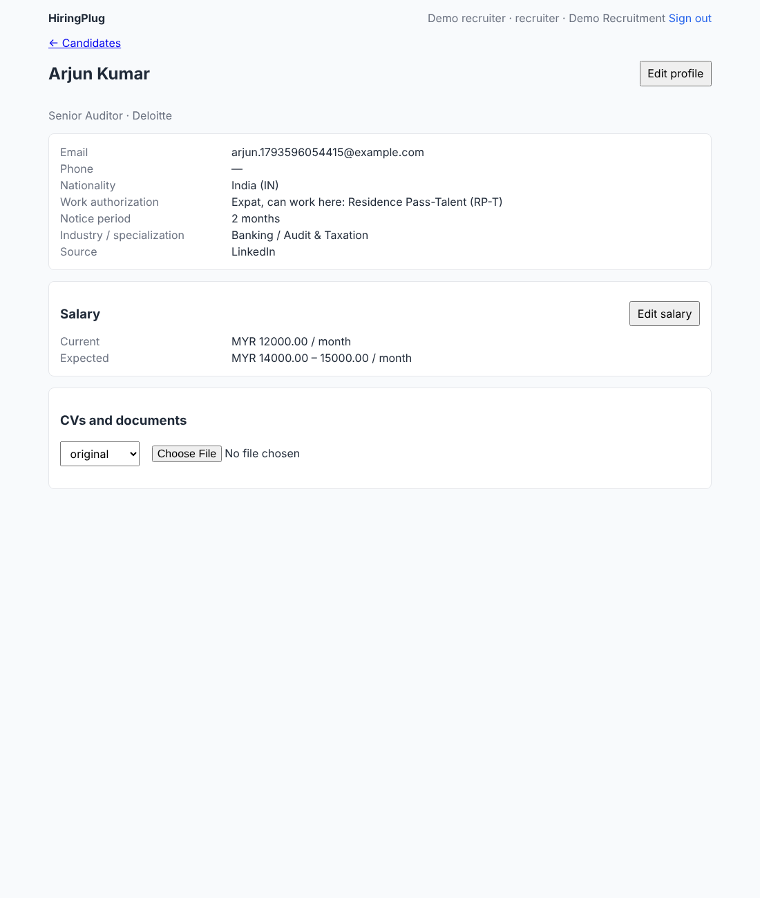

# HiringPlug

An applicant tracking system (ATS) for recruitment agencies and in-house
hiring teams. It works for one company or many: it can run for your own team
and be sold to others (each company's data is isolated). It runs on your own
machine first and is built to move to the cloud later.



## What is here today (milestone 1: the foundation)

- **Companies** (clients, prospects or your own departments) and their
  **contacts**, whose email is checked (format, mail server, shared or
  throwaway addresses), and **jobs** for them, with a salary budget that only
  permitted roles see, and a **pipeline board** per job (drag candidates
  through applied, screening, submitted, interview, offer, placed; reject or
  withdraw with a reason), **notes** and an activity timeline on every record,
  a **dashboard** of open jobs and who is waiting too long, and **import** from
  CSV with a report of rows to fix.
- **Candidates** with the profile fields recruiters need: name, email, phone,
  nationality, work authorization (local / expat with RP-T, PR or spouse visa /
  needs a visa), notice period, industry, specialization, source.
- **Salary details** (current and expected, with currency and period) that only
  permitted roles can see. The database itself refuses them to everyone else.
- **CV upload** (PDF and Word). The Python AI worker extracts the text, using
  OCR for scanned pages (including sideways scans), and the text appears on the
  candidate.
- **Users and roles** (owner, admin, recruiter, sourcer, hiring manager,
  viewer) with view / create / update permissions per area.
- **API documentation** generated from the contract, at `/docs` on the API's own port (http://localhost:8080/docs).
- **A web app** to search and add candidates, edit their profile and salary
  (each needs its own permission), see the "restricted" notice where salary is
  hidden, and upload CVs and read their text.
- **Guardrails** so things do not regress: one contract for all languages,
  data isolated between companies in the database, automatic checks on every
  change, and a generator that creates new modules already wired and tested.

Your full feature list and how each item is designed: [docs/features.md](docs/features.md).

## Selling HiringPlug as a SaaS

- **[Profit Planner](https://claude.ai/artifact/SXZUgNHU16BkqiUHX6uU2G)**: an
  interactive calculator for pricing, users, costs, SST and income tax, with
  margins, break-even and a month-by-month forecast (in RM). Its source is
  [docs/pricing-calculator.html](docs/pricing-calculator.html). The link is
  private to its owner until shared from the page's Share menu.
- **[Scaling plan](docs/saas-plan-scaling-to-20k-users.md)**: what to change
  before selling, the set-up and monthly cost at each size up to 20,000 users
  online, AI costs, and why the Python worker stays.

## How it is built (one minute version)

| Part | Language | Does |
|---|---|---|
| `contracts/` | OpenAPI (YAML) | The single source of truth for the API and job messages. Each module has its own file. |
| `backend/` | Go | The API and the business rules, the database, and the worker for core jobs. One codebase split into modules. |
| `ai/` | Python | Reading CVs (text extraction, OCR), parsing them, PDFs, the AI assistant and CV vs job matching. |
| `web/` | TypeScript (React) | The screens recruiters use. |
| `deploy/` | Docker | Runs everything on one machine. |

Go and Python only talk through a job queue in PostgreSQL; the web app only
talks to the Go API. Read [docs/README.md](docs/README.md) first; it gives a
reading order.

## Quick start

You need [Go](https://go.dev/dl/), [uv](https://docs.astral.sh/uv/) (Python),
[Node 22+ with pnpm](https://pnpm.io/installation), [Task](https://taskfile.dev),
Docker (for PostgreSQL), [Tesseract](https://tesseract-ocr.github.io/tessdoc/Installation.html) (OCR),
antiword and LibreOffice (old Word .doc files; `apt install antiword libreoffice-writer-nogui`).
On Windows, use WSL2 or install the same tools natively; every command is `task ...`.

```bash
cp .env.example .env
task setup       # install dependencies
task db:up       # start PostgreSQL in Docker
task db:setup    # create tables and roles, plus demo users; prints sign-in tokens
task dev         # API on :8080, both workers, web app on http://localhost:5173
```

Sign in to the web app with the `recruiter` token printed by `task db:setup`,
and with the `sourcer` token to see salary hidden. API docs: http://localhost:8080/docs.

To run everything in Docker instead (local-first deployment), with
[Docker Desktop](https://www.docker.com/products/docker-desktop/) installed:
**double-click `update-hiringplug.command` (macOS) or `update-hiringplug.bat`
(Windows)**. It gets the latest code, rebuilds what changed and opens
http://localhost:3000. Run it again after each update (e.g. after pulling in
GitHub Desktop). In between you need nothing: the app starts by itself whenever
Docker Desktop is running. (The command it runs:
`docker compose -f deploy/docker-compose.yml up -d --build`.)

## Everyday commands

| Command | Does |
|---|---|
| `task gen` | Regenerate code after changing `contracts/` or `backend/db/` |
| `task verify` | Everything CI checks: generation, lint, type checks, all tests, web build |
| `task new:module -- name=job_ads entity=job_ad` | Create a new module, wired and tested |
| `task test` / `task lint` | Just the tests / just the linters |
| `task e2e` | End-to-end test across the running services |

## Documentation

- [docs/README.md](docs/README.md): start here
- [AGENTS.md](AGENTS.md): the rules for anyone (human or AI) changing this code
