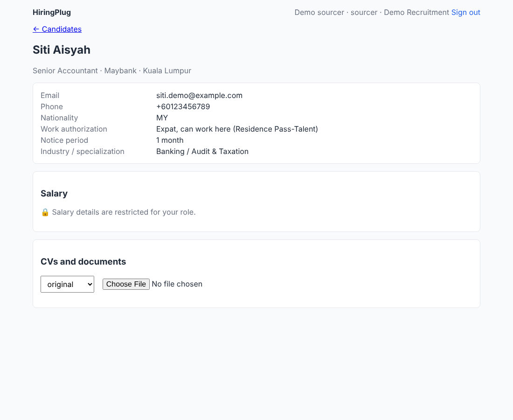

# Access control

## Who is calling

Every API call carries `Authorization: Bearer <token>`. The token names the
company (tenant) and the user. The user is looked up on every request, so
deactivating a user signs them out at once.

**Signing in** (✅): email and password (`POST /v1/auth/sign-in`) gives a
12-hour token, kept for the browser tab. Passwords are stored as salted
Argon2id hashes, need at least 10 characters (not the email, the name or a
common password), and attempts are limited per client address and per email.
An unknown email and a wrong password get the same answer, taking the same
time. An email with accounts at several companies chooses one. Changing or
resetting a password, or being deactivated, ends every earlier session
(tokens issued before it are refused). The password is checked before the
sign-in's transaction, so the transaction holds the person's row and checks
again that they are active and the password is still the one checked: a
change, reset or deactivation committed meanwhile signs nobody in. Using a
link holds it too, so a link used twice at once works once. The access log
never shows a secret in a path (links, bookings, client shortlists: the
contract's `…Token` parameters are logged by name).

**Two-step sign-in** (✅): anyone can add an authenticator app under Your
account (scan a QR code or type the key, then enter its first code); after
that, a correct password gives a signed 10-minute challenge instead of a
token, and the 6-digit code (RFC 6238: 30-second steps, one step of clock
drift either way, each code once) or one of ten single-use recovery codes
finishes signing in (`POST /v1/auth/two-step`). A challenge holds when the
person's sessions were last ended: after a password change or reset (or a
deactivation) it no longer works. The secret is sealed with
AES-GCM under a key derived from `HP_AUTH_JWT_SECRET`; recovery codes are kept
as SHA-256 hashes. Codes are rate-limited per address and per person. A reset
or invitation link sets the password but still asks for the code. Turning it
off needs the password. Owners can **require** it for everyone (Roles and
access, once their own is on): people without it are signed out and set it up
at their next sign-in, before any token is issued. Owners and admins can reset
someone's two-step (a lost phone; only owners reset owners), which signs them
out; the Team page shows who has it on.

**Sign in with Microsoft** (✅ backend, 1.46.0; the sign-in page waits for the
owner's choice of layout): an owner turns it on in Roles and access with the
company's Microsoft organisation (the Entra *Directory (tenant) ID*;
`PUT /v1/agency/microsoft-sign-in`, `identity.roles:manage`, audited as
`agency.microsoft_sign_in_changed`). Only people already on the Team page
(active, or invited: signing in accepts the invitation, without a password)
with an account of that organisation can sign in; personal Microsoft accounts
and other organisations, and guests in the company's (`acct` 1, or `#EXT#` in
the `upn`), are refused. The first sign-in links the account
(organisation + object ID) to the team member with its sign-in name
(`preferred_username`, the UPN: a domain the organisation verified), or with
its email only when Microsoft says the email's domain is verified
(`xms_edov`): anyone's address can be typed as an account's mail, so it proves
nothing by itself. **Without the `acct` claim no account is linked by its
address at all**: a guest's `preferred_username` is its home address, which
may be a team member's, and only `acct` (or the optional `upn`) tells a guest
apart. The claims of the last sign-in through the company's own Microsoft
app are noted for the company (the claim is set on that app; sign-ins through
the server's app say nothing about it), and Roles and access warns until
`acct` is added in Entra (`acctClaimMissing`), only while sign-in goes through
that very app and organisation: moving to the server's app, to another app of
the company's or to another organisation clears it. Later
sign-ins match the linked account, whatever its address has become. An
account is **never linked by its address to an owner, nor to someone whose
account was unlinked** (`app_user.microsoft_connect_only`): they link one on
purpose. From Your account › Connect Microsoft sign-in while signed in
(`POST /v1/me/microsoft/start` and `/complete`, the same tab, a session not an
API key; starting asks for the current password and, with two-step sign-in
on, its code or a recovery code, limited like changing the password, and
codes tried count against the person's limit for codes as at sign-in; an
account of the company's organisation, linked to nobody else there). Or from
an invitation or a **reconnect link**: an owner or admin (only owners, for
owners; nobody for someone whose role is above their own, nor for themselves)
sends one from the Team page
(`POST /v1/team/{userId}/microsoft/reconnect`, `identity.team:manage`,
audited `user.microsoft_reconnect_sent`); it is emailed to the person's
HiringPlug address only, never shown to whoever sent it, works once for 7
days, and signing in with Microsoft from it (or from an invitation) links the
account to that person **whatever its address**: for someone whose UPN is not
their HiringPlug email, who would otherwise be locked out once Microsoft is
required. A sign-in started from a link keeps it (`microsoft_sign_in_flow.link_id`)
and finishes only with that very link, held, unused, unexpired, of the same
kind and theirs (an invitation accepted with a password meanwhile, or a link
replaced, links nothing; two finishing at once: one works). A reconnect link
ends when their account is unlinked, their role changes, they are
deactivated, an account is linked to them, or the company turns Microsoft
sign-in off or changes its organisation. Every link is audited (`user.microsoft_linked`, `by`: `sign_in`,
`invitation`, `self` or `reconnect_link`, kept as `user_microsoft.linked_by`)
and the person is emailed ("not you? tell an owner"). Account emails
(invitations, resets, reconnect links, "Microsoft linked") go from the
server's mail only, sent by nobody (`email.sent_by` `system`): never from the
connected mailbox of whoever caused them, whose Sent Items would keep the
link. Someone made an owner
loses a link made by a sign-in's address (`user.microsoft_unlinked`, reason
`made_owner`) and their Microsoft sessions end: owners hold only links made on
purpose, and from then on (owner or not) one is linked to them only on
purpose. Owners (and admins, for everyone but owners; nobody for a role
above their own) **unlink** an account on
the Team page (`DELETE /v1/team/{userId}/microsoft`, `identity.team:manage`,
`user.microsoft_unlinked`), which ends that person's Microsoft sessions; from
then on one is linked to them only on purpose (Your account, or a reconnect
link). A sign-in checks again, inside its transaction and with the person's
row held, what it found before: that the account is still linked to them, or
that they may still be linked by address. The row is held FOR NO KEY UPDATE,
and everything that changes a person's row and their Microsoft link (a
sign-in, connecting from Your account, sending a reconnect link, an unlink, a
promotion or deactivation, a change of organisation) holds the row first:
they wait for each other and never deadlock, and each checks the person as
they are once held. It goes through the company's own Microsoft app (Settings >
Email connection) or the server's (`HP_MAIL_MICROSOFT_*`); while Microsoft
sign-in is on, only owners may change or remove the company's Microsoft app
(`MICROSOFT_APP_OWNERS_ONLY`).

- *Flow.* `POST /v1/auth/microsoft/start` (public) finds the company from an
  invitation, a careers page address, or the only company on the server that
  signs in with Microsoft, or else goes through the server's app for any
  organisation (the account's organisation then finds the company; an account
  at several asks which one). The email typed is only a hint to Microsoft:
  routing by it would show, in the address returned, where it is on a team. It saves the sign-in (`microsoft_sign_in_flow`, 10 minutes) with
  the PKCE S256 verifier and nonce sealed (AES-GCM, key derived from
  `HP_AUTH_JWT_SECRET`), the state's SHA-256, and the SHA-256 of a random value
  the browser tab keeps in sessionStorage. Microsoft returns to
  `GET /v1/auth/microsoft/callback`, which signs in nobody: it parks the code on
  the sign-in once and sends the browser to `/#/sign-in/microsoft?ticket=…`
  (or `error=cancelled|failed`; Microsoft's own text is never passed on), with
  `Cache-Control: no-store` and `Referrer-Policy: no-referrer`; nginx keeps it
  out of the access log. `POST /v1/auth/microsoft/complete` takes the ticket
  (once: it is deleted as it is read) with the tab's value, so a ticket copied
  to another browser, or a sign-in link someone else started, signs in no one.
- *Checks.* The code is exchanged with the verifier; the ID token must be
  RS256-signed by one of Microsoft's published keys (kept a day; a new key ID
  fetches them again once, an unknown one at most once a minute), its issuer
  the token's own organisation (`https://login.microsoftonline.com/<tid>/v2.0`),
  its audience the app, within its times (2 minutes' leeway), with the nonce,
  and its organisation the company's (never the personal-accounts one).
- *Answers.* Refusals are `MICROSOFT_SIGN_IN_FAILED` with a reason:
  `not_on_team` (also for deactivated members, and invitations older than
  their 7 days: the same words), `other_organisation` (guests too),
  `personal_account`, `connect_first` (an owner's address, or someone's whose
  account was unlinked: connect from Your account or with a reconnect link),
  `linked_elsewhere` / `already_connected` (an invitation or reconnect link
  used with an account linked to someone else, or by someone with another
  one) or `failed`; connecting from Your account answers
  `MICROSOFT_CONNECT_FAILED` (`already_connected`, `linked_elsewhere`, or as
  above). They come only after
  Microsoft has vouched for the account, and only about it: the redirect is the
  same for anyone. The pre-tenant lookups are `SECURITY DEFINER` functions
  (`app_microsoft_*`, migration 00198); the app cannot read the sign-ins table
  directly. Microsoft has its own limits per address, apart from passwords'
  (start 120 per 15 minutes; the redirect and finishing 300 each), so a busy
  office signs in all morning and neither way uses up the other's. The email
  typed when starting is only a hint, so it counts against no limit of the
  email's (it would use up password sign-in's for that address).
- *Sessions.* HiringPlug's own token says how it was signed in (`amr`: `pwd`
  or `microsoft`). Microsoft sign-ins skip the two-step code (password sign-ins
  still need it). An owner can **require** Microsoft: then signing in with a
  password, two-step codes for a password sign-in begun before, password reset
  emails (they explain how to sign in instead), reset and invitation links, and
  changing a password are refused to everyone but owners (`MICROSOFT_REQUIRED`),
  and their password sessions stop working at once. Owners keep their password
  as a way back in. Someone who signs in only with Microsoft has no password
  (`hasPassword` in `/v1/me`): changing one answers `PASSWORD_NOT_SET` (a reset
  link sets one, unless Microsoft is required), and turning two-step off takes
  the app's code instead. The Team page lists each member's sign-in methods.
  Microsoft sessions stop when the company turns Microsoft sign-in off (and
  stay stopped if it is turned on again), when the person's account is
  unlinked, and when the company changes its organisation: that also removes
  the links to the old organisation's accounts (`linksRemoved` in the audit
  entry), and everyone links again at their next sign-in
  (`app_user.microsoft_sessions_after`; password sessions go on). Sessions are
  issued, and ended (`tokens_valid_after`, `microsoft_sessions_after`), by the
  database's clock only, so an app server whose clock is off ends none too
  late; each end is after every earlier one, so a session dated the last end
  (issued in the same second) is ended by the next. A session is issued as of
  its transaction's start, never before the last end it read with the
  person's row held; an end is cut off by the clock when it is made
  (`clock_timestamp()`, the row held first), so one that waited for the row
  still ends a session a sign-in issued meanwhile. Link expiry compares the
  app server's clock (when a link is made) with the database's (when it is
  used): a few seconds either way, on links that last an hour or 7 days.
- *Who can always get in: Entra and Exchange administrators.* Single sign-on
  trusts the company's Microsoft organisation. Whoever administers it can
  reset the password of the Entra account linked to anyone (an owner too) and
  sign in to HiringPlug as them, and whoever can read a team member's mailbox
  (an Exchange administrator, or a mail rule) can use the invitation, reset
  and reconnect links emailed to them. HiringPlug cannot tell these from the
  person: give those roles only to people the company would trust with every
  HiringPlug account, keep owners' two-step sign-in on (it guards their
  password, Your account › Connect, and resets), and watch the audit log
  (`user.microsoft_linked`, `user.microsoft_reconnect_sent`) and the emails it
  sends for links nobody asked for.

**Invitations and resets.** Owners and admins invite people (email, name,
role); the invitation is emailed and its link is also shown, to pass on if
email is not set up. "Forgot your password?" emails a reset link and says the
same whether or not the email is known. Links work once (invitations 7 days,
resets 1 hour), a new one ends the old, and only their SHA-256 is stored. On
the command line, `hp tenant` prints the first owner's link and
`hp password-link -user usr_...` makes one for anyone. Developers can still
use tokens (`hp dev-setup`, `hp token`; they do not say how they were signed
in, so a company that requires Microsoft refuses them to non-owners).

**Team rules** (`identity.team:manage`: owners and admins): nobody changes
their own role or deactivates themselves; only owners make, change or
deactivate owners; the company always keeps an active owner.

**Public endpoints** (`x-permission: public`, under `/v1/public/`) are the only
exception: the careers page and its apply form, for signed-out candidates. The
page address (`/v1/public/careers/<address>`) is turned into the company by a
database function that returns only the company's id and name
(`app_careers_tenant`); everything after runs in that company's tenant scope
as the system user, so row-level security still applies. They show published
ads only (no internal fields), never reveal whether an email is already on file
(applying answers the same either way, and never changes an existing profile),
and are limited per client address (5 applications in 10 minutes, 20 a day).
The client address is the connection's, or, behind the reverse proxy, the one
the proxy names in `HP_CLIENT_IP_HEADER` (nginx sets `X-Real-IP`; clients cannot
set it).

## What they may do

**Roles** hold **permissions**. Each module declares its permissions, and which
roles get them by default, in its contract file. That file is the only list:
Go reads it at startup, and the web app gets the user's permissions from
`GET /v1/me` to show or hide buttons.

Your "view / modify / write" maps to `:read` / `:update` / `:create`. Sensitive
details get their own permissions.

| Permission | owner | admin | recruiter | sourcer | hiring manager | viewer |
|---|---|---|---|---|---|---|
| `candidates:read` | ✓ | ✓ | ✓ | ✓ | ✓ | ✓ |
| `candidates:create` | ✓ | ✓ | ✓ | ✓ | | |
| `candidates:update` | ✓ | ✓ | ✓ | ✓ | | |
| `candidates:merge` (duplicates) | ✓ | ✓ | ✓ | | | |
| `candidates.compensation:read` (salary) | ✓ | ✓ | ✓ | | | |
| `candidates.compensation:update` (salary) | ✓ | ✓ | ✓ | | | |
| `documents:read` | ✓ | ✓ | ✓ | ✓ | ✓ | ✓ |
| `documents:create` | ✓ | ✓ | ✓ | ✓ | | |
| `documents:delete` (formatted CVs only) | ✓ | ✓ | ✓ | ✓ | | |
| `companies:read` | ✓ | ✓ | ✓ | ✓ | ✓ | ✓ |
| `companies:create`, `companies:update` | ✓ | ✓ | ✓ | ✓ | | |
| `contacts:read` | ✓ | ✓ | ✓ | ✓ | ✓ | ✓ |
| `contacts:create`, `contacts:update` | ✓ | ✓ | ✓ | ✓ | | |
| `jobs:read` | ✓ | ✓ | ✓ | ✓ | ✓ | ✓ |
| `jobs:create`, `jobs:update` | ✓ | ✓ | ✓ | | | |
| `jobs.salary:read` (budget) | ✓ | ✓ | ✓ | | ✓ | |
| `jobs.salary:update` (budget) | ✓ | ✓ | ✓ | | | |
| `pipeline:read` | ✓ | ✓ | ✓ | ✓ | ✓ | ✓ |
| `pipeline:update` (add to jobs, move) | ✓ | ✓ | ✓ | ✓ | | |
| `notes:read`, `notes.activity:read` | ✓ | ✓ | ✓ | ✓ | ✓ | ✓ |
| `notes:create` (and delete own) | ✓ | ✓ | ✓ | ✓ | ✓ | |
| `notes.sensitive:read` (sensitive notes) | ✓ | ✓ | ✓ | | | |
| `notes:manage` (delete anyone's) | ✓ | ✓ | | | | |
| `interviews:read` | ✓ | ✓ | ✓ | ✓ | ✓ | ✓ |
| `interviews:schedule` (and see all feedback) | ✓ | ✓ | ✓ | | | |
| `interviews:feedback` (on interviews you are on) | ✓ | ✓ | ✓ | ✓ | ✓ | |
| `emails:read` (emails sent about a candidate; one that shows salary only with `candidates.compensation:read`, unless Settings say everyone) | ✓ | ✓ | ✓ | ✓ | ✓ | |
| `emails:send` | ✓ | ✓ | ✓ | ✓ | | |
| `emails.templates:manage` | ✓ | ✓ | ✓ | | | |
| `placements:read` | ✓ | ✓ | ✓ | ✓ | ✓ | ✓ |
| `placements:manage` (record and change) | ✓ | ✓ | ✓ | | | |
| `placements.fees:read`, `placements.fees:update` (salary and fee) | ✓ | ✓ | ✓ | | | |
| `automations:read`, `automations:approve` (send or skip emails waiting for approval) | ✓ | ✓ | ✓ | | | |
| `automations:manage` (add, change, switch on and off) | ✓ | ✓ | | | | |
| `automations.tasks:read`, `automations.tasks:update` (your own tasks) | ✓ | ✓ | ✓ | ✓ | ✓ | |
| `claims:create` (expense claims: upload receipts, fill in and submit your own, see them) | ✓ | ✓ | ✓ | ✓ | | |
| `claims:approve` (see everyone's claims and the team dashboard; approve, reject, mark paid) | ✓ | ✓ | | | | |
| `claims.storage:manage` (connect the Google Drive, OneDrive or Dropbox receipts are uploaded to; the top folder; try failed uploads again) | ✓ | ✓ | | | | |
| `offers:read` | ✓ | ✓ | ✓ | ✓ | ✓ | ✓ |
| `offers:manage` (make, change, ask for approval, send, record the answer) | ✓ | ✓ | ✓ | | | |
| `offers:approve` (approve others' requests; send without asking) | ✓ | ✓ | | | ✓ | |
| `offers.salary:read` | ✓ | ✓ | ✓ | | ✓ | |
| `offers.salary:update` | ✓ | ✓ | ✓ | | | |
| `integrations:manage` (API keys and webhooks; never with an API key) | ✓ | ✓ | | | | |
| `leads:read`, `leads:manage` (hiring leads and their sources) | ✓ | ✓ | ✓ | ✓ | | |
| `identity.team:manage` (invite, change roles, deactivate) | ✓ | ✓ | | | | |
| `cvformats:create` (formatted CVs) | ✓ | ✓ | ✓ | ✓ | | |
| `cvformats.templates:manage` (upload and remove CV templates) | ✓ | ✓ | ✓ | | | |
| `reports:read` (fees in them need `placements.fees:read`) | ✓ | ✓ | ✓ | | | |
| `reports.team:read` (everyone's activity against targets, not only your own) | ✓ | ✓ | | | | |
| `reports.settings:manage` (activity targets and the forecast's stage weights) | ✓ | ✓ | | | | |
| `reports.forecast:read` (the revenue forecast; also needs `placements.fees:read`) | ✓ | ✓ | | | | |
| `intake:create` (import CVs and LinkedIn PDFs as candidates; follow your imports) | ✓ | ✓ | ✓ | ✓ | | |
| `settings:read` (dropdown options and mandatory fields; every form needs it) | ✓ | ✓ | ✓ | ✓ | ✓ | ✓ |
| `settings:manage` (change them) | ✓ | ✓ | | | | |
| `assistant:use` (the AI assistant; it sees only what you may see, never contact details or salary) | ✓ | ✓ | ✓ | ✓ | ✓ | |
| `matching:read` (fit scores and reasons; the CV quotes in them also need `documents:read`) | ✓ | ✓ | ✓ | ✓ | ✓ | ✓ |
| `interview_prep:read`, `interview_prep:manage` (a job's interview insights: questions asked and the AI's interview prep) | ✓ | ✓ | ✓ | ✓ | | |
| `matching:create` (ask for fit scores; uses the AI allowance) | ✓ | ✓ | ✓ | ✓ | | |
| `aiusage:read` (the company's AI use and its estimated cost, month by month) | ✓ | ✓ | | | | |
| `aiusage:manage` (the monthly AI limit and the AI prices) | ✓ | ✓ | | | | |
| `auditlog:read` (the company's audit log: who changed what, and when) | ✓ | ✓ | | | | |
| `auditlog.salary_views:read` (who was shown a candidate's salary, and when; sensitive) | ✓ | ✓ | | | | |
| `privacy:read`, `privacy:record` (a candidate's consent and data protection requests; record them) | ✓ | ✓ | ✓ | ✓ | | |
| `privacy:manage` (the Data protection page, decide requests, download a copy of a candidate's data) | ✓ | ✓ | | | | |
| `identity.roles:manage` (Roles and access: what each role may do and which candidates it sees) | ✓ | | | | | |
| `folders:use` (folders of candidates, contacts and companies; a folder shows only the records you may see) | ✓ | ✓ | ✓ | ✓ | ✓ | ✓ |
| `bin:manage` (delete candidates, contacts and companies to the Bin, see it and restore) | ✓ | ✓ | | | | |
| `candidates.status:update`, `contacts.role:update`, `companies.category:update` (change a candidate's status, a contact's role, a company's category, on the card or form) | ✓ | ✓ | ✓ | | | |

The table above is the default. **Each company can change it** on the
**Roles and access** page (owners only):

- **What each role may do**: tick or untick any permission for admins,
  recruiters, sourcers, hiring managers and viewers (sensitive ones are
  marked). The owner role is fixed (every permission, all candidates), so a
  company can never lock itself out, and only owners may change roles.
- **Which candidates each role sees**: all candidates, their team's (people
  can be put in teams on the Team page, e.g. desks), or their own; and
  optionally also the candidates on jobs they (or their team) own.
- Candidates and jobs have an **owner**: whoever added them, unless changed on
  their page (applicants from the careers page belong to nobody until someone
  takes them). Handing a candidate over is allowed even if the giver then no
  longer sees them. The candidate list has a "Mine" filter.
- Changes apply on each person's next click. API keys acting as a role get
  the company's permissions for it, and every candidate when the role sees
  every candidate; a role limited to its own (or its team's) candidates sees
  none through a key (a key owns none), and no new key can be made for it.
  Nobody makes a key that can do more than they can themselves.
  Who may interview follows the company's settings too.

**A candidate out of someone's scope is hidden everywhere**, enforced by the
database: the API puts the scope in every transaction (`app.scope_users`, the
people whose candidates the user sees, empty for all; `app.scope_jobs`), and
restrictive row-level security policies on the candidate and on every table
about them (salary, history, CVs, notes, emails, applications and their stage
history, interviews and feedback, offers, placements, fit scores, assistant
answers, consent, requests, and their audit entries) refuse their rows. Lists,
pages, the job board, dashboards and reports therefore only ever count and
show what the user may see. `TestOwnScopeHidesOtherPeoplesCandidatesEverywhere`
checks it through the API and with raw SQL.

Coming later: new named roles (beyond editing the six) and single sign-on.

## Three layers of enforcement

Salary is the example; every sensitive field follows the same pattern.

1. **The endpoint.** Every operation declares `x-permission`. The HTTP layer
   checks it before the handler runs. Changing salary needs
   `candidates.compensation:update`.
2. **The service.** When reading a candidate, salary is only loaded for users
   with `candidates.compensation:read`. Otherwise the response leaves it out
   and says so: `"restrictedFields": ["compensation"]`. The web app then shows
   "🔒 restricted", and nobody mistakes "hidden" for "none recorded".
3. **The database.** Salary is in its own table, `candidate_compensation`, with
   row-level security that requires the permission in the transaction. Even a
   buggy query, or a new endpoint someone forgets to protect, gets no rows.
   `TestTheDatabaseEnforcesIsolationEvenForRawSQL` proves it with raw SQL.

The same permissions also bound what leaves the system. Audit entries record
that a salary changed but never the amounts, and the AI (the assistant and
CV vs job matching) only receives what the user may see, never contact
details or salary. A formatted CV made with the salary is a copy of it: the
documents module asks cvformats whether a document is one, and refuses to
open, download, turn into a PDF, show the text of or attach it for anyone
without `candidates.compensation:read`.

**Who was shown a salary.** Each time a salary reaches a person (a page, a
list or search that asked for salaries or was sorted or filtered by salary,
an export, an email's fields or an email sent or read again, a copy of a
candidate's data, a formatted CV, a screening call, an offer, a placement
or an invoice that prints it) it is counted in `salary_view` (see [features.md](features.md#audit-log-and-who-was-shown-a-salary--1450-the-api-the-page-follows)):
who, which candidate, where and which day, never the amount, never for the
system. Lines are written only by the database function
`app_record_salary_view` (the app cannot add, change or delete one itself)
and read with `auditlog.salary_views:read`, within the reader's candidate
scope: a list or export line (many candidates) is visible only when the
reader sees one of its candidates, and counts and matches only those. Candidate lists return salaries only when asked (`includeSalary`), so
screens that do not show them never receive them; the same goes for offers,
placements and an email's field values. A merge moves the duplicate's lines
to the kept candidate (`app_move_salary_views`).

Known gaps, not counted: the placements dashboard shows each placement's
fee and fee percentage, from which the salary can be worked out (fee × 100
÷ percentage); and the market map. Give `placements.fees:read` only to
roles that may know salaries.

The **audit log** page reads `audit_log` with `auditlog:read`. Row-level
security still applies: entries about candidates and applications outside
the reader's scope are left out; entries about other records (an offer, an
email, an interview) about such a candidate are not, so give the permission
only to roles that see every candidate.

## Company isolation

Every table holding a company's data has `tenant_id` and a row-level security
policy, and the app connects as a role that cannot bypass it. Details and
guarantees: [architecture.md](architecture.md#data-safety).

## Adding a sensitive field

1. Store it in its own table (or a table only for sensitive fields) with a
   policy like `candidate_compensation`'s.
2. Declare `<module>.<field>:read` / `:update` permissions with
   `sensitive: true` in the module contract.
3. Load it in the service only when the user has the permission. Otherwise add
   it to `restrictedFields`.
4. Never log or audit its values; keep it out of AI prompts unless permitted.
5. Add tests for each role that may and may not see it, through the HTTP API.
