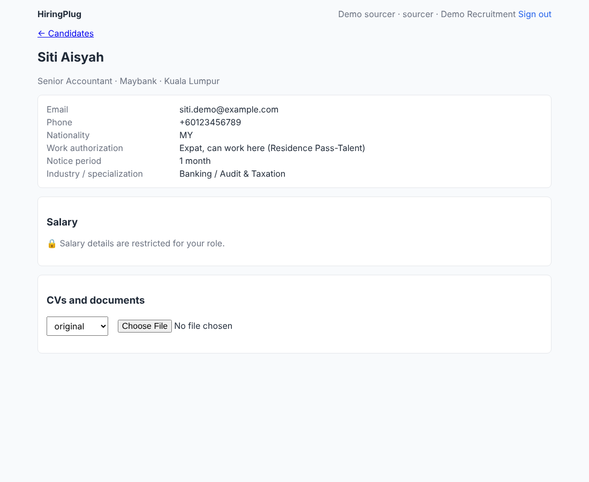

# Access control

## Who is calling

Every API call carries `Authorization: Bearer <token>`. The token names the
company (tenant) and the user. The user is looked up on every request, so
deactivating a user signs them out at once.

**Signing in** (✅): email and password (`POST /v1/auth/sign-in`) gives a
12-hour token, kept for the browser tab. Passwords are stored as salted
Argon2id hashes, need at least 10 characters (not the email, the name or a
common password), and attempts are limited per client address and per email.
An unknown email and a wrong password get the same answer, taking the same
time. An email with accounts at several companies chooses one. Changing or
resetting a password, or being deactivated, ends every earlier session
(tokens issued before it are refused).

**Invitations and resets.** Owners and admins invite people (email, name,
role); the invitation is emailed and its link is also shown, to pass on if
email is not set up. "Forgot your password?" emails a reset link and says the
same whether or not the email is known. Links work once (invitations 7 days,
resets 1 hour), a new one ends the old, and only their SHA-256 is stored. On
the command line, `hp tenant` prints the first owner's link and
`hp password-link -user usr_...` makes one for anyone. Developers can still
use tokens (`hp dev-setup`, `hp token`); single sign-on (Google, Microsoft)
can come later, changing only how a token is obtained.

**Team rules** (`identity.team:manage`: owners and admins): nobody changes
their own role or deactivates themselves; only owners make, change or
deactivate owners; the company always keeps an active owner.

**Public endpoints** (`x-permission: public`, under `/v1/public/`) are the only
exception: the careers page and its apply form, for signed-out candidates. The
page address (`/v1/public/careers/<address>`) is turned into the company by a
database function that returns only the company's id and name
(`app_careers_tenant`); everything after runs in that company's tenant scope
as the system user, so row-level security still applies. They show published
ads only (no internal fields), never reveal whether an email is already on file
(applying answers the same either way, and never changes an existing profile),
and are limited per client address (5 applications in 10 minutes, 20 a day).
The client address is the connection's, or, behind the reverse proxy, the one
the proxy names in `HP_CLIENT_IP_HEADER` (nginx sets `X-Real-IP`; clients cannot
set it).

## What they may do

**Roles** hold **permissions**. Each module declares its permissions, and which
roles get them by default, in its contract file. That file is the only list:
Go reads it at startup, and the web app gets the user's permissions from
`GET /v1/me` to show or hide buttons.

Your "view / modify / write" maps to `:read` / `:update` / `:create`. Sensitive
details get their own permissions.

| Permission | owner | admin | recruiter | sourcer | hiring manager | viewer |
|---|---|---|---|---|---|---|
| `candidates:read` | ✓ | ✓ | ✓ | ✓ | ✓ | ✓ |
| `candidates:create` | ✓ | ✓ | ✓ | ✓ | | |
| `candidates:update` | ✓ | ✓ | ✓ | ✓ | | |
| `candidates:merge` (duplicates) | ✓ | ✓ | ✓ | | | |
| `candidates.compensation:read` (salary) | ✓ | ✓ | ✓ | | | |
| `candidates.compensation:update` (salary) | ✓ | ✓ | ✓ | | | |
| `documents:read` | ✓ | ✓ | ✓ | ✓ | ✓ | ✓ |
| `documents:create` | ✓ | ✓ | ✓ | ✓ | | |
| `companies:read` | ✓ | ✓ | ✓ | ✓ | ✓ | ✓ |
| `companies:create`, `companies:update` | ✓ | ✓ | ✓ | ✓ | | |
| `contacts:read` | ✓ | ✓ | ✓ | ✓ | ✓ | ✓ |
| `contacts:create`, `contacts:update` | ✓ | ✓ | ✓ | ✓ | | |
| `jobs:read` | ✓ | ✓ | ✓ | ✓ | ✓ | ✓ |
| `jobs:create`, `jobs:update` | ✓ | ✓ | ✓ | | | |
| `jobs.salary:read` (budget) | ✓ | ✓ | ✓ | | ✓ | |
| `jobs.salary:update` (budget) | ✓ | ✓ | ✓ | | | |
| `pipeline:read` | ✓ | ✓ | ✓ | ✓ | ✓ | ✓ |
| `pipeline:update` (add to jobs, move) | ✓ | ✓ | ✓ | ✓ | | |
| `notes:read`, `notes.activity:read` | ✓ | ✓ | ✓ | ✓ | ✓ | ✓ |
| `notes:create` (and delete own) | ✓ | ✓ | ✓ | ✓ | ✓ | |
| `notes.sensitive:read` (sensitive notes) | ✓ | ✓ | ✓ | | | |
| `notes:manage` (delete anyone's) | ✓ | ✓ | | | | |
| `interviews:read` | ✓ | ✓ | ✓ | ✓ | ✓ | ✓ |
| `interviews:schedule` (and see all feedback) | ✓ | ✓ | ✓ | | | |
| `interviews:feedback` (on interviews you are on) | ✓ | ✓ | ✓ | ✓ | ✓ | |
| `emails:read` (emails sent about a candidate) | ✓ | ✓ | ✓ | ✓ | ✓ | |
| `emails:send` | ✓ | ✓ | ✓ | ✓ | | |
| `emails.templates:manage` | ✓ | ✓ | ✓ | | | |
| `placements:read` | ✓ | ✓ | ✓ | ✓ | ✓ | ✓ |
| `placements:manage` (record and change) | ✓ | ✓ | ✓ | | | |
| `placements.fees:read`, `placements.fees:update` (salary and fee) | ✓ | ✓ | ✓ | | | |
| `offers:read` | ✓ | ✓ | ✓ | ✓ | ✓ | ✓ |
| `offers:manage` (make, change, ask for approval, send, record the answer) | ✓ | ✓ | ✓ | | | |
| `offers:approve` (approve others' requests; send without asking) | ✓ | ✓ | | | ✓ | |
| `offers.salary:read` | ✓ | ✓ | ✓ | | ✓ | |
| `offers.salary:update` | ✓ | ✓ | ✓ | | | |
| `integrations:manage` (API keys and webhooks; never with an API key) | ✓ | ✓ | | | | |
| `leads:read`, `leads:manage` (hiring leads and their sources) | ✓ | ✓ | ✓ | ✓ | | |
| `identity.team:manage` (invite, change roles, deactivate) | ✓ | ✓ | | | | |
| `cvformats:create` (formatted CVs) | ✓ | ✓ | ✓ | ✓ | | |
| `cvformats.templates:manage` (upload and remove CV templates) | ✓ | ✓ | ✓ | | | |
| `reports:read` (fees in them need `placements.fees:read`) | ✓ | ✓ | ✓ | | | |
| `assistant:use` (the AI assistant; it sees only what you may see, never contact details or salary) | ✓ | ✓ | ✓ | ✓ | ✓ | |
| `matching:read` (fit scores and reasons; the CV quotes in them also need `documents:read`) | ✓ | ✓ | ✓ | ✓ | ✓ | ✓ |
| `matching:create` (ask for fit scores; uses the AI allowance) | ✓ | ✓ | ✓ | ✓ | | |
| `privacy:read`, `privacy:record` (a candidate's consent and data protection requests; record them) | ✓ | ✓ | ✓ | ✓ | | |
| `privacy:manage` (the Data protection page, decide requests, download a copy of a candidate's data) | ✓ | ✓ | | | | |
| `identity.roles:manage` (Roles and access: what each role may do and which candidates it sees) | ✓ | | | | | |

The table above is the default. **Each company can change it** on the
**Roles and access** page (owners only):

- **What each role may do**: tick or untick any permission for admins,
  recruiters, sourcers, hiring managers and viewers (sensitive ones are
  marked). The owner role is fixed (every permission, all candidates), so a
  company can never lock itself out, and only owners may change roles.
- **Which candidates each role sees**: all candidates, their team's (people
  can be put in teams on the Team page, e.g. desks), or their own; and
  optionally also the candidates on jobs they (or their team) own.
- Candidates and jobs have an **owner**: whoever added them, unless changed on
  their page (applicants from the careers page belong to nobody until someone
  takes them). Handing a candidate over is allowed even if the giver then no
  longer sees them. The candidate list has a "Mine" filter.
- Changes apply on each person's next click. API keys acting as a role get
  the company's permissions for it (and all candidates: a key owns none).
  Who may interview follows the company's settings too.

**A candidate out of someone's scope is hidden everywhere**, enforced by the
database: the API puts the scope in every transaction (`app.scope_users`, the
people whose candidates the user sees, empty for all; `app.scope_jobs`), and
restrictive row-level security policies on the candidate and on every table
about them (salary, history, CVs, notes, emails, applications and their stage
history, interviews and feedback, offers, placements, fit scores, assistant
answers, consent, requests, and their audit entries) refuse their rows. Lists,
pages, the job board, dashboards and reports therefore only ever count and
show what the user may see. `TestOwnScopeHidesOtherPeoplesCandidatesEverywhere`
checks it through the API and with raw SQL.

Coming later: new named roles (beyond editing the six), single sign-on, and a
"who viewed salary" log.

## Three layers of enforcement

Salary is the example; every sensitive field follows the same pattern.

1. **The endpoint.** Every operation declares `x-permission`. The HTTP layer
   checks it before the handler runs. Changing salary needs
   `candidates.compensation:update`.
2. **The service.** When reading a candidate, salary is only loaded for users
   with `candidates.compensation:read`. Otherwise the response leaves it out
   and says so: `"restrictedFields": ["compensation"]`. The web app then shows
   "🔒 restricted", and nobody mistakes "hidden" for "none recorded".
3. **The database.** Salary is in its own table, `candidate_compensation`, with
   row-level security that requires the permission in the transaction. Even a
   buggy query, or a new endpoint someone forgets to protect, gets no rows.
   `TestTheDatabaseEnforcesIsolationEvenForRawSQL` proves it with raw SQL.

The same permissions also bound what leaves the system. Audit entries record
that a salary changed but never the amounts, and the AI (the assistant and
CV vs job matching) only receives what the user may see, never contact
details or salary.

## Company isolation

Every table holding a company's data has `tenant_id` and a row-level security
policy, and the app connects as a role that cannot bypass it. Details and
guarantees: [architecture.md](architecture.md#data-safety).

## Adding a sensitive field

1. Store it in its own table (or a table only for sensitive fields) with a
   policy like `candidate_compensation`'s.
2. Declare `<module>.<field>:read` / `:update` permissions with
   `sensitive: true` in the module contract.
3. Load it in the service only when the user has the permission. Otherwise add
   it to `restrictedFields`.
4. Never log or audit its values; keep it out of AI prompts unless permitted.
5. Add tests for each role that may and may not see it, through the HTTP API.
