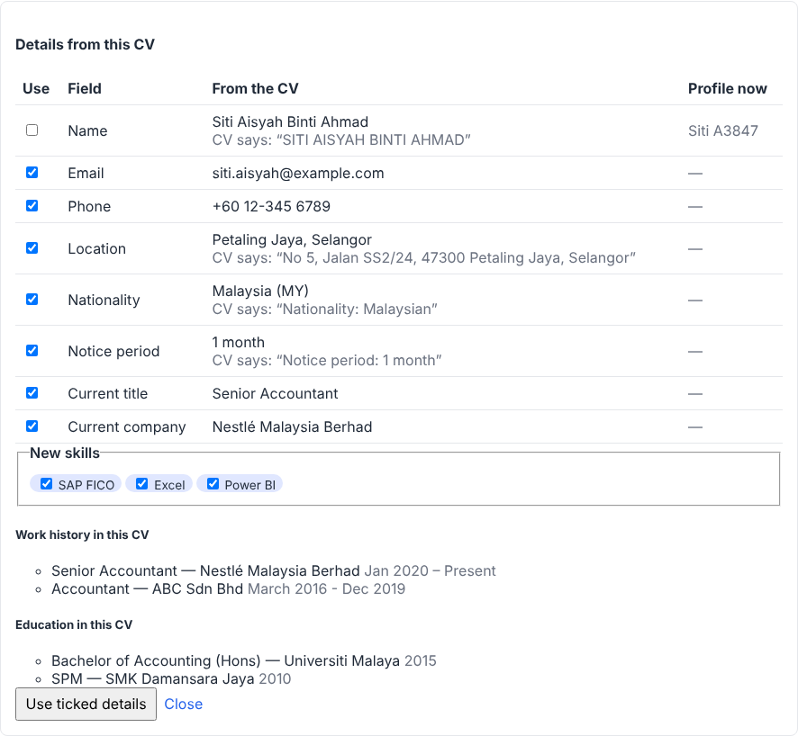

# Features: your list, mapped to the design

Context from your answers: **agency and in-house**, **your own team and other
companies (SaaS)**, **local first, cloud later**, and every version 1
must-have (OCR/CV parsing, careers page, email, job boards, AI matching, data
import).

Status: ✅ built in milestone 1 · 🧩 designed, scheduled (see [roadmap](roadmap.md)).

| # | Feature | Module(s) | Status |
|---|---|---|---|
| 1 | Contacts with built-in email verifier | `companies`, `contacts` | ✅ |
| 1.5 | Job ads puller | `leads` | ✅ job board feeds, careers pages, saved ads |
| 2 | Companies | `companies` | ✅ records, auto-fill from the website |
| 3 | Candidate profile fields | `candidates` | ✅ |
| 3 | JobStreet / LinkedIn / original / formatted CVs | `documents`, `cvformats` | ✅ upload, text, formatted CVs in your Word template, PDF |
| 3.5 | AI interpretation sidebar (DeepSeek) | `assistant` + AI worker | ✅ off until an AI provider is set up |
| 4 | Pipeline dashboard | `pipeline`, `reports` | ✅ board, dashboard and reports |
| 5 | Jobs and applicants ✅; interview scheduling, CV vs job match | `jobs`, `pipeline`, `interviews`, `matching` | ✅ jobs, pipeline, interviews; matching (off until an AI provider is set up) |
| 5 | Email with templates | `emails` | ✅ sending; inbox sync 🧩 4.3 |
| 5 | Notes: screening, call and interview notes | `notes` | ✅ |
| 6 | API documentation for integration | contract → `/docs` | ✅ |
| 7 | User access: view / modify / write, sensitive (salary) | `identity` + platform | ✅ roles, each company's own permissions and candidate scope per role, teams, owners |

## 3. Candidates

Profile fields (all in the contract, `contracts/modules/candidates.yaml`):

| Field | Notes |
|---|---|
| First and last name | Spaces tidied; full name derived |
| Email | Lower-cased; **one candidate per email** in a company: adding someone with an email another candidate has is refused, naming that candidate and who owns them with a link (unless you may not see them) |
| Status | Whether they are open to a move: **looking out**, **passive**, **not looking** or **placed** (or not set). It colours the candidate's page (light yellow, light green, pink, light purple) |
| LinkedIn profile | Their LinkedIn link, tidied to `https://www.linkedin.com/in/...` (`lnkd.in` short links kept); shown as a link on the profile. Read from a CV like Kano and CV Studio do: a `linkedin.com/in/...` (or `/pub/`, `lnkd.in`) address in the text, or one **hidden behind a link** in the file (a "LinkedIn" icon or word linking to the profile, in a PDF or Word CV) |
| Phone | Any common format in; stored internationally (`012-345 6789` → `+60123456789`, default country configurable) |
| Nationality | ISO country code (`MY`, `SG`, ...) |
| Country of residence | ISO country code; not known is shown as **NA**. Read from a CV: the country in their address, else Malaysian place names near the top (Kuala Lumpur, Selangor, KL, ...), else their phone's country code (`+65` → SG, `012-...` → MY). Unlike Kano's check, an employer's "Sdn Bhd" or an address further down the CV says nothing about where they live |
| Work authorization | `local`; `expat_eligible` with basis `rp_t` (Residence Pass-Talent), `permanent_resident`, `spouse_visa` or `other`; `requires_visa`. The basis is required exactly when the status is `expat_eligible` (checked in Go and again by the database). |
| Notice period | Value and unit (days, weeks, months); 0 means immediate |
| Industry, specialization | Industry from the company's list (Settings; Kano's ten industries to start); specialization free text with suggestions. From a CV, the industry of the latest employer is **inferred** like Kano's local rules: known employers first (Maybank, Infineon, Deloitte, Petronas, ...), then words in the name, then the job title (SAP/ERP work is IT); the review shows the words it was inferred from. When the AI is on it fills what the rules leave empty, Kano's way: rules first, a full AI read only when the core details are missing, otherwise only the industry; every value must still quote the CV |
| Skills, tags | Short labels (up to 100 skills and 50 tags, 60 characters each); spaces tidied and the same label in another case kept once. The form suggests labels already in use; the candidate list filters by one skill and one tag (ignoring case) and shows tags next to names. |
| Current title and company, location, source | Source: the company's list (Settings), picked as **icons side by side**: JobStreet, LinkedIn, referral, careers page, direct, other, and the company's own (shown by initials) |
| **Current salary**, **expected salary** | Amount, currency (`MYR`, `SGD`, ...) and period (hour/day/month/year) per figure; expected can be a range. **Sensitive:** see [access control](access-control.md). |

**The candidate's page** opens with a banner coloured by their status: their
name and status, job title and company, and in the top-right corner their
nationality, where they live and the source; the status buttons; their skills;
then notice period, current and expected salary (with "+26% on current" when
the two compare; "Restricted" for roles without salary access); and the work
authorization buttons. A column down the banner's right edge is coloured by
work authorization and says which: **Local** (green), **PR** (purple),
**Spousal / RP-T** (blue: it asks which pass), **Needs pass** (red), **Not
known** (grey). A click saves at once, with the lost-update protection below.

The web app edits every field above. Salary has its own form, shown only to
roles with `candidates.compensation:update`; viewers get no edit buttons. Edits
are protected against lost updates (`version`): a form saves with the version
it was opened with, so if someone else saved first (even if the page has
refreshed since), the form says so and offers to reload. Validation messages
appear next to the field (e.g. "Pass held" is required for an expat who can
work here); any the form cannot place are listed under it, so a failed save is
never silent. Saving without changes writes nothing. Amounts accept thousands
separators (`8,500`, `1,00,000`); a decimal comma (`8500,50`) is refused rather
than guessed. Every change is in the audit log, and search ignores case and
accents (`jose` finds `José`).

**Work history and education** ✅: jobs (title, company, from/to as month and
year or year only, current) and qualifications (name, institution, year) on
the candidate's page, newest first, edited as a whole with the same lost-update
protection as the profile; filled from a CV in one tick. Merging keeps the
kept candidate's history, or takes the duplicate's when it has none.

**Possible duplicates** ✅: a candidate's page warns about others with the
same phone number or a very similar name ("Siti Aisyah" and "Siti Aishah",
at least 60% alike ignoring case and accents). The same email is refused when
adding. **Merge** a duplicate into the candidate you keep (owners, admins and
recruiters, who can see salaries, so nothing is lost unseen): its CVs, jobs
and notes move over, empty fields are filled from it (and its salary, if the
kept candidate has none), and it is deleted, in one transaction. If both were
on the same job, the kept candidate's application stays.

**CV versions** ✅. A candidate has documents, each with a `source`: `jobstreet`,
`linkedin`, `original`, `formatted` or `other`. Each upload keeps its file, its
extracted text and any extraction warnings; files can be downloaded under their
original name. **Compare CVs side by side** (on the candidate's CV list) shows
two versions next to each other, PDFs as they look and Word files as text, with
the differences read from them on top: fields that disagree, jobs whose title
or dates changed (matched by employer), jobs and skills only one version has.
That is the check before sending a formatted CV to a client.

**CV parsing** ✅: after a CV's text is read (with OCR for scans), the AI
worker reads the profile details out of it: name, email, phone, LinkedIn,
location, nationality, notice period, skills, work history and education.
Every value carries the exact CV text it came from, and the server keeps only
values whose quote is in the CV. On the candidate's page, **Review details
from this CV** lists each suggestion next to what the profile has now, with
the CV's wording: empty profile fields are ticked, filled ones never are, and
**Use ticked details** saves them (with the usual lost-update protection).
New skills are added to the existing ones. **Read details from this CV**
parses CVs uploaded earlier. Formatted CVs are parsed too, for comparing, but not offered for review. The CV's work
history and education are saved on the profile when ticked (ticked by default
only if the profile has none; existing history is replaced only when asked).
Design:
[ai-worker.md](ai-worker.md#cv-parsing-grounded-in-the-source).

**CV preview ✅.** The candidate's page shows their CV as it looks, near the
top: the newest CV they sent, with their other CVs to pick from. A PDF is shown
as it is; a Word file (.docx or old .doc) gets a PDF copy made by the AI worker
with LibreOffice when it is uploaded (its text shows meanwhile). Word CVs from
before this get their copy the first time the page is opened.

**Formatted CVs, CV Studio's way ✅.** "Make formatted CV" offers two ways.
**From their CV** formats one of the CVs the candidate sent with CV Studio's
own engine: the AI reads it, CV Studio's rules tidy and check it, and its
renderer lays it out in its template, in the background (a minute; the
candidate's page shows its progress). Options: correct spelling, punctuation
and capitals (never the meaning, numbers or dates); blind (no name or contact
details, employers and schools described rather than named, optionally "the
candidate" instead of he or she); paragraphs aligned left or justified. Lines
stating the candidate's own salary are left out before the AI sees the CV. When
CV Studio's check finds something the result may have lost or changed, the
page says what, to compare before sending. It needs the AI (Settings > AI
provider) and counts in the monthly AI allowance. **From their profile** is
the template way below.

**Formatted CVs ✅.** "Make formatted CV" (candidate page, CVs and documents)
fills the candidate's profile, work history and education into a Word
template and saves it as their `formatted` CV (read and compared with the
original like any formatted CV); a PDF follows a moment later (made by the AI
worker with LibreOffice). Options: which template, which of their jobs it is
for (its title and client appear), show email and phone (off by default, so
the client goes through you), include current and expected salary (only for
those who may see salary; never written to the audit log), and your summary.
Templates are ordinary Word files with `{{placeholders}}`: download the
built-in standard template from the **CV templates** page, restyle it in Word
(logo, fonts, layout), and upload it; a template using unknown placeholders is
refused, naming them. Paragraphs between `{{#experience}}` and
`{{/experience}}` repeat for each job (likewise education), `{{#experience?}}`
keeps a heading only when there is something under it, and a line whose
placeholders are all empty is left out.

**Blind CVs ✅.** The "Blind CV" option shows a reference (e.g. "Candidate
C-4F2K9Q", also `{{candidate.reference}}` in any template) instead of the
name, leaves out email, phone, nationality and work authorization, and takes
the candidate's names, email addresses, phone numbers and profile links out
of every other text (job descriptions, your summary), while keeping years and
amounts. Before saving, the finished file (every part, headers and footers
too) is checked for the name, email or phone: if one is still there, usually
written in a template's own text, nothing is saved and you are told what
kind of detail it was. The file name carries the reference, not the name.

## 3.5 AI assistant sidebar ✅ (off until an AI provider is set up)

A panel on candidate and job pages: **Summary**, **Gaps and red flags**, and
your own questions. On a candidate's page, "About" switches to one of their
jobs for **Fit for this job** ("how well does this candidate fit?").
Answers come back in a few seconds and are kept, newest first; each person
sees only their own.

- **It sees only what you may see.** Go gathers the context with the asking
  user's permissions: the profile, work history, education and the newest
  CV's text (with `documents:read`), the job and its description. A record you
  cannot see is "not found" to the assistant too.
- **Never names, contact details or salary.** The candidate's name, emails,
  phone numbers and profile links are taken out of every text
  (`platform/redact`, shared with blind CVs); recorded salaries are never
  read; salary figures written in a CV or job description ("Expected salary:
  RM 5,000") are cut out (`redact.WithoutSalary`). Nationality is left out
  as well: the right to work says what matters for a job.
- **The prompts** (in `ai/src/hiringplug_ai/jobs/assistant_ask.py`) tell the
  model to answer only from the data, say when something is missing, never
  judge or guess race, religion, age, gender, marital status, health or
  nationality, and to ignore instructions written inside a CV.
- **Provider.** Chosen per company in **Settings > AI provider** (owners and
  admins, `aiproviders:manage`): DeepSeek, Claude (Anthropic) or ChatGPT
  (OpenAI) with the company's own API key and model, the server's own
  provider, or off. Each provider keeps its key and model, so switching back
  and forth needs no retyping; saving a key sends the provider a tiny request
  and shows whether it works (key refused, no credit, unknown model...). Keys
  are sealed (AES-256-GCM, `HP_AI_KEYS_SECRET`) when saved, never shown again
  (only the last four characters), never logged or audited, and opened only by
  the AI worker. The calls follow CV Studio's provider layer: Claude and
  DeepSeek through the Messages API (DeepSeek's Anthropic-compatible endpoint,
  thinking off), ChatGPT through the Responses API; a request is sent again
  only on 429/529 (the provider did no work), never after an error that might
  have billed. The server's own provider (`HP_AI_PROVIDER`,
  `HP_AI_PROVIDER_URL`, `HP_AI_PROVIDER_KEY`, `HP_AI_MODEL`: any
  OpenAI-compatible chat API, e.g. a host running DeepSeek's open model in a
  region you choose) serves companies that chose none. Data location matters
  under Malaysia's PDPA: DeepSeek's own API stores data in China.
- **Costs.** Tokens are recorded per answer; each company has a monthly
  allowance (`HP_AI_MONTHLY_TOKENS`, default 2,000,000) for the assistant and
  CV vs job matching together, shown in the panel. Once used, asking is
  refused (`ASSISTANT_LIMIT_REACHED`) until the 1st.
- **Flow.** Browser → Go API (permission check, context, allowance) → job
  queue → Python AI worker → provider → result job → Go saves it; the page
  polls while an answer is on its way. Questions and answers are never logged.
- **Later:** streaming answers, notes in the context (with the sensitive-notes
  permission).

## 3.6 CV vs job match ✅ (off until an AI provider is set up)

A fit score for a candidate on a job, with its reasons, so a recruiter can see
at a glance who meets the job and check why. On a job's board, **Score
candidates' fit** scores every active candidate not scored yet (**Score all
again** after the job or a CV changed; at most 100 at a time; candidates
without a CV with readable text are counted and left out). Each card then
shows **Fit 72%**; clicking it opens the reasons above the board, and **Best
fit first** orders each column by score. A candidate's page shows the score
for each of their jobs, with **Score fit** / **Score again**.

- **Reasons quote both texts.** The AI lists the job's main requirements
  (skills, experience, qualifications, languages, tools), each copied from the
  job's description or its ad, a verdict for each (meets, partly, not in the
  CV) and the words of the CV that show it. Go checks every quote with the
  same check CV parsing uses (`platform/quote`: ignoring case, spacing, curly
  quotes and dashes): a requirement that is not in the job's text is left out
  (and counted), and a "meets" or "partly" without a quote from the CV counts
  as not shown, with a note saying so. An invented quote can never raise a
  score.
- **The score is worked out, not asked for:** met counts in full, partly as
  half, of the requirements that passed (at most 15). Strong from 75%,
  partial from 50%. It suggests; the recruiter decides.
- **Fit stats, CV Studio's CV scoring:** with the score, the AI rates the CV
  0-100 on CV Studio's six dimensions (technical / functional skills,
  experience level, industry / domain background, education &
  qualifications, leadership & communication, keyword & requirement match),
  each with a one-sentence note, shown as coloured bars (green from 70, amber
  from 45), and lists up to five **strengths** and **gaps to ask about**
  (the AI notes). The **recommendation** follows CV Studio's thresholds but
  from the worked-out score: shortlist from 70, consider from 45, pass below.
  The ratings and notes are marked as the AI's opinion; Go keeps each known
  rating once, holds it to 0-100, and drops anything else.
- **Never who a person is.** Requirements about age, gender, race, religion,
  marital status or nationality ("Malaysians only", "aged below 35") are never
  scored, whatever the ad says; the prompt also tells the model not to consider
  them. The right to work is on the profile for the recruiter to check.
- **Never names, contact details or salary.** As for the assistant: the CV's
  text has the candidate's name, emails, phones and links taken out, salary
  figures are cut from the CV, the description and the ad, and recorded
  salaries are never read. What was sent is kept only until the answer is
  checked, then cleared; the audit log records the score and counts, never
  quotes.
- **Who sees it.** `matching:read` (everyone who may see the pipeline) sees
  scores and reasons; the CV quotes need `documents:read` too.
  `matching:create` (owners, admins, recruiters, sourcers) asks for scores,
  which uses the company's AI allowance, shared with the assistant
  (`MATCHING_LIMIT_REACHED` once used).
- **Flow.** Browser → Go API (permissions, texts, allowance) → `match.score` on
  the job queue → Python AI worker (`jobs/match_score.py`) → provider →
  `match.scored` → Go checks the quotes, works out the score and saves it; the
  page polls while scores are on their way.
- **Scored without being asked** while an AI provider is set up: when someone
  is put on a job or applies (as soon as their CV has text), and again when a
  new CV of theirs is read. Not those who withdrew consent (asking is refused
  too, `MATCH_CONSENT_WITHDRAWN`), and nothing once the month's allowance is
  used.
- **Outdated scores**: once the job's description or ad changes, its scores
  say "outdated"; **Score all again** refreshes them.
- **Possible candidates** on each job's page: people not on the job whose CVs
  share the most words with its description and ad (a keyword search of CVs,
  not the AI, so it works without one), best first, with where their CV has
  those words. Those who withdrew consent, and those the user may not see, are
  left out. **Add to job** puts them on it (and scores them).
- **Later:** finding possible candidates by meaning rather than words
  (embeddings).

## 1, 2. Companies and contacts

- **Companies** ✅: clients and prospects (agency) or your own organisation's
  departments (in-house): name, type, website, industry, size, phone, address,
  city, country, registration number (e.g. SSM) and notes. Search by name or
  website (ignoring case and accents), filter by type. Names are unique per
  company (`Nestlé Malaysia` and `nestle malaysia` are the same), and edits use
  the same lost-update protection as candidates.
- **Auto-fill from the website** ✅: "Fill in from website" on a company's
  page queues a job that reads its home page and its contact page (a link
  with "contact" or "hubungi"), only where robots.txt allows, through the
  same guarded HTTP client as webhooks (no private addresses in production,
  size and time limits). It reads schema.org Organization data (legal name,
  phone, address with postcode, city, country, number of employees as a size,
  description), the page's own description, `tel:` links, and a Malaysian
  registration number (labelled, or in brackets after "Sdn Bhd"/"Berhad").
  Details already recorded the same way are left out. Each one is a
  **suggestion with its source**, shown next to the current value; a person
  accepts it (the company is changed by the usual rules and the audit entry
  names the source) or dismisses it. Reading again replaces the suggestions
  still waiting. Why a reading failed (site down, robots.txt) is shown. Later:
  AI extraction from the page text (with 5.3), data providers (Apollo, Google
  Places) and the business registry, as more sources of suggestions.
- **Contacts** ✅: people at companies (hiring managers, HR) with job title,
  email, office phone, mobile, LinkedIn, status (works there / has left) and
  notes; listed on their company's page. The **email check** runs whenever an
  email is added or changed: the format, whether the domain receives mail (its
  MX records, looked up with a 3-second limit outside any database
  transaction), and shared (`hr@`) or disposable addresses. The result is
  **valid**, **risky**, **invalid** or **unknown** (lookup failed: "Check
  again"), with the reasons in words. Next: optionally the mailbox itself. Each result is
  stored with its evidence and date: valid, risky (catch-all, role, disposable),
  invalid or unknown. Mailbox checks need outbound port 25, which home ISPs and
  cloud providers often block, so a paid verification service can be plugged
  in instead. CV Studio's email verifier notes will be reused.
- **Employment check** ✅: whether a contact still works at their company.
  LinkedIn cannot be read automatically (it refuses automated access), so a
  person drops the contact's LinkedIn profile saved as PDF (More > Save to PDF)
  on the contact's page. The AI worker reads its text and jobs with the CV
  rules (no AI, `contact.read_linkedin`); the jobs are kept, the PDF deleted.
  The current job is compared with the contact's company, ignoring "Sdn Bhd",
  "Berhad", "(M)" and the like: **still at** the company, **no longer at** it
  (with where they are now and since when), or **no current job**. A profile
  whose name, or LinkedIn address, is not the contact's is flagged as perhaps
  someone else's; a missing LinkedIn address is filled in from it. The
  comparison is made when shown, so it follows the contact's company.

## 1.5 Job ads puller ✅

Finds companies that are hiring, as business development leads (the
**Leads** page; owners, admins, recruiters and sourcers).

**Legal note:** automatically scraping LinkedIn or JobStreet breaks their terms
of use, and LinkedIn takes scrapers to court. The puller only uses sources that
are allowed:

1. **Public job board feeds** that companies publish for their own sites:
   Greenhouse, Lever, Ashby and SmartRecruiters (enter the board name, or
   paste the board's address).
2. **Careers pages** whose jobs carry schema.org JobPosting markup (the markup
   companies add for Google for Jobs). The site's robots.txt is respected
   (`HiringPlugBot`), and a page without markup is reported, not guessed at.
3. **Ads saved by hand**, from anywhere (LinkedIn, JobStreet, a newspaper):
   company, job, where, the ad's address and notes.

Sources are checked when added and then every day (or "Check now"). Each
opening becomes a lead with its company, title, location, link and posting
date; one listed again is updated, and one no longer listed is marked closed
(and reopened if it comes back). Each source shows its open openings, when it
was last checked and why a check failed. Leads are filtered by status (new,
contacted, became a client, ignored), still listed or closed, and words, and
can be linked to a company record. Fetches never reach the server's own or
private networks. Next: licensed job-data providers, and contacts found for a
lead's company (with the built-in email check).

## 4, 5. Jobs, pipeline, interviews, matching

- **Jobs** ✅: job orders for clients (agency) or requisitions (in-house):
  company, hiring contact (must work at that company), title, status (open,
  on hold, filled, closed), location and country, work type, on site / hybrid /
  remote, openings, description and the **official intake date** (today
  unless chosen), listed on the company's page. The **salary
  budget** follows the salary pattern: its own permissions (hiring managers
  may see it, sourcers and viewers may not), its own table that the database
  refuses to others, and no amounts in the audit log. Job ads (the advertised
  text) come in Phase 3.
- **A job from the client's JD** ✅: drop the client's job description (PDF,
  Word or text) on the Add job form, or on a job's ads to write an ad; the
  title, location, country, work type and arrangement and the description are
  read from it into the form (fields already typed are kept), to check and
  save.
- **Blind ads** ✅: every ad is shown in two columns, as written and blind.
  The blind version is made from the ad when it is read: the client's name
  (also without "Sdn Bhd", "Berhad" and the like, and however the JD writes
  its ending: "MAJU FOODS BHD", "Maju Foods (M) Sdn. Bhd." for Maju Foods
  Berhad on record), its first word alone when the JD shortens it ("Maju's HR
  Director"; only with a capital, and not common words such as Global or
  Asia), its website and the name
  part of its address (acme from careers.acme.com.my), and the hiring contact
  are replaced in the title, text, location and salary line, and every email,
  phone number and link removed. The client description itself may not name
  the client. The first mention of the client becomes the
  ad's "client description" ("a leading Malaysian bank"), later ones "our
  client". A person may write their own blind title and text; it may not name
  the client, changes to the ad then no longer remake it, and the ad shows when
  it was written for an older version ("Make again from the ad" goes back).
  Each ad chooses what the careers page and job feed show: new ads the blind
  version, ads published before keep showing the ad as written. Either version
  downloads as **Word or PDF** (title, a line of facts, the text with its bullet
  points; the PDF uses a standard font, so characters beyond Western European
  ones, such as Chinese, print as "?").
- **Blind ads rewritten by the AI, CV Studio's way** ✅ ("Rewrite with AI" under
  the blind version, once the AI is on): a pattern can take out names, but
  not "40 hubs across 12 countries", which finds the client just as well. CV
  Studio's Blind JD prompt rewrites the ad into a candidate-facing job
  description without the client's identity (names, brands, addresses,
  links, contacts and anything listed under "Also take out"), with company
  size and reach described broadly and the wording paraphrased, in one of
  its tones (professional, conversational, concise) and rewording strengths
  (light, balanced, strong); responsibilities and requirements that still
  copy long runs of the ad are sent back once. CV Studio's checks then put
  back genuine tech terms from the ad (SAP, Python, Power BI...; "Go" and
  "Excel" only as tools), soften company scale and scrub the client's name.
  The result becomes the blind version in sections (About our client, Tech
  stack, What you will do, What you need to succeed, Nice to have, Why join
  us), as a person's edit would; Go refuses one that still names the client.
  What to check (tech terms missing, wording still close) is shown with it.
  Its tokens count in the monthly AI allowance.
- **Job ads** ✅: the advertised text of a job, separate from the internal job
  order (a job can have several), with its own country (the job's unless chosen). Each has its own title, location, work type
  and arrangement, an optional salary line shown as written (separate from the
  job's private budget), a closing date and the ad's text, where lines starting
  with "- " become bullet points (plain text only: nothing typed into an ad can
  run in a reader's browser). A new ad starts from the job's details. Status:
  draft, published or closed. Publishing needs an open job, the ad's text and
  a closing date that has not passed, and says which is missing. A published
  ad stays up while its job is on hold; a job that is filled or closed takes
  its published ads down in the same change. The careers page (3.2) shows
  published ads.
- **Careers page** ✅: every company has a public page (`/#/careers/<address>`,
  linked from each job's ads panel) listing its published ads that have not
  passed their closing date, each with its text and an apply form: name,
  email, phone, CV (PDF or Word) and a consent tick box ("I agree that
  <company> keeps my details to handle my application"). Applying adds the
  candidate (source: careers page), or uses the existing candidate with that
  email without changing their profile; the CV is attached, read and parsed;
  and they join the job's pipeline at "applied", all in one transaction. The
  answer is the same whether the email was known, so the form reveals nothing.
  Robots are kept out by a hidden field people never fill in and a limit per
  connection (5 applications in 10 minutes, 20 a day).
- **Job boards** ✅ (without partner accounts): each published ad has a link
  per board (JobStreet, LinkedIn, Indeed, Facebook; "Links for job boards" on
  the ad). Post the ad on the board with its link; applicants who come
  through it are recorded on the application ("Applied via LinkedIn" on the
  pipeline card) and, for new candidates, as their source. The careers page
  has real addresses (`/careers/<company>/<ad>`, which search engines and
  boards can link to; the `#/` ones keep working), describes each ad for
  Google for Jobs (schema.org JobPosting), and publishes an XML job feed of
  its open ads (`/v1/public/careers/<company>/jobs.xml`, the source/job
  format Indeed and aggregators read). Posting through the boards' partner
  programmes comes once those accounts exist.
- **Interviews** ✅: on each of a candidate's jobs (candidate page), recruiters
  schedule interviews: title, date and time, length, in person / video /
  phone, the address or meeting link, the interviewers (any of the company's
  users) and instructions for the candidate. Scheduling moves the application
  to the interview stage if it is at an earlier one; closed or placed
  applications get no new interviews. An interviewer already booked at that
  time is a clash, shown with the other interview, and "Schedule anyway"
  overrides it. Interviews are changed, marked done, "did not come" or
  cancelled, and every one has "Add to calendar" (an .ics file for Outlook,
  Google or Apple Calendar; importing it again after a change updates the
  event). Interviewers give feedback (strong yes / yes / no / strong no, and
  comments) once the interview has taken place, and see their colleagues'
  feedback only after giving their own, so the first opinion does not steer
  the rest; recruiters see it all. The dashboard shows "My upcoming
  interviews" (two weeks) and "Feedback to give"; "Email candidate" writes
  the invitation. The interviewers get an email reminder the day before (when,
  how, where, who else, and a link to the candidate), with the time in the
  company's time zone (`HP_TIME_ZONE`); a moved interview is reminded of at
  its new time only, and a cancelled one not at all.
- **Email the client** ✅ (CV Studio's composer): **Email client** on any
  candidate on a job (the job's board, or the candidate's job list) opens a
  composer addressed to the job's hiring contact, from you (replies come to
  you). Templates keep the subject, the formatted message, its signature and
  banner: pick one and **Use selected template**, or **Save changes**, **Save
  as new**, **Delete template** (roles that manage templates). To, **CC** and
  **BCC** (bcc addresses get it but are never listed in it). The message has a
  toolbar: bold, italic, underline, strike, bullets, numbered list, left /
  centre / right, link, clear format, font, size, colour, **Insert field** and
  **Insert banner**. Fields are filled from the candidate and the job when it
  is sent: [First name], [Last name], [Full name], [Current salary], [Expected
  salary], [Notice period], [Expat status], [Nationality], [Lives in],
  [Current title], [Current company], [Job title], [Client company], [Client
  contact], [Your name], [Agency] (older `{{candidate.firstName}}`
  placeholders work too). **Preview** shows it filled in; a field with no
  value for this candidate refuses the email, naming it. **Salary**: only
  people whose role may see salaries can fill the salary fields, and a sent
  email that shows salary is hidden from roles that may not see salaries
  (the database enforces it), unless Settings → Salary in emails says
  everyone who may read emails sees it. **Attachments**: the candidate's CVs
  from the ATS (a formatted CV as PDF once made) and files from your computer,
  up to 10 files and 10 MB in all. **Banners** are images uploaded once (PNG,
  JPEG or GIF, up to 1 MB) and shown inside the email, not linked. Only the
  toolbar's formatting is kept (no scripts, no images loading from elsewhere),
  and every email also carries a plain-text version.
- **Email** ✅: write email from a candidate's page (or "Email candidate" on
  an interview). Pick a template, optionally for one of their jobs: it is
  filled from the candidate, the job and its company, the interview (time in
  the sender's time zone, length, how, where, instructions) and the sender.
  A placeholder without a value stays visible as `[job.title]` and sending
  waits until it is filled in. Templates with "client" or "submit" in their
  name go to the job's hiring contact; others to the candidate. Every company
  starts with four templates (interview invitation, submit candidate to
  client, application received, unsuccessful application), changed or added
  to on the templates page (`#/email-templates`). Sending is queued with the email's record and delivered in the
  background by the worker through your mail server (`HP_SMTP_*`): from your
  sending address, shown as "Sender (Company)", with replies going to the
  person who sent it. The candidate's page lists every email with its state
  (sending / sent / not sent, and why: a refused address, no mail server set
  up); a server that is down for a moment is tried again. Locally, Mailpit
  catches all mail at http://localhost:8025. Replies coming back into the app
  arrive with inbox sync (4.3).
- **Pipeline** ✅: a candidate on a job is an *application* moving through
  stages: applied → screening → submitted (to the client or hiring manager) →
  interview → offer → placed, or rejected / withdrawn with a reason (not
  qualified, salary, client said no, took another offer, ...) and a note. Each
  job has a **board** (drag a card to another column, or use its "Move to"
  menu) showing how long each candidate has been in their stage; closed
  applications are listed below with their reasons and can be reopened. A
  candidate's page lists their jobs and adds them to another. The rules are in
  one place (`pipeline/domain.go`) and tested for every from → to move: a
  reason exactly when closing, reopen before placing, and a placed candidate
  only goes back to offer or is withdrawn. Two people moving the same card:
  the second is told and reloads. Next: dashboard counts and conversion.
- **Interviews:** Google and Microsoft calendar sync (4.3).
- **CV vs job match** ✅: a fit score per application with reasons quoting the
  job and the CV; see [3.6](#36-cv-vs-job-match--off-until-an-ai-provider-is-set-up).

## Booking links (a small Calendly of our own) ✅

- **Your hours** (Account > Booking hours): the days and hours you take calls,
  your time zone, the gap kept around meetings, how soon and how far ahead a
  candidate may book. Everyone with `scheduling:use` (all but viewers).
- **Your calendar**, without connecting an account: paste the private address
  your calendar gives (Google Calendar: Settings › your calendar › Integrate
  calendar › *Secret address in iCal format*; Outlook: Settings › Calendar ›
  Shared calendars › Publish a calendar › *ICS link*, "Can view when I'm
  busy"). The Go worker reads it (`scheduling.refresh_calendar`, through the
  guarded HTTP client) when saved and again when a booking page is opened and
  it is older than 15 minutes; only **when** you are busy is kept, never what
  the meetings are. Repeating meetings, skipped and moved occurrences, free
  and cancelled events, all-day events and Outlook's Windows time-zone names
  are understood (`platform/ical`). The address is never shown back (only its
  host) nor written to the audit log.
- **In an email to a candidate**: "+ Booking link" (title, length, where:
  a meeting link, a phone number or an address) puts "Please pick a time
  that suits you: …/book/<link>" in the message. One link, one meeting;
  links last 30 days; only a hash of the link's secret is stored.
- **The booking page** (`/book/<link>`, no sign-in) shows your free times in
  the candidate's own time zone: your hours, less your calendar's busy times,
  the interviews you are on and your other bookings (with the gap around
  each). Booking locks your schedule, so two people cannot take one time.
- **Both calendars are blocked**: the candidate and you each get an email
  with a calendar invitation (`METHOD:REQUEST`, as Gmail, Outlook and Apple
  Mail recognise, plus `invite.ics`), which they add to the calendar. The
  candidate can move the time with the same link (the invitation is updated:
  same UID, next SEQUENCE) until the minimum notice; you can cancel from the
  candidate's page (a `METHOD:CANCEL` takes it off both calendars).
- **Later**: connecting Google or Microsoft accounts directly (OAuth), to
  write the event straight into the calendar and read busy times live.

## Offers ✅

On a candidate's job (from submitted on), **Make offer** drafts an offer:
salary, start date, the day to answer by, and other terms (benefits,
probation, notice). It moves the application to the offer stage. Recruiters
**ask for approval**; owners, admins and hiring managers approve it or send it
back with a note, but never their own request, and see the salary to do so.
Approvers can also send a draft straight away (sending is their approval).
Changing an offer waiting for approval or approved sends it back to draft.
Then the offer is marked sent, and accepted or declined; any offer not yet
answered can be withdrawn, and a declined or withdrawn one can be followed by a
new one (one open offer per application). The salary is protected like other
salaries (`offers.salary:read` / `:update`, enforced by the database too, never
in the audit log). Approvers see **Offers to approve** on their dashboard.

## Placements and fees ✅

Recording a placement (on a candidate's job at the offer stage, "Record
placement") moves the application to placed. A placement has the start date,
the guarantee period (90 days unless changed), the recruiter credited (whoever
records it unless changed), what happened (placed; fell through, with the day
they left, which must be within the guarantee; or did not start), and the
invoice (not invoiced; invoiced, with its number and date; paid, with the date,
not before the invoice; dates default to today). The agreed salary and the fee
are separate, like candidate salaries: only owners, admins and recruiters see
or change them (`placements.fees:read` / `:update`), the database hides them
from everyone else, and the audit log records only that they changed. The fee
is a percentage of the yearly salary (a monthly salary counts 12 times; worked
out to the cent on the server, with a preview in the form) or a fixed amount.
The **Placements** page lists them all, filtered by what happened or the
invoice, with fee totals per currency (not invoiced / invoiced and unpaid /
paid; fall-throughs and no-starts not counted) and the placements whose
guarantee ends within two weeks. A fall-through means the client is owed a
**replacement**: the placement shows "Replacement owed" (listed at the top of
the Placements page) until it is marked provided or refunded.

## 5. Notes and activity

✅ Notes (general, screening, interview, call) on candidates, jobs, companies
and contacts, shown with the record's **activity** (who changed what and when,
from the audit log; salary changes never show amounts) in one timeline. A
screening note starts with screening questions to fill in. Hiring managers can
write interview notes. A note can be marked **sensitive** (e.g. salary talks):
only roles that may see salaries can read or write it, the database enforces
it, and others see "2 sensitive notes are hidden". You delete your own notes;
owners and admins any. Next: templates per company and notes on an
application.

✅ **Screening call** (candidate page: *Screening call*): the candidate's CV
on one side (the newest one they sent; PDFs as they are, Word files as text;
any version can be picked) and the call on the other, so the CV stays in view
while you take notes, with the **AI assistant docked** underneath for
prompting (summary, questions to ask). One *Save the call* updates the
profile with what was asked: **salary and currency** (current and expected;
needs `candidates.compensation:update`), **notice period** (the company's
list), **work authorization**, **nationality**, and the **source only when the
candidate has none** (an existing source is kept and the page says so). The
notes become a screening note (sensitive if ticked). It is all or nothing: if
one part is refused (e.g. a salary range that runs backwards, or someone saved
the profile meanwhile), nothing is saved, and the notes typed are kept. The
audit log records that a call was saved, never the salary.

## Import

✅ **CVs and LinkedIn PDFs** (menu: Import; permission `intake:create`): pick
one file or many (PDF, .docx, .doc; on LinkedIn: *More → Save to PDF*) and
their source (LinkedIn to start). Each file becomes a candidate named after
the file, owned by whoever imported it, and is read like any CV; when the
reading is done the candidate is filled in from it: name, email, phone,
location, nationality, country of residence, LinkedIn link, current title and
company (the latest job), industry, notice period, skills, work history and
education. A value the rules refuse (e.g. a phone in no known format) is left
out and the rest kept. **One candidate per email:** when the CV's email
belongs to a candidate already, the file is added to that candidate and the
new one merged into them (their empty fields filled, nothing they have
replaced). The page shows each import with its files' progress (reading, new
candidate, added to existing, could not be read: fill it in, failed: not a CV
file), refreshing while files are read, with a link to each candidate. Your
imports are yours: others do not see them, and a candidate you may not see is
not named.

✅ **Import** (menu: Import) candidates, companies or contacts from a CSV file
(in Excel: Save As, CSV). Columns are matched to fields by their names
(`Full Name`, `E-mail`, `Mobile Number`, `Designation`, ...) and can be
changed; the first rows are shown. Each row goes through the same API as the
forms, so every check applies: duplicates are reported as "already there" with
a link, invalid values as "to fix" with the reason, and the rows to fix can be
downloaded as a CSV to correct and import again. Country names and
nationalities become codes (`Malaysian` → `MY`); sources like `Job Street`
become `jobstreet`. Contacts find their company by name (ignoring case and
accents), or add it. Excel files (.xlsx) directly: later.

## Dashboard

✅ The home page: open jobs with candidates per stage, totals, candidates
moved this week, placements in the last 30 days, and who has waited more than
14 days in one stage.

✅ **Recent moves**: a timeline of stage moves, newest first and grouped by
day (Today, Yesterday, then the date): the time, the candidate, from which
stage to which (or "added at Applied"), on which job, and **who moved them**
(blank when the app did, e.g. an accepted offer). It refreshes after every
move or addition, and shows only candidates your role may see. A candidate's
page has the same timeline for them (**Stage history**).

## Reports ✅

The **Reports** page (owners, admins and recruiters), for a period (the last
90 days unless chosen; days in the company's time zone):

- **Pipeline conversion:** applications made in the period by the furthest
  stage they reached, and what share of those at the stage before got there.
  A candidate rejected after an interview counts as reaching interview.
- **Sources:** applications, interviews and placements per source (the
  channel they applied through, else the candidate's source), with placements
  per application.
- **Placements per recruiter:** placements starting in the period, fall-throughs
  and fees per currency (fees only for those who may see them).
- **Time to fill:** median days from a job opening to its first placement, and
  from a candidate being added to the job to being placed, with the jobs placed
  in the period, slowest first.

Every stage change is recorded (by the database, whatever made it), so these
figures come from what happened, not from where applications are now; the
history before this was rebuilt from the audit log.

## Market map ✅

On each job (owners, admins, recruiters and sourcers), from the company's own
database: the candidates whose current title has the job title's words (level
words such as "Senior" and "Manager" left out, so "Senior Finance Manager"
maps everyone in finance), how many are looking out or passive, where they work
and live, their work authorization and median notice, and, for roles that may
see salaries, current and expected pay (25th percentile, median, 75th). Like
Kano's Owl, the AI assistant adds **market insights** (kind `market_map`):
target companies, other titles to search, skills, typical pay, difficulty and
where to find people, from what the AI knows of the market as well as the job
and the counts above (never pay or names), marked as estimates. The map, with
the insights, downloads as Word or PDF.

## Data protection (PDPA) ✅

Malaysia's Personal Data Protection Act, for the candidates you hold. **HiringPlug
never deletes or anonymises anything by itself, and keeps records until you
decide otherwise**: it shows you what needs deciding and records what you did.

- **Consent** on every candidate's page (**Data protection**): given or
  withdrawn, how (careers page application, email, phone, in person, signed
  document) and when, with a note. Applying on the careers page records it
  automatically (applying again after withdrawing is a new consent).
  Candidates added by hand, imported or sourced show "No consent recorded"
  until someone records it.
- **Withdrawn consent means do not contact**: the page says so, and emails to
  the candidate are refused (`EMAIL_DO_NOT_CONTACT`).
- **Requests** a candidate makes about their data, logged on their page: a
  copy of their data, a correction, stop using their data and contacting them,
  remove their data, or other, with the day received and how they asked.
  Access and correction requests show when they must be answered (21 days,
  PDPA ss. 31 and 35) and turn red when late.
- **The Data protection page** (owners and admins): consent counts (given,
  withdrawn, not recorded), open requests oldest first with their due days,
  who withdrew consent, and the latest decisions. Each request is closed as
  done or declined with what was done (required); closing a "stop using their
  data" request as done marks the candidate do not contact. For a removal
  request, nothing is deleted: you say what you did. Requests can be reopened.
- **A copy of their data** (for access requests): **Download a copy of their
  data** on the candidate's page gives a plain text file (or JSON): profile,
  work history, education, salary, CVs with their text, the jobs they were put
  forward for, notes, emails sent, consent and requests. It holds only what
  the person downloading may see, and says what was left out (e.g. salary,
  sensitive notes). Each download is in the audit log.
- Merging duplicates keeps both candidates' requests, and withdrawn consent
  wins.

## Main settings ✅

One **Settings** button in the top bar leads to everything that is set up
rather than worked on, with a menu of its parts on the left; each person sees
the parts they may change: **General** (below), **AI provider**, **Team**,
**Roles and access**, **Data protection**, **Integrations**, **CV templates**,
**Email templates**, **System** and **Your account** (booking hours,
password), which everyone has.

**System** (owners and admins) shows the company's background work in plain
words (sending emails, reading CVs, making PDF copies, ...): how much is
waiting, running or being retried, what failed for good in the last 30 days
and why, with **Try again**; and the server's last backup, with a warning
when it failed or is more than two days old.

**General** (owners and admins) has these parts.

- **Dropdowns.** Candidate source, notice period and industry are the
  company's own lists: add options, rename, reorder, hide. Options that come
  with the app (the six sources, Kano's ten industries, the usual notice
  periods) can be hidden but not removed; a notice period is a number of days,
  weeks or months (`2_week`). Work type and work arrangement can only be
  renamed, reordered or hidden, because job boards and Google for Jobs need
  their values. A hidden option is no longer offered, but records that have it
  keep it and still show its name. A candidate's source must be one of the
  company's sources (checked by the API); industries are words, so renaming one
  leaves older records with the old words. The careers page keeps the app's own
  labels (it has no sign-in to read a company's settings).
- **Mandatory fields.** Tick which candidate fields (email, phone,
  nationality, location, current title and company, industry, source, notice
  period, work authorization) and job fields (location, work type, arrangement,
  hiring contact, description) must be filled in. They are needed when a person
  adds a record (the quick "Add candidate" row asks for them too) and cannot be
  emptied later; records from before keep working until someone edits that
  field. Fields the app always needs (a candidate's first name, a job's title
  and company) stay on. CSV imports and other systems using an API key are
  held to them too (an import lists the rows that miss one, to fix); the
  careers page and CV reading are not. Forms mark mandatory fields with *.

## 6. API documentation

`/docs` renders the contract (endpoints, fields, permissions, error codes) and
`/openapi.json` serves it for tools. ✅ Other systems use it with **API keys**
(acting as a chosen role) and hear about changes through signed **webhooks**:
both on the Integrations page, described in [integrations](integrations.md).

## 7. User access

Roles have permissions per area: **view** (`:read`), **write** (`:create`),
**modify** (`:update`). **Sensitive** details have their own permissions
(`candidates.compensation:read` / `:update`). Defaults per role are in the
contract. ✅ People sign in with email and password; owners and admins invite
them, change roles and deactivate them on the **Team** page; "Forgot your
password?" emails a reset link; everyone changes their password under their
name. ✅ **Roles and access** (owners): each company chooses what each role may
do and which candidates it sees (all, its team's or its own, plus those on
the jobs it owns); teams of people on the Team page; an owner on every
candidate and job, changeable on their pages; a "Mine" filter on the candidate
list. A candidate someone may not see is hidden from them everywhere, by the
database. Later: new named roles, single sign-on, and a "who viewed salary"
log. Details: [access-control.md](access-control.md).

## Agency and in-house, own team and SaaS

- **Both modes on one core.** Candidates, jobs, pipeline, notes and documents
  are shared. Agency adds clients, client contacts, submissions and placements
  with fees; in-house adds hiring managers, requisition approval and offers. A
  company setting switches the screens.
- **Many companies from day one.** Every table is isolated per company in the
  database, so your own team is simply the first company.
