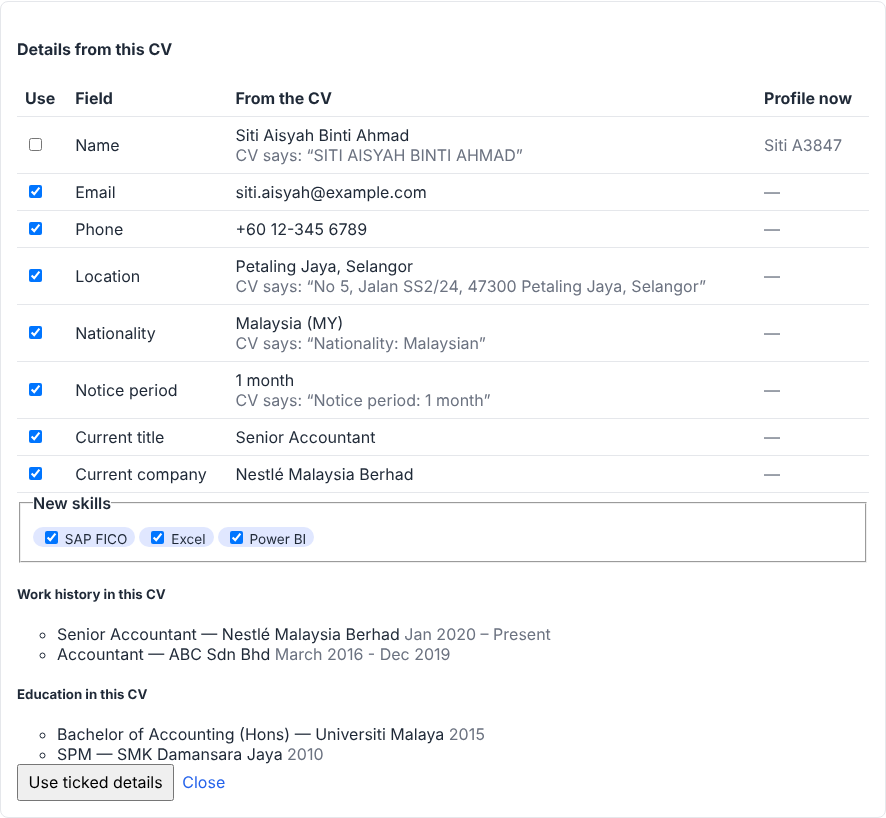

# Features: your list, mapped to the design

**Candidate workspace.** The FIFA card keeps its status colours and work-rights
stripe, with an availability dropdown, expandable plain skills and a slim inline
notice/salary ribbon. Its contact plate, on the right, has nationality and
where they live, then email, phone and LinkedIn: clicking the email or number
copies it ("Copied"). The source is under Details. Work rights are edited in the existing Work authorization
field under Details. Details opens first, followed by CV & files, Jobs, Activity,
Salary and Email; document, pipeline and email tabs follow their permissions.
Tabs load on first visit and keep forms and drafts mounted until the candidate
changes. Search highlight links open CV & files directly. **CV beside** (on the
tab row) splits the page: the details on the left and the newest CV on the right, in view while the
details scroll; remembered in the browser, off on the CV & files tab and on
narrow screens.

CV & files has one document library and one viewer: selecting a file changes its
preview and action toolbar together. Upload, compare, formatting, formatting
history, extracted-detail review, text/original view, reread and
permission-gated formatted-file deletion remain available. A PDF has no
Download button beside it (the viewer has its own); other files download from
the ⋯ menu. Compare side by
side shows two CVs next to each other in the tab itself (each with its own
picker; what their details disagree on folded underneath). One details
button: **Read details** reads a CV never read (or one that failed), turning
orange with a timer while it reads and a bar filling under it, as Format a CV
does, then green; the review opens by itself when it was asked for. **Review
details** opens the review **beside the CV** (in place of the list of files),
the CV staying in view while the review scrolls; **Read this CV again** is at
the review's foot, and reads the file's text afresh too (with the reader as it
is now: a table of jobs read row by row, a name in a Word file's header), the
old text kept should the file not read. A CV read by an older reader is read
again by itself when its review is opened (1.40.3). When the details cannot be read, the bar says so with
where the reader broke (its error type and line, never CV text), until
dismissed; asking again clears it. A formatted CV (our own output) has no
review: it is read for comparing, again from its ⋯ menu. Jobs uses the
existing stage badge and separate Move to menu, including reason/cancel/reopen,
interviews, offers, placements and stage history. Profile/history editing,
duplicate merging, privacy tools, call history and salary notes remain in their
respective tabs. The assistant remains available below the workspace and can
still be docked. Email composers reveal candidate/CV controls and extra
formatting on demand; CC/BCC, field insertion, attachments, templates, booking,
preview and validation keep their existing behavior.

A candidate can keep three formatted CVs and four non-formatted CVs. When a
category is full, upload or formatting asks which existing CV to replace.
The old CV goes to Settings → Bin only once the new CV is saved. An admin can
move any CV to the Bin from its file menu and restore a binned CV when there
is room in the same category. Word and PDF copies of a formatted CV count as
one file. Files still in the Bin are permanently removed after 30 days.

Context from your answers: **agency and in-house**, **your own team and other
companies (SaaS)**, **local first, cloud later**, and every version 1
must-have (OCR/CV parsing, careers page, email, job boards, AI matching, data
import).

Status: ✅ built in milestone 1 · 🧩 designed, scheduled (see [roadmap](roadmap.md)).

| # | Feature | Module(s) | Status |
|---|---|---|---|
| 1 | Contacts with built-in email verifier | `companies`, `contacts` | ✅ |
| 1.5 | Job ads puller | `leads` | ✅ job board feeds, careers pages, saved ads |
| 2 | Companies | `companies` | ✅ records, auto-fill from the website |
| 3 | Candidate profile fields | `candidates` | ✅ |
| 3 | JobStreet / LinkedIn / original / formatted CVs | `documents`, `cvformats` | ✅ upload, text, formatted CVs in your Word template, PDF |
| 3.5 | AI interpretation sidebar (DeepSeek) | `assistant` + AI worker | ✅ off until an AI provider is set up |
| 4 | Pipeline dashboard | `pipeline`, `reports` | ✅ board, dashboard and reports |
| 5 | Jobs and applicants ✅; interview scheduling, CV vs job match | `jobs`, `pipeline`, `interviews`, `matching` | ✅ jobs, pipeline, interviews; matching (off until an AI provider is set up) |
| 5 | Email with templates | `emails` | ✅ sending; inbox sync 🧩 4.3 |
| 5 | Notes: screening, call and interview notes | `notes` | ✅ |
| 6 | API documentation for integration | contract → `/docs` | ✅ |
| 7 | User access: view / modify / write, sensitive (salary) | `identity` + platform | ✅ roles, each company's own permissions and candidate scope per role, teams, owners |

**Version.** The top bar shows HiringPlug's version beside its name (the
`VERSION` file, raised with every update), so anyone can tell which update
their copy runs. **Ad blockers.** No class or id in the app looks like an
advert (`ad-…`, `adv-…`, `sponsor…`): blockers hide those on every site, and
once hid a job ad's text (`blockerSafeClasses.test.ts`).

## 3. Candidates

Profile fields (all in the contract, `contracts/modules/candidates.yaml`):

| Field | Notes |
|---|---|
| First and last name | Spaces tidied; full name derived |
| Email | Lower-cased; **one candidate per email** in a company: adding someone with an email another candidate has is refused, naming that candidate and who owns them with a link (unless you may not see them) |
| Status | Whether they are open to a move: **looking out**, **passive**, **not looking** or **placed** (or not set). It colours the candidate's page (light yellow, light green, pink, light purple) |
| LinkedIn profile | Their LinkedIn link, tidied to `https://www.linkedin.com/in/...` (`lnkd.in` short links kept); shown as a link on the profile. Read from a CV like Kano and CV Studio do: a `linkedin.com/in/...` (or `/pub/`, `lnkd.in`) address in the text, or one **hidden behind a link** in the file (a "LinkedIn" icon or word linking to the profile, in a PDF or Word CV) |
| Phone | Any common format in; stored internationally (`012-345 6789` → `+60123456789`, default country configurable) |
| Nationality | ISO country code (`MY`, `SG`, ...) |
| Country of residence | ISO country code; not known is shown as **NA**. Read from a CV: the country in their address, else Malaysian place names near the top (Kuala Lumpur, Selangor, KL, ...), else their phone's country code (`+65` → SG, `012-...` → MY). Unlike Kano's check, an employer's "Sdn Bhd" or an address further down the CV says nothing about where they live |
| Work authorization | `local`; `expat_eligible` with basis `rp_t` (Residence Pass-Talent), `permanent_resident`, `spouse_visa` or `other`; `requires_visa`. The basis is required exactly when the status is `expat_eligible` (checked in Go and again by the database). |
| Notice period | Value and unit (days, weeks, months); 0 means immediate |
| Industry, specialization | Shared industries/subindustries catalogue in Settings, applied to both candidates and companies. Select multiple current/historical categories in profile editing or during a screening call. Go suggests the employer’s business using saved company selections and explicit employer-name rules; ambiguous employers are chosen manually. Specialization stays a separate job-function field. See [industries.md](industries.md). |
| Skills, tags | Short labels (up to 100 skills and 50 tags, 60 characters each); spaces tidied and the same label in another case kept once. IT skills are picked from the company's IT skills list (Settings › Dropdowns); tags are typed, with labels already in use suggested. The candidate list filters by one skill and one tag (ignoring case) and shows tags next to names. |
| Specialization, certifications | Picked from the company's Specialization and Professional certifications lists (Settings › Dropdowns: add, rename, reorder, hide or remove any item; candidates keep the words they have). Up to 50 certifications of 100 characters, shown under Details. Advanced search narrows by specialization (any chosen) and certifications (every one chosen). |
| Editing in Details | Specialization, industries, IT skills and certifications are changed right in a candidate's Details (no Edit profile): a small dropdown beside each (type to find any item), × on a chip to remove, saved at once with a short "Saved". Quick changes one after another build on each other; a change by someone else meanwhile comes back as a conflict. |
| Favourites in dropdowns | Each person stars their own favourite specializations, industries, IT skills, certifications and countries (☆ in a dropdown, or **Settings › My dropdowns**). Favourites come first in that person's dropdowns only; the rest stay below and typing finds any item, so nothing is hidden or removed. Countries keep the order chosen (until some are chosen, the agency's usual countries come first; every country can be picked). |
| Current title and company, location, source | Source: the company's list (Settings), picked as **icons side by side**: JobStreet, LinkedIn, referral, careers page, direct, other, and the company's own (shown by initials) |
| **Current salary**, **expected salary** | Amount, currency (`MYR`, `SGD`, ...) and period (hour/day/month/year) per figure; expected can be a range. **Sensitive:** see [access control](access-control.md). |

**The candidate's page** opens with a banner coloured by their status (the
colour shading to white, like the company and contact cards): their
name and status, job title and company, and in the top-right corner their
nationality, where they live and the source; the status buttons; their skills;
then notice period, current and expected salary (with "+26% on current" when
the two compare; "Restricted" for roles without salary access); and the work
authorization buttons. A column down the banner's right edge is coloured by
work authorization and says which: **Local** (green), **PR** (purple),
**Spousal / RP-T** (blue: it asks which pass), **Needs pass** (red), **Not
known** (grey). A click saves at once, with the lost-update protection below.
Next to the status it says since when ("since 27 Oct 2026 · 12 days"), set
each time the status changes. **Notes and activity** come right under the
banner. **The candidate list** marks each name with a bar in its work
authorization colour (Local, PR, Spousal / RP-T, Needs pass, Not known; a
legend sits above the table) and, by default, shows role, status with since
when, notice period, current and expected salary ("Restricted" for roles
without salary access, enforced by the database), work authorization (the
pass for an expat: RP-T, Spouse visa) and email. "Columns" lets each person
choose and order their own from these and nationality, residence, location,
source, industry, tags, phone and last updated; the choice is saved for them
(`/v1/me/preferences`, readable only by them) and "Back to the default"
undoes it.

**The list tops** (Candidates, Companies, Contacts): no page title, one
search bar holding its filters (Candidates: a funnel for **Filters**, with
**Mine only** inside them, and **✦ AI**; Companies: type and category;
Contacts: role and status), the folder tabs with the view tools at their
end (Candidates: columns, table or full resume), a count line, and once
rows are chosen a dark bar: Email each separately, Add to folder, Select
all, Clear.
Rows are chosen as in a file list: click (or Ctrl/⌘+click) one, Shift+click
for every row from the last one clicked, Ctrl/⌘+A for all shown, Esc for
none, ↑/↓ to move between rows (Shift+↑/↓ chooses while moving), Space to
choose the row you are on.
CVs dropped anywhere on the Candidates page are imported; clicking "Drop
CVs anywhere to upload" picks files instead (keyboards, touch screens).
While an import is open, more CVs go on its own drop box. Typing boolean rules in the search bar (`AND`, `OR`, `NOT`,
`NEAR/n`, quotes, `word*`, `-word` or `!word`; the operators in capitals, so
"Johnson and Johnson" stays a name search, and brackets alone do not count,
so "(03) 2345 6789" stays a phone search) shows them in blue with a BOOLEAN
badge and, once typing pauses, runs a boolean search: of CVs and profiles for
candidates (their certifications too), of the name, website, industries and
subindustries (and LinkedIn's industry), city and about for companies,
of the full name, job title and email for contacts (an email's or website's
words count on their own: `majubank`; fields stay apart, so a NEAR never
runs from one into the next). A boolean that cannot be read
says what is wrong with it.

**Advanced search** (Candidates, "Filters"): a boolean search of
their CVs and profiles, as on job boards: `SAP AND (BW OR BPC) NOT
internship`, `"project manager"`, `manag*` (any ending), `SAP NEAR/3
planning` (within 3 words, either way round; NEAR alone is 5; it binds
before NOT); terms that must match together are searched within one CV or the
profile. NOT checks its operand across the profile and all readable CVs.
An exclusion inside one OR branch applies to that branch. The box shows
how it is read (operators, phrases and words left out in their colours).
Dropdowns narrow it: status, work authorization (local, PR, spousal / RP-T
/ other pass, needs pass, not known), nationality, where they live, source,
industry, IT skills (all or any of them), specialization, certifications, tags, location, notice period (at
most), expected salary (at most, RM a month; only for roles that may see
salaries, and the database enforces it), and when the profile was last
updated. What is set shows as chips to remove one by one; the search is
kept while you open candidates and come back. Each result says whether it
was found in the CV or the profile, with the lines of the CV where the
words are, marked. Opening a candidate from the results shows their CV as
text with the words marked ("4 places for ...", each word with its count
to jump to its next place, "Next place", "Stop marking"). Words are matched
in their other forms (manager, managers), as CVs are indexed; symbols are
not searchable (C++ is C, .NET is NET).

**A record's page** (candidate, company, contact, job) has its actions as a
neat row of icons above the card: for a candidate email, screening call,
reference check, edit profile; for a contact verify email, email, edit; for a
company or job, edit; and, set apart, delete. Each is named in a tooltip on
hover or keyboard focus (and for screen readers). The AI assistant is a tab
of its own on candidate and job pages.

**Each candidate's initials** sit in a disc of their status's colours
(Looking out, Passive, Placed, Not looking; grey when not set), as on their
page and in a job's pipeline; their work authorization is written under the
name in its own colour.

**Click opens: Profile | Full resume** (the switch above the results, kept
on that computer). Profile is the usual table. Full resume reads the
results without leaving the list: the results down the left (pay, notice,
"in CV", "✓ read" for those already looked at), the chosen candidate's
newest CV on the right with the search's words marked, their current and
expected pay and notice on top (pay only for roles that may see it), Prev
and Next (or the ← → keys), Open profile, + Add to job (open jobs) and
Choose to email. On a phone the list and the resume take turns ("Back to
results").

**Search by meaning** ✅ (1.40.0; the **≈ Meaning** switch in the search box,
kept on that computer): type who you need in your own words, a role
("talent acquisition", "accounts executive") or the work ("someone who hired
engineers"), and candidates are found by what they do, whatever their
titles say and whether or not their CVs use your words. A recruiter's
reading comes first: abbreviations spelt out (TA, AR/AP, HRBP), tools and
qualifications placed (S/4HANA is SAP, ACCA is accounting, HACCP is food
quality, Android is mobile, CISSP is cyber security, Snowflake is data),
every title put in its job family (about 57, covering the agency's
verticals: software, data, DevOps, cyber security, sales, marketing,
finance, operations, compliance and more), and titles
that mislead read by the work under them: an Account Executive who keeps
the books is accounting, one who sells is sales; a "Principal Consultant"
placing accountants is a recruiter. The newest title counts most, an old one
less each year (a recruiter until 2013 is still found, lower); a level is
put first only when the search names one ("senior", "manager", "executive"),
so "headhunter" finds headhunters at any level. Someone whose best title is
in another field counts less, however close the words (a salesperson is at
most a possible match for "accounts executive"); the fields a recruiter
would also look at are not (an HR generalist for talent acquisition, a
finance manager for accounts). A tool or code in the search (S/4HANA, ACCA)
counts most where a CV names it. Each candidate shows why, in a **Match**
column beside the name: **Strong**, **Good** or **Possible match**, the
title of theirs that matched with its field (and level, when the search
named one), and the part of their CV that matched (three lines, all of it
on hover; for those who may read CVs). The other filters and folders
still apply. A line above the list says how the search was read ("Searching
for accounts executive (accounting), executive level first, whatever their
titles say") and, while the company's CVs are still being read, how far it
has got. When a word search finds few, it offers to search the same words
by meaning. **Export** of a search by meaning exports its best 100, in order.
Only candidates you may see are searched (your scope, never the Bin); with up
to 2,000 to consider (a folder, filters, or a small company), every one is
compared, beyond that the nearest are found by an index and compared.

How: a small meaning model runs in the AI worker on this server (nothing is
sent anywhere, no AI provider or allowance needed). Every candidate is read
in the background once (titles, work and newest CV), then again when those
change; a search's words are read in a moment (the page waits, then ranks).
Measured on three recruiter benches of made-up candidates and the searches a
recruiter types (the third written after the rules were tuned, measured
once): right people first 0.97, 0.95 and 0.96 (NDCG@10) against 0.62, 0.66
and 0.61 for a keyword search. Without the model installed, the page says
so and offers the word search. What was read is not in backups (it is
read again after a restore); a job is never counted as their job now unless
the CV says so.

**AI candidate search** (Candidates, "AI search"; CV Studio's AI Crawler, on
the company's own candidates): drop the client's JD (PDF, Word or text; it is
read as for a new job) or paste it, and/or write a boolean; the same filters
as the advanced search narrow who may be considered. With a JD, those found
(up to 300) are ordered by how many words their CVs share with it; the first
10, 15 or 20 are sent to the AI by reference (C1, C2...) with their profile
and CV, without names, contact details or salary, and none who withdrew
consent. The AI reads what the job needs as CV Studio's Job Fit does
(responsibilities, requirements, tech stack, nice to have; not the company,
location, benefits or culture), gives each a fit from 0 to 100 (strong 75+,
possible 50-74, weak) with reasons and gaps, and writes sourcing notes, the
must-haves and nice-to-haves it read, and a boolean for the job ("Use it"
puts it in the search). "Strict must-haves" caps anyone missing one at 50.
The shortlist is best first; opening a candidate marks the boolean's words in
their CV. Searches are personal ("Earlier searches"), use the monthly AI
allowance, and one with no answer after 30 minutes shows as failed.

The web app edits every field above. Salary has its own form, shown only to
roles with `candidates.compensation:update`; viewers get no edit buttons. Edits
are protected against lost updates (`version`): a form saves with the version
it was opened with, so if someone else saved first (even if the page has
refreshed since), the form says so and offers to reload. Validation messages
appear next to the field (e.g. "Pass held" is required for an expat who can
work here); any the form cannot place are listed under it, so a failed save is
never silent. Saving without changes writes nothing. Amounts accept thousands
separators (`8,500`, `1,00,000`); a decimal comma (`8500,50`) is refused rather
than guessed. Every change is in the audit log, and search ignores case and
accents (`jose` finds `José`).

**Work history and education** ✅: jobs (title, company, from/to as month and
year or year only, current) and qualifications (name, institution, year) on
the candidate's page, newest first, edited as a whole with the same lost-update
protection as the profile; filled from a CV in one tick. Merging keeps the
kept candidate's history, or takes the duplicate's when it has none.

**Possible duplicates** ✅: a candidate's page warns about others with the
same phone number or a very similar name ("Siti Aisyah" and "Siti Aishah",
at least 60% alike ignoring case and accents). The same email is refused when
adding. **Merge** a duplicate into the candidate you keep (owners, admins and
recruiters, who can see salaries, so nothing is lost unseen): its CVs, jobs
and notes move over, empty fields are filled from it (and its salary, if the
kept candidate has none), and it is deleted, in one transaction. If both were
on the same job, the kept candidate's application stays.

**CV versions** ✅. A candidate has documents, each with a `source`: `jobstreet`,
`linkedin`, `original`, `formatted` or `other`. Each upload keeps its file, its
extracted text and any extraction warnings; files can be downloaded under their
original name. **Compare CVs side by side** (on the candidate's CV list) shows
two versions next to each other, PDFs as they look and Word files as text, with
the differences read from them on top: fields that disagree, jobs whose title
or dates changed (matched by employer), jobs and skills only one version has.
That is the check before sending a formatted CV to a client.

**CV files** ✅: CVs and job descriptions come in the files CV Studio takes:
PDF, Word (.docx and .doc), text (.txt), RTF, OpenDocument text (.odt), and
pictures of the CV (PNG, JPG, TIFF, BMP, WEBP), told by their bytes, never
their name. Text, RTF and ODT files are read at once at upload (in Go, by
their formats: accents, paragraphs and tables kept, font tables and field
codes left out); PDFs, Word files and pictures by the AI worker, scans and
pictures with OCR (Tesseract: a phone photo turned upright, a small
screenshot enlarged). RTF and ODT CVs also get a PDF copy to preview;
a picture shows as it is. A file with no readable text is refused at upload.
The file's name is a hint to the candidate's name ("TAN WEI LING CV.pdf").

**CV parsing** ✅: after a CV's text is read (with OCR for scans), the AI
worker reads the profile details out of it: name, email, phone, LinkedIn,
location, nationality, notice period, skills, work history and education.
Every value carries the exact CV text it came from, and the server keeps only
values whose quote is in the CV. A PDF CV whose work history is a table
(Organization | Role | Location | Client | Industry | Duration, cells wrapped
over several lines) is read row by row, so each job keeps its own title,
employer and dates (1.38.0); a heading naming a field of work ("IT
Experience", "Relevant Work Experience", "Oil & Gas Experience") starts the
work history, but not a job title, skill or tagline ("Head of Customer
Experience", "User Experience", "10+ Years Experience"). A sidebar beside
such a table is read as its own column, never inside the work history; a
certificates table ("Title | Issuer | Date") is not read as jobs (1.38.3). **A new CV updates the profile by itself** ✅:
once the candidate's newest CV is read, where it says they are now replaces
what the profile had (job title, current employer, industry, location), empty
fields are filled (contact details are only ever filled, never replaced; the
name is kept), new skills are added, and its work history and education are
taken when they are at least as long as the profile's (keeping the
descriptions written on the same jobs). A CV older than the
profile's work history (an old CV found later) only fills empty fields, and
reading an older CV again changes nothing. The change is audited
(`candidate.updated_from_cv`, naming the CV) and the page shows it as soon as
the CV is read. If the profile cannot be saved (someone saving it at the same
moment), the CV's details are still kept for **Review details**. On the candidate's page, **Review details
from this CV** lists each suggestion next to what the profile has now, with
the CV's wording: empty profile fields are ticked, filled ones never are, and
**Use ticked details** saves them (with the usual lost-update protection).
New skills are added to the existing ones. **Read details from this CV**
parses CVs uploaded earlier. Formatted CVs are parsed too, for comparing, but not offered for review. The CV's work
history and education are saved on the profile when ticked (ticked by default
only if the profile has none; existing history is replaced only when asked).
Design:
[ai-worker.md](ai-worker.md#cv-parsing-grounded-in-the-source).

**CV preview ✅.** The candidate's page shows their CV as it looks, near the
top: the newest CV they sent, with their other CVs to pick from. A PDF is shown
as it is; a Word file (.docx or old .doc) gets a PDF copy made by the AI worker
with LibreOffice when it is uploaded (its text shows meanwhile). Word CVs from
before this get their copy the first time the page is opened.

**Formatted CVs, CV Studio's way ✅.** "Make formatted CV" offers two ways.
**From their CV** formats one of the CVs the candidate sent with CV Studio's
own engine: the AI reads it, CV Studio's rules tidy and check it, and its
renderer lays it out in its template, in the background (a minute). One run
at a time per candidate (other candidates' CVs can be formatted meanwhile): the
button turns orange with the seconds elapsed while it runs, under it a bar
fills, and once saved the button turns green "Done" (clicking it shows the new
CV and turns it back to "Format a CV"). Once blind or not is chosen, the form
says when a formatted CV of that kind is saved already (a blind one for a blind
CV, an ordinary one otherwise) and its button reads "Format again" (1.39.0). Options: correct spelling, punctuation
and capitals (never the meaning, numbers or dates); blind (no name or contact
details, employers and schools described rather than named, optionally "the
candidate" instead of he or she); paragraphs aligned left or justified. Lines
stating the candidate's own salary are left out before the AI sees the CV. When
CV Studio's check finds something the result may have lost or changed, the
page says what, to compare before sending. It needs the AI (Settings > AI
provider) and counts in the monthly AI allowance. Its summary box carries
CV Studio's "ABOUT HIM / HER" heading. The summary is optional (one line:
"AI summary" on or off, off keeps the CV's own; a blind CV gets it too, the
blind step anonymising each point, so it reads in points like the formatted CV
rather than as the CV's own paragraph): its length (short 4-5 points,
normal 6-7, detailed 8-10), what it brings out (CV Studio's General,
Technology, Leadership or Commercial) and your own direction and tone in a
sentence or two ("confident and concise, lead with the S/4HANA migration").
Whether, the length and the focus are remembered in the browser for the next
CV; the direction is about one candidate, so it starts empty each time. The summary still sticks to the
CV and never mentions pay; a direction about the candidate's pay ("expected
salary", "current package") is refused, since pay is never sent to the AI
(work that only sounds like pay, "compensation and benefits design", is fine). **From their profile** is
the template way below. Either way the file is named after the agency as CV
Studio names it, "Hyppies CV - Siti Aisyah.docx": the agency's name is in
Settings > General (Agency). A blind CV's bullets keep the indents of the
bullets they were made from, even where blinding changed their words.
**Downloading** a formatted CV (the download button above the CV) saves the
Word file under its own name; the preview of a Word file is a PDF copy and
hides the viewer's own download, which would save the copy under a made-up name.

**Formatting several CVs at once ✅ (1.38.0)**: choose candidates on a job's
pipeline (or rows on the candidate list) and press **Format CVs** in the bar
that appears (on the pipeline the bar's actions are icons with a tip on hover:
email the client, email each candidate, client link, format CVs): up to 20 at a time, with the same options as one CV (blind,
"the candidate", spelling, alignment, the AI summary with its length, focus
and direction). Each candidate's newest CV they sent (PDF or Word; their CV
before other files) is formatted CV Studio's way, exactly as if started on
their own page, in the background; each new formatted CV appears on the
candidate's page when ready. Anyone who cannot be formatted now is listed
afterwards with the reason and a link to their page: no PDF or Word CV, one
being formatted already, as many formatted CVs as they can keep (format theirs
on their page to choose one to replace), or not one you may see. With no AI
set up, nothing starts and the form says so. `POST /v1/studio-cvs/batch`.

**Deleting a formatted CV ✅**: its "..." menu has "Delete this formatted CV"
(after a confirmation; `documents:delete`, recruiters and up). Its Word file
and PDF copy are removed and the deletion is in the audit log. Only CVs
HiringPlug made can be deleted: the candidate's own files are always kept.

**Formatted CVs ✅.** "Make formatted CV" (candidate page, CVs and documents)
fills the candidate's profile, work history and education into a Word
template and saves it as their `formatted` CV (read and compared with the
original like any formatted CV); a PDF follows a moment later (made by the AI
worker with LibreOffice). Options: which template, which of their jobs it is
for (its title and client appear), show email and phone (off by default, so
the client goes through you), include current and expected salary (only for
those who may see salary; never written to the audit log), and your summary.
Templates are ordinary Word files with `{{placeholders}}`: download the
built-in standard template from the **CV templates** page, restyle it in Word
(logo, fonts, layout), and upload it; a template using unknown placeholders is
refused, naming them. Paragraphs between `{{#experience}}` and
`{{/experience}}` repeat for each job (likewise education), `{{#experience?}}`
keeps a heading only when there is something under it, and a line whose
placeholders are all empty is left out.

**Blind CVs ✅.** The "Blind CV" option shows a reference (e.g. "Candidate
C-4F2K9Q", also `{{candidate.reference}}` in any template) instead of the
name, leaves out email, phone, nationality and work authorization, and takes
the candidate's names, email addresses, phone numbers and profile links out
of every other text (job descriptions, your summary), while keeping years and
amounts. Before saving, the finished file (every part, headers and footers
too) is checked for the name, email or phone: if one is still there, usually
written in a template's own text, nothing is saved and you are told what
kind of detail it was. The file name carries the reference, not the name.
Employers, clients and their branded products are masked as whole names
(Digi, Digi Prepaid, DigiPrepaid, Maybank2u), never inside an ordinary word:
"Digital" stays "Digital" (CV Studio masked it as "[Company]tal"), even when
the AI reworded the rest of the line. Only an ordinary English word is given
back this way: a brand built on the name ("MyDigi", "Shopeepay") stays
masked (1.38.3).
A CV Studio blind CV keeps what CV Studio's rules made of the formatted one
(1.38.0): the job titles, dates and last position as formatted (unless one
names an employer), the sub-headings inside a job (not turned into bullets),
and one entry per employer: two employers both shown as "[Company]" are never
joined into one. The AI is also told to keep the structure exactly and to use
"[Company]" only for an organisation or brand, never ordinary words or tax
terms (GST, TDS, TCS).

## 3.5 AI assistant sidebar ✅ (off until an AI provider is set up)

A panel on candidate and job pages (on a candidate's page its own tab,
**AI assistant**, beside Email; docked, it stays on the right whatever tab is
open): **Summary**, **Gaps and red flags** (on a job's page **Gaps to ask the client**: the AI is told it is reading a job, not a candidate), and your own questions. On a candidate's page, "About" switches to one of their
jobs for **Fit for this job** ("how well does this candidate fit?").
Answers come back in a few seconds and are kept, newest first; each person
sees only their own. Each answer is a card; long ones past the newest are
folded (**Show all**). **Dock right** moves the assistant to a panel on the
right of the screen that stays put while you scroll (the page makes room for
it; drag its edge to make it wider or narrower), **–** tucks it away as a tab
on the right edge, and **Back in the page** returns it. The choice and width
are remembered on that browser, on every page with the assistant (on a phone
the panel takes the whole width).

- **It sees only what you may see.** Go gathers the context with the asking
  user's permissions: the profile, work history, education and the newest
  CV's text (with `documents:read`), the job and its description. A record you
  cannot see is "not found" to the assistant too.
- **Never names, contact details or salary.** The candidate's name, emails,
  phone numbers and profile links are taken out of every text
  (`platform/redact`, shared with blind CVs); recorded salaries are never
  read; salary figures written in a CV or job description ("Expected salary:
  RM 5,000") are cut out (`redact.WithoutSalary`). The question you type is
  cleaned the same way, and every amount of money in it taken out
  (`redact.WithoutMoney`); you still see it as you wrote it. Nationality is
  left out as well: the right to work says what matters for a job.
- **The prompts** (in `ai/src/hiringplug_ai/jobs/assistant_ask.py`) tell the
  model to answer only from the data, say when something is missing, never
  judge or guess race, religion, age, gender, marital status, health or
  nationality, and to ignore instructions written inside a CV.
- **Provider.** Chosen per company in **Settings > AI provider** (owners and
  admins, `aiproviders:manage`): DeepSeek, Claude (Anthropic), ChatGPT
  (OpenAI) or Qwen (Alibaba Cloud Model Studio) with the company's own API
  key and model, the server's own
  provider, or off. Each provider keeps its key and model, so switching back
  and forth needs no retyping; saving a key sends the provider a tiny request
  and shows whether it works (key refused, no credit, unknown model...). Keys
  are sealed (AES-256-GCM, `HP_AI_KEYS_SECRET`) when saved, never shown again
  (only the last four characters), never logged or audited, and opened only by
  the AI worker. The calls follow CV Studio's provider layer: Claude and
  DeepSeek through the Messages API (DeepSeek's Anthropic-compatible endpoint,
  thinking off), ChatGPT through the Responses API, Qwen through Model
  Studio's OpenAI-compatible chat API (the international endpoint in
  Singapore, thinking off; keys from its international console); a request is sent again
  only on 429/529 (the provider did no work), never after an error that might
  have billed. The server's own provider (`HP_AI_PROVIDER`,
  `HP_AI_PROVIDER_URL`, `HP_AI_PROVIDER_KEY`, `HP_AI_MODEL`: any
  OpenAI-compatible chat API, e.g. a host running DeepSeek's open model in a
  region you choose) serves companies that chose none. Data location matters
  under Malaysia's PDPA: DeepSeek's own API stores data in China.
- **Costs.** Tokens are recorded per answer in the AI use ledger (see
  [AI usage and its limit](#ai-usage-and-its-limit)); every AI feature counts
  against one monthly limit per company, shown in the panel as a percentage.
  Once used, asking is refused (`ASSISTANT_LIMIT_REACHED`) until the 1st.
- **Flow.** Browser → Go API (permission check, context, allowance) → job
  queue → Python AI worker → provider → result job → Go saves it; the page
  polls while an answer is on its way. Questions and answers are never logged.
- **Later:** streaming answers, notes in the context (with the sensitive-notes
  permission).

### AI usage and its limit

Built in 1.44.0.

- **One ledger.** Every AI run (assistant answers and emails, fit scores, AI
  candidate searches, CV readings, formatted CVs, blind ads, JD readings,
  industry picks, interview prep, provider key checks) adds a row to `ai_use`:
  the feature, who asked (none for automatic work), the record it was for, and
  its input and output tokens. The ledger is append-only: deleting the record
  (Bin purge, a JD file deleted, answers forgotten) leaves the use counted. A
  result delivered twice counts once (each run has its own key); a new run of
  the same record (a CV read again, a fit score refreshed) counts again. A use
  counts in the month the AI did the work (agency time, `HP_TIME_ZONE`).
- **The limit.** Each company has one monthly limit for every AI feature
  together: in tokens (`HP_AI_MONTHLY_TOKENS` is the default for a company that
  set none) or in money at its own prices per million input and output tokens.
  Owners and admins (`aiusage:manage`) set it with `PUT /v1/ai-usage/settings`.
  Once it is reached, AI work is refused until the 1st (the assistant and fit
  scores answer `*_LIMIT_REACHED`, CVs are read by the rules alone); AI work
  already on its way finishes.
- **Warnings.** When the month's use reaches the company's warning percent
  (80% by default) and again at 100%, those who may see the company's AI use
  (`aiusage:read`) get a bell item (`ai_limit`, can be turned off) and a line in
  the morning email; each is audited once (`ai_usage.warning_reached`,
  `ai_usage.limit_reached`: the percent and month only). Changing the limit
  checks again: a limit set below this month's use is announced at once, and a
  raised one takes the notice away (reaching the new limit is announced again).
  Everyone sees a banner while the limit is reached (`GET /v1/ai-usage/status`).
- **Costs.** `GET /v1/ai-usage` gives the month by feature and by person and
  the last months. Costs are estimates from the company's current prices; the
  provider's bill is final. History before 1.44.0 was copied into the ledger
  from each feature's own records.
- **The page: Settings › AI usage** (`#/settings/ai-usage`, `aiusage:read`).
  This month on top: the cost against a money limit (or the tokens against a
  token limit), the tokens and uses beside it, a meter with the warning mark,
  and when the limit starts again. Beside it the limit and prices: a form for
  `aiusage:manage` (tokens or money, warning percent, currency, price per
  million tokens in and out, "Use the server default"), the values for those
  who only read them. Then this month by feature and by person (what the
  system did on its own is "Automatic"), and the last 12 months as bars with
  the limit as a line: clicking a month lists its features. Money is shown
  exactly as the API sends it (decimal strings, never rounded in the browser).

### AI help in the email windows ✅

Every email window (to a candidate, a client contact, or many at once) has
**✦ AI**, while the assistant is on, for those who may use it:

- **Write it for me**: say what the email should say ("invite her to a
  second interview on Thursday afternoon"); the AI writes the subject and
  message, told the job and client when the email is about one.
- **Improve my draft**: check grammar, rewrite, friendlier, more formal, or
  shorter, with an optional note ("keep it under 100 words").
- **Reply to their email**: paste the email they sent (and, if you like, how
  to answer); the AI drafts the reply.

What it writes is shown first; **Use this** puts it in the email (to edit
and send as usual), **Discard** drops it. Before anything goes to the AI, the
browser swaps names, email addresses, phone numbers, amounts (pay included),
links and fields for placeholders, and puts them back, exactly as they were,
in what comes back; the server also takes out salary lines. What was sent is
not kept. It uses the company's monthly AI allowance, like the assistant.

## 3.6 CV vs job match ✅ (off until an AI provider is set up)

A fit score for a candidate on a job, with its reasons, so a recruiter can see
at a glance who meets the job and check why. On a job's board, **Score
candidates' fit** scores every active candidate not scored yet (**Score all
again** after the job or a CV changed; at most 100 at a time; candidates
without a CV with readable text are counted and left out). Each card then
shows **Fit 72%**; clicking it opens the reasons above the board, and **Best
fit first** orders each column by score. A candidate's page shows the score
for each of their jobs, with **Score fit** / **Score again**.

- **Reasons quote both texts.** The AI lists the job's main requirements
  (skills, experience, qualifications, languages, tools), each copied from the
  job's description or its ad, a verdict for each (meets, partly, not in the
  CV) and the words of the CV that show it. Go checks every quote with the
  same check CV parsing uses (`platform/quote`: ignoring case, spacing, curly
  quotes and dashes): a requirement that is not in the job's text is left out
  (and counted), and a "meets" or "partly" without a quote from the CV counts
  as not shown, with a note saying so. An invented quote can never raise a
  score.
- **The score is worked out, not asked for:** met counts in full, partly as
  half, of the requirements that passed (at most 15). Strong from 75%,
  partial from 50%. It suggests; the recruiter decides.
- **Fit stats, CV Studio's CV scoring:** with the score, the AI rates the CV
  0-100 on CV Studio's six dimensions (technical / functional skills,
  experience level, industry / domain background, education &
  qualifications, leadership & communication, keyword & requirement match),
  each with a one-sentence note, shown as coloured bars (green from 70, amber
  from 45), and lists up to five **strengths** and **gaps to ask about**
  (the AI notes). The **recommendation** follows CV Studio's thresholds but
  from the worked-out score: shortlist from 70, consider from 45, pass below.
  The ratings and notes are marked as the AI's opinion; Go keeps each known
  rating once, holds it to 0-100, and drops anything else.
- **Never who a person is.** Requirements about age, gender, race, religion,
  marital status or nationality ("Malaysians only", "aged below 35") are never
  scored, whatever the ad says; the prompt also tells the model not to consider
  them. The right to work is on the profile for the recruiter to check.
- **Never names, contact details or salary.** As for the assistant: the CV's
  text has the candidate's name, emails, phones and links taken out, salary
  figures are cut from the CV, the description and the ad, and recorded
  salaries are never read. What was sent is kept only until the answer is
  checked, then cleared; the audit log records the score and counts, never
  quotes.
- **Who sees it.** `matching:read` (everyone who may see the pipeline) sees
  scores and reasons; the CV quotes need `documents:read` too.
  `matching:create` (owners, admins, recruiters, sourcers) asks for scores,
  which uses the company's AI allowance, shared with the assistant
  (`MATCHING_LIMIT_REACHED` once used).
- **Flow.** Browser → Go API (permissions, texts, allowance) → `match.score` on
  the job queue → Python AI worker (`jobs/match_score.py`) → provider →
  `match.scored` → Go checks the quotes, works out the score and saves it; the
  page polls while scores are on their way.
- **Scored without being asked** while an AI provider is set up: when someone
  is put on a job or applies (as soon as their CV has text), and again when a
  new CV of theirs is read. Not those who withdrew consent (asking is refused
  too, `MATCH_CONSENT_WITHDRAWN`), and nothing once the month's allowance is
  used.
- **Outdated scores**: once the job's description or ad changes, its scores
  say "outdated"; **Score** (beside the pipeline's order menu) asks again for
  them and for anyone not scored yet; with people chosen it reads **Score N**
  and scores those again.
- **The job's pipeline toolbar**: Steps and Board as tabs beside the title;
  Add a candidate on the left; the order (longest waiting, or best fit once
  anyone is scored) and Score on the right. People are chosen by clicking
  them, their name included (a double-click, Enter or Ctrl/Cmd-click opens
  their profile); a board column's count chooses its stage, and in Steps
  "Choose all N" chooses those shown.
- **Possible candidates** on each job's page (folded under the pipeline): first
  those whose work matches the job **by meaning** (its title and the needs its
  description lists, read as in Search by meaning; each with why, the job's
  words in their CV counted too), then people whose CVs
  best match the job's distinctive terms (a keyword search of CVs, not the
  AI, so it works without one), except those the meaning search read and
  turned down (a procurement "Strategic Sourcing Manager" shares words with a
  talent sourcing job, not its work): the words every job description uses
  (experience, proven, within, advanced, skills, strong, team...), headings
  and place names are left out; the title, acronyms (ACCA, SAP) and the
  description's two-word terms count most, and each term counts less the more
  of the company's CVs have it. A CV needs two terms, or one strong one (a
  word of the title's field, an acronym, a two-word term): a role or
  seniority word alone (manager, senior, executive) is never enough; best first, with where their CV has
  those words. Those who withdrew consent, and those the user may not see, are
  left out. **Add to job** puts them on it (and scores them). A job with no
  description or ad yet asks for one instead.

## 1, 2. Companies and contacts

- **Companies** ✅: clients and prospects (agency) or your own organisation's
  departments (in-house): name, type, website, industry, size, phone, address,
  city, country, registration number (e.g. SSM) and notes. Search by name or
  website (ignoring case and accents), filter by type. Names are unique per
  company (`Nestlé Malaysia` and `nestle malaysia` are the same), and edits use
  the same lost-update protection as candidates.
- **Duplicate companies and contacts** ✅ (1.32.0): a company's page warns
  about possible duplicates (the same website or LinkedIn page, or the same
  name without Sdn Bhd, Berhad and the like, or a name much alike); a
  contact's about the same LinkedIn profile, the same name in any order
  (titles such as Dato' aside), the same mobile (an office line is shared by
  colleagues), or a name much alike at the same company. **Merge into this one** (companies:merge, contacts:merge:
  owners, admins, recruiters) moves everything to the record kept: a
  company's contacts, jobs, notes, documents, leads, automations, industries
  and folder places (its terms and benefits only if the kept one has none); a
  contact's emails and Outlook threads, jobs, invoices, notes, folder places
  and checks. Empty fields are filled from the duplicate (a contact's notes
  are joined), the duplicate is deleted, and both records' activity says so.
  Contacts at two companies are not merged (they may have changed jobs).
  Everything moves, also what the person merging cannot see (records in the
  Bin, sensitive notes, colleagues' Outlook threads and Apollo lookups),
  without being shown to them. A website on a shared host (facebook.com/…,
  linktr.ee/…) counts as its page, not the host.
  **Possible duplicates** beside each list's search shows every group across
  the agency.
- **Notifications** ✅ (1.33.0): a bell in the top bar lists what needs you,
  newest first, with a red count of what is new since you last opened it: new
  applicants on jobs you own (careers page, job boards, referrals; the last 7
  days), your tasks due today or overdue, offers waiting for your approval
  (offers:approve; never your own request) and your interviews today and
  tomorrow (on the panel or arranged by you). Each opens the candidate (or the
  dashboard). Nothing is copied: the list is worked out from the records as
  you, so it shows only what you may see, and never a salary. **Settings ›
  Your account › Notifications** has a switch for each kind and for the
  **morning email**: at 8:00 agency time (HP_TIME_ZONE) the same list by
  email, only on mornings when there is something (applicants since the last
  email). It goes on while you are away and comes back with you. A CV you had
  formatted CV Studio's way is said the moment it is ready (or could not be
  made), by the candidate's name, for two days: the bell lights **green** with
  the count (1.39.0; bell only, not the morning email). The bell and the CV
  imports icon are marked while open, and close by themselves after 30 seconds.
- **Exports and Excel import** ✅ (1.34.0): **Export** (Excel .xlsx or CSV)
  on Candidates, Companies, Contacts, Jobs, Placements and Reports gives what
  the page's search and filters find (candidates: the advanced search too),
  at most 10,000 rows (on Jobs and Placements, the rows the page shows after
  its filters). The server builds the file, so salaries are in it only
  for roles that may see them (candidates.compensation:read; placement
  salaries and fees with placements.fees:read); exporting needs its own
  permission (candidates:export, companies:export, contacts:export and
  placements:export: owners and admins by default; jobs:export: recruiters too);
  every list export is in the audit log, against the person (how many, never a salary); reports, which are counts and totals, are not. Text that
  would start a formula is written as text (phone numbers are left as they are); dates are the agency's, and list keys are shown as Settings' words. Reports come one sheet each.
  **Import** reads Excel (.xlsx, its first sheet; dates as dates) as well as
  CSV; an old .xls is asked to be saved as .xlsx.
- **In-app help and a getting-started checklist** ✅ (1.37.0): the **?** in
  the top bar opens **Help** (`#/help`, also found by Settings' search): short
  topics in plain words on adding and importing candidates (CVs, LinkedIn
  PDFs, CSV and Excel), searching (quick, boolean, advanced, AI), jobs and the
  pipeline, interviews and the calendar, offers, placements and invoices,
  email and templates, WhatsApp, folders, duplicates, notifications, exports,
  reports, AI, automations, claims, leads, your account, and settings, team
  and roles. A search box finds topics by any of their words (every word
  must match; accents and words like "how" and "to" ignored), showing the
  sentence that matched; the search stays in the address so Back returns to
  it. Each topic links to the screens it describes. Topics, their parts and
  their links follow the person's permissions (a viewer reads nothing about
  exporting, and no link opens a page they would not be shown). The topics
  are a typed data file in the web app (`web/src/help/`), versioned with it.
  **Getting started** on the Dashboard, for a new company: add your company's
  details (Settings › Invoicing), invite your team, connect your email, add
  your first job, import candidates and set up the AI provider, each with a
  button to its screen, only the steps the person's role can do. Each ticks
  itself from the records (the invoice template saved, more than one person
  on the team, a mailbox connected, a job, a candidate, an AI provider on); it
  disappears once all are done, so an agency already set up never sees it.
  **Hide checklist** hides it for that person (`guideDismissed` in
  `/v1/me/preferences`); "Show the getting-started checklist" at the foot of
  Help brings it back. On laptop widths (701 to 1500px) Settings in the top
  bar is its gear alone (named for screen readers and in a tooltip) and the
  page links sit closer, so More fits on a 1366px screen.
- **Benefits & pre-offer process** ✅: on a client's page, under its details,
  what it offers and what it checks before an offer, recorded from the
  agency's template (Hyppies' Benefits & Pre-Offer Process to start with:
  annual and other leave, medical and insurance, work mode,
  working hours, dental and optical, fixed, performance and other bonuses,
  commission, special benefits; then reference and background checks,
  health screening, payslips, NRIC/passport, education certificate and
  anything else). A client's grades (Executive, Manager...) are set at the
  top of the form (so the template has no "Job grade/level" item; one an
  agency saved stays retired, still shown where a company wrote in it); a benefit that differs by grade has a value per grade, shown as
  chips (a grade chosen at the top shows only its values), and the Word/PDF
  has a column per grade. Filled in as one form, each item with a value and remarks
  and a hint saying what to write; each pre-offer step Yes, No or Not known
  with remarks. It reads as cards, says which items are not recorded yet,
  and downloads as Word or PDF in two tables. The template is in Settings,
  General (Company benefits template): rename, reorder, hide or add items and
  change their hints; an item taken out keeps what was recorded for it. The
  audit log says which items changed, not what they say.
- **Terms and benefits documents** ✅: under a client's terms of business
  and under its benefits, drop or choose files to keep there (the signed
  terms, a benefits brochure: PDF, Word, text or a picture), each with who
  added it and when, to download. Anyone who may edit companies can add
  them; deleting is a permission of its own (`companies.documents:delete`,
  owners and admins to start with), which an owner can give to any role in
  Settings, Roles and access.
- **Company categories and card** ✅: each company is in a category
  (Signed client, Prospective client, Unknown, VIP client to start with),
  set from Settings, Dropdowns & categories, Company categories: rename them, add your
  own and choose each one's colour. A company's page opens with a card in
  its category's colour (like a candidate's): its name, category (also
  down its right edge), type and industry, where it is based, size and
  website; one click on a category changes it; and its fee (a range when
  it depends on the salary), guarantee and payment terms and open jobs, and,
  for those who may see fees, its **billing**: the fees of placements on all
  its jobs that stood (not fallen through or cancelled), this year and all
  time in the agency's time zone (`GET /v1/companies/{id}/billing`; only the
  applications ever placed on its jobs are looked at). Below the card, tabs
  as on a candidate's page: Details, Terms & benefits, Jobs, Contacts,
  Activity; each fact is shown once. While the edit form is open the card is
  read-only, so a click there never makes the form's save stale.
  The company list shows each one's category as a coloured chip and can be
  filtered by it.
- **Adding a company from its addresses** ✅: on "Add company", typing its
  LinkedIn page or website fills in a name guessed from the address (e.g.
  "linkedin.com/company/maju-foods" → "Maju Foods"; typing a name takes
  over). Saving with a website reads it at once (below): what it says fills
  the details left empty (phone, address, city, country, size, registration
  number, description) and replaces a guessed name with the company's own;
  what was typed stays, and differences are suggestions. The server never
  reads LinkedIn; with the HiringPlug LinkedIn companion in the recruiter's
  browser, **Fill in from LinkedIn** reads the company's About page there
  (name, size, website, overview; CV Studio's access rules stop it at any
  sign-in, check or restriction). LinkedIn's industry is kept only as a hint.
- **AI industry pick** ✅: a new company without an industry is given the
  closest of the agency's industries or subindustries (Settings, Industries),
  picked by the AI from its name, website, what it says of itself (its
  website or LinkedIn overview, read first when there is a website) and
  LinkedIn's industry as a hint. The AI answers with a number from the
  list, so it never invents an industry; a company whose industry was chosen
  keeps it, and anyone may change the one picked. Its tokens count towards
  the monthly AI allowance.
- **Auto-fill from the website** ✅: "Fill in from website" on a company's
  page queues a job that reads its home page and its contact page (a link
  with "contact" or "hubungi"), only where robots.txt allows, through the
  same guarded HTTP client as webhooks (no private addresses in production,
  size and time limits). It reads schema.org Organization data (legal name,
  phone, address with postcode, city, country, number of employees as a size,
  description), the page's own description, `tel:` links, and a Malaysian
  registration number (labelled, or in brackets after "Sdn Bhd"/"Berhad").
  Details already recorded the same way are left out. Each one is a
  **suggestion with its source**, shown next to the current value; a person
  accepts it (the company is changed by the usual rules and the audit entry
  names the source) or dismisses it. Reading again replaces the suggestions
  still waiting. Why a reading failed (site down, robots.txt) is shown. Later:
  AI extraction from the page text (with 5.3), data providers (Apollo, Google
  Places) and the business registry, as more sources of suggestions.
- **Contacts** ✅: people at companies (hiring managers, HR) with job title,
  email, office phone, mobile, LinkedIn, status (works there / has left) and
  notes; listed on their company's page. Each has a **role** (Hiring manager,
  HR to start with; Settings, Dropdowns & categories, Contact roles: rename them, add your
  own and choose each one's colour). A contact's page opens with a card in
  their role's colour (like a candidate's): name, whether they still work
  there (one click to mark them as having left), job title and company, the
  role down its right edge (one click on a role changes it), and email,
  mobile and office phone; below it, tabs (Details, Employment check, Email,
  Activity). The contact list shows each one's role and status as chips,
  filters by role (or "role not set") and status, and pages with "Show
  more". A role must be one of the list's (hidden ones count); a role or a
  company category still in use can be hidden but not removed in Settings.
  The **email check** runs whenever an
  email is added or changed: the format, whether the domain receives mail (its
  MX records, looked up with a 3-second limit outside any database
  transaction), and shared (`hr@`) or disposable addresses. The result is
  **valid**, **risky**, **invalid** or **unknown** (lookup failed: "Check
  again"), with the reasons in words.
- **Email verifier** ✅ (CV Studio's, in Go: `platform/mailcheck`): **Verify
  email** on a contact, **Verify emails** on a company's contacts. In the
  background (`contact.check_mailbox`) it asks the contact's mail server, on
  port 25, whether it takes mail for the address and for a made-up one beside
  it; no email is sent (never DATA, AUTH, VRFY or EXPN). Only public addresses
  are contacted, with verified TLS when offered, bounded replies and 25
  seconds per check, two at a time and one per domain. Results: **mailbox
  exists** (and a made-up one is refused: delivery is still not guaranteed),
  **accepts any address** (catch-all: a caution, not a verdict), **bounces**
  (the server says the mailbox does not exist, 5.1.1, or Microsoft 365's
  directory rejection on a Microsoft 365 server; or the domain takes no mail)
  and **not confirmed** (the server restricts checks, greylists, is full or
  unreachable: never counted as invalid). A busy server is asked again once,
  two minutes later, comparing the domain's servers, about the same made-up
  mailbox (kept 4 hours). Contacts whose email bounces are marked in red in the
  company's contacts, with a count. Servers often block port 25 from homes
  and clouds: then every answer is "not confirmed", never a wrong "bounces".
- **Employment check on LinkedIn** ✅ (CV Studio's, with the **HiringPlug
  LinkedIn companion**, `extension/linkedin-companion`; each person downloads
  it from **Settings › LinkedIn companion**, which shows the install steps and
  whether this browser is connected; the zip is built with the web app, so it
  always matches it; from 1.4.0 it **updates itself**: **Update the
  companion** there, when a newer one is ready, writes the new version into
  its folder, chosen once, and restarts it, with no download): **Check employment on
  LinkedIn** on a company's contacts (or **Check on LinkedIn now** on one
  contact). The companion, a browser extension connected to this HiringPlug
  only, reads each contact's LinkedIn profile in the recruiter's own browser
  (with their LinkedIn sign-in; the server never reads LinkedIn), in a
  background tab it closes afterwards, unless the recruiter looked at it. It
  takes the dates of their time at the company's exact LinkedIn page (by its
  link and LinkedIn's number for the company, never by a similar name or job
  title), as precise as shown: still there since 2021-06, left in 2025-08, or
  unclear (collapsed, missing or ambiguous roles). The server makes each check
  (bound to the contact, their profile and the company's page; answered only
  by whoever asked, within 15 minutes) and checks the dates make sense. A
  contact whose time there ended, with no current role there, becomes **has
  left** (audited; change it back with Edit); unclear changes nothing. The
  company's contacts show what LinkedIn showed under each status. A role
  typed in on LinkedIn (linked to no company page, shown with a grey logo)
  matches by the company's exact name, in HiringPlug or on its LinkedIn page
  (case, punctuation and legal suffixes such as Sdn Bhd aside; never a similar
  name): the result says "matched by the company's name" and never marks the
  contact as left (mark them yourself with Edit if right). When their
  Experience has loaded and no role is at the company's page or name, the
  check says so instead of waiting for it; when LinkedIn never finishes, it
  names what it did not show (the Experience section, the roles, or the dates
  at the company) (companion 1.5.0).
- **Follow leavers** ✅: when LinkedIn shows a contact has left, the companion
  also reads their current roles elsewhere (up to three: company, LinkedIn
  page, title, since when). The contact shows **Now at ...** with **Add at
  ...**. The company here with the same LinkedIn page is certain, so they are
  added there at once; otherwise the companies whose names match are offered
  (the same name, legal suffixes such as Sdn Bhd aside, first), with **None of
  these: create ...**, and with no match it asks before creating the company.
  The one chosen gets the LinkedIn page if it had none, so the next move is
  found by it. The person is added there as a new contact (their old address
  is not copied: one is guessed from their new colleagues' and verified) and a
  lead note is written on the company; the old record is marked as having
  left, so nothing is sent there any more. The same **Add at ...** follows the
  current job read from a LinkedIn profile PDF (Employment check). The old
  company's open jobs that had them as contact are listed as needing a new
  contact.
- **Fresh contact data** ✅: a new or changed email is verified at once; a
  verified address is checked again every month while the contact works
  there (not if nothing changed it sooner, nor for someone who left). The
  company's LinkedIn check only checks contacts due (never checked, or 90 days
  since), with "Check them again too". Contact lists show how long ago each
  address was checked.
- **Emails that would not arrive** ✅: the composer warns about recipients who
  left or whose mailbox is gone (`POST /v1/contacts/address-check`).
  Automations do not send to them (`EMAIL_UNDELIVERABLE`): the run is skipped
  and the recruiter gets a task to update the company's contact for the job.
- **Email suggestion** ✅: for a contact without an email, the address their
  colleagues' addresses suggest (first.last@, flast@, first@ ... at the
  company's main domain; at least two colleagues agreeing, no tie), with
  **Use and verify**. A guess, until verified.
- **Real bounces** ✅: after an email goes through a connected **Microsoft
  365** mailbox, its inbox is read 15 minutes and 2 hours later
  (`email.bounce_scan`) for bounce notices ("Undeliverable: ...") naming one
  of the recipients exactly. The email shows **Bounced** and from whom; that
  contact's mailbox is marked as gone (and stays so through monthly
  re-checks). Notices are not kept. Gmail (connected to send only: reading
  needs Google's restricted scope and review) and SMTP mailboxes are not read.
- **Employment check** ✅: whether a contact still works at their company.
  LinkedIn cannot be read automatically (it refuses automated access), so a
  person drops the contact's LinkedIn profile saved as PDF (More > Save to PDF)
  on the contact's page. The AI worker reads its text and jobs with the CV
  rules (no AI, `contact.read_linkedin`); the jobs are kept, the PDF deleted.
  The current job is compared with the contact's company, ignoring "Sdn Bhd",
  "Berhad", "(M)" and the like: **still at** the company, **no longer at** it
  (with where they are now and since when), or **no current job**. A profile
  whose name, or LinkedIn address, is not the contact's is flagged as perhaps
  someone else's; a missing LinkedIn address is filled in from it. The
  comparison is made when shown, so it follows the contact's company.

## 1.5 Job ads puller ✅

Finds companies that are hiring, as business development leads (the
**Leads** page, under More in the top bar; owners, admins, recruiters and
sourcers). Like the other lists, its filters and buttons sit beside the
title: **Sources** opens the sources, **+ Save a lead** an ad found elsewhere.

**Legal note:** automatically scraping LinkedIn or JobStreet breaks their terms
of use, and LinkedIn takes scrapers to court. The puller only uses sources that
are allowed:

1. **Public job board feeds** that companies publish for their own sites:
   Greenhouse, Lever, Ashby and SmartRecruiters (enter the board name, or
   paste the board's address).
2. **Careers pages** whose jobs carry schema.org JobPosting markup (the markup
   companies add for Google for Jobs). The site's robots.txt is respected
   (`HiringPlugBot`), and a page without markup is reported, not guessed at.
3. **Ads saved by hand**, from anywhere (LinkedIn, JobStreet, a newspaper):
   company, job, where, the ad's address and notes.

Sources are checked when added and then every day (or "Check now"). Each
opening becomes a lead with its company, title, location, link and posting
date; one listed again is updated, and one no longer listed is marked closed
(and reopened if it comes back). Each source shows its open openings, when it
was last checked and why a check failed. Leads are filtered by status (new,
contacted, became a client, ignored), still listed or closed, and words, and
can be linked to a company record. Fetches never reach the server's own or
private networks. Next: licensed job-data providers.

**Find HR for a lead** ✅ (1.41.0): each lead has a **Find HR** button
(for those who may read companies and contacts) that opens a panel beside the
list, so you can work down the leads without leaving the page. A lead not yet
linked asks first which company it is: those in HiringPlug with the same name
(legal form, case and accents aside: "MAJU FOODS BERHAD" is "Maju Foods Bhd")
or a much alike one are offered, up to five; **This one** links the lead.
Otherwise **Add it as a new company**: its name, and its LinkedIn page, which
**Find on LinkedIn** looks up by the name in your own browser (the LinkedIn
companion 1.6.0 or later; or paste the page). A page already on another
company is not added twice: the panel offers to link that company instead.
Adding needs permission to add companies, linking to manage leads. Then the
company's own **Find HR** runs in the panel (a linked company without a
LinkedIn page asks for it first). Closing the panel stops a scan still
running.

## 4, 5. Jobs, pipeline, interviews, matching

- **Jobs** ✅: job orders for clients (agency) or requisitions (in-house):
  company, hiring contact (must work at that company), title, status (open,
  on hold, filled, closed), location and country, work type, on site / hybrid /
  remote, openings, description and the **official intake date** (today
  unless chosen), listed on the company's page. The status is a coloured
  dropdown next to the job's title, for those who may edit jobs. The **salary
  budget** follows the salary pattern: its own permissions (hiring managers
  may see it, sourcers and viewers may not), its own table that the database
  refuses to others, and no amounts in the audit log. Job ads (the advertised
  text) come in Phase 3.
- **A job from the client's JD** ✅: drop the client's job description (PDF,
  Word or text) on the Add job form, or on a job's ads to write an ad; the
  title, the hiring company, location, country, work type and arrangement, how
  many are wanted and the description are read from it into the form (fields
  already typed are kept), to check and save. The company is chosen when one
  on record has its name ("Maju Foods Bhd" for "MAJU FOODS BERHAD"); otherwise
  the form names it, to choose or add. The rules read labelled lines
  ("Location:", "No. of vacancies:"), a letterhead as the company (never the
  title), "About <company>", "hiring 2 …" as the openings, and take as the
  title the first short line with a job-title word, past a slogan or a heading. With an AI provider (and allowance left), the
  AI reads a PDF or Word JD's details too and tells the title from a slogan or
  heading; what it gives must be text from the JD, and lines about pay are
  taken out before it sees the JD (the salary and closing date come from the
  rules only). Reading JDs counts in the monthly AI allowance.
- **Job descriptions kept with the job** ✅: every JD dropped on a job (on its
  details, on an ad, or on the Add job form it was added from) stays with the
  job under Job details: a PDF, picture or text file opens in the app, any
  file downloads as sent, and those given "Delete job descriptions"
  (`jobs.documents:delete`, admins to start with) delete it; what was filled
  in from it stays.
- **Custom pipeline stages** ✅: Settings › **Pipeline stages** (owners and
  admins, `pipeline.templates:manage`) saves stage templates, e.g. "Tech
  hiring": Applied, Phone screen, Sent to client, Tech test, Panel interview,
  Offer, Placed. Each stage counts as one standard stage (applied, screening,
  submitted, interview, offer or placed), in that order, so reports, the
  dashboard, automations, offers and placements work as before. Templates are
  created, edited (renamed, stages added, removed, moved), deleted, and one
  may be the default. A job follows the default (else the standard stages)
  until it is given its own: **Stages: …** above its pipeline (`pipeline:update`)
  chooses a template (the job keeps its own copy: changing or deleting the
  template later leaves it as it is), or changes the stages for that job only.
  The board's columns, the Steps view, the move menus and the "next" buttons
  follow the job's stages; a candidate in a stage that was removed stays in
  the first stage of the same kind, or, with none of that kind left, in a
  column of that kind until they move on.
- **The job page** ✅: the pipeline comes first, across the width of the
  screen, with the possible candidates folded under it; the rest is in tabs
  under it, like a candidate's: **Notes & activity**, **Job details** (and its
  JDs), **Job ads**, **Market map**, **Budget & retainer** and **Interview
  insights**, with the AI
  assistant folded at the bottom. The ads panel folds away, and each ad is a card (title, status, facts and
  its buttons) that opens to its versions, side by side or one at a time; the
  newest is open, older ones folded.
- **Blind ads** ✅: every ad is shown in two columns, as written and blind.
  The blind version is made from the ad when it is read: the client's name
  (also without "Sdn Bhd", "Berhad" and the like, and however the JD writes
  its ending: "MAJU FOODS BHD", "Maju Foods (M) Sdn. Bhd." for Maju Foods
  Berhad on record), its first word alone when the JD shortens it ("Maju's HR
  Director"; only with a capital, and not common words such as Global or
  Asia), its website and the name
  part of its address (acme from careers.acme.com.my), and the hiring contact
  are replaced in the title, text, location and salary line, and every email,
  phone number and link removed. The client description itself may not name
  the client. The first mention of the client becomes the
  ad's "client description" ("a leading Malaysian bank"), later ones "our
  client"; "<description> is a …" reads "Our client is a …". Without the AI,
  the rules also soften the details that point at the client
  (`jobs/blind_soften.go`): head counts ("8,000 employees" becomes "a
  sizeable team"), "across 12 countries" ("across the region"), "40
  branches" ("a network of sites"), founding years ("well established"),
  stock listings ("publicly listed"), revenue and assets ("a significant
  amount") and rankings ("number one", "the largest", "the leading": all
  "established"). Requirements, team sizes and the salary line stay as
  written. A person may write their own blind title and text; it may not name
  the client, changes to the ad then no longer remake it, and the ad shows when
  it was written for an older version ("Make again from the ad" goes back).
  Each ad chooses what the careers page and job feed show: new ads the blind
  version, ads published before keep showing the ad as written. Either version
  downloads as **Word or PDF** (title, a line of facts, the text with its bullet
  points; the PDF uses a standard font, so characters beyond Western European
  ones, such as Chinese, print as "?").
- **Blind ads rewritten by the AI, CV Studio's way** ✅ (on its own when an ad
  is added and the company has the AI, as CV Studio blinds a JD on upload;
  again with "Rewrite with AI" at the top of the blind version, choosing tone
  and rewording; until the AI answers, and without the AI, the blind version
  is the one made by the rules): a pattern can take out names, but
  not "40 hubs across 12 countries", which finds the client just as well. CV
  Studio's Blind JD prompt rewrites the ad into a candidate-facing job
  description without the client's identity (names, brands, addresses,
  links, contacts and anything listed under "Also take out"), with company
  size and reach described broadly and the wording paraphrased, in one of
  its tones (professional, conversational, concise) and rewording strengths
  (light, balanced, strong); responsibilities and requirements that still
  copy long runs of the ad are sent back once. CV Studio's checks then put
  back genuine tech terms from the ad (SAP, Python, Power BI...; "Go" and
  "Excel" only as tools), soften company scale and scrub the client's name.
  The result becomes the blind version in sections (About our client, Tech
  stack, What you will do, What you need to succeed, Nice to have, Why join
  us), as a person's edit would; Go refuses one that still names the client,
  and one with a title but no text (the rules' blind version stays: the blind
  ad never goes empty). The AI's answer is read whatever the model's spelling
  of its keys, with list items as text or as objects; an answer with no job
  text in it fails with that reason.
  What to check (tech terms missing, wording still close) is shown with it.
  It is cut at a whole line to the blind text's 20,000 characters. If the ad
  is changed while the AI works, the blind version is marked out of date (it
  was made from the earlier text); one with no answer after 30 minutes (the
  AI worker stopped) shows as failed so the ad can be rewritten again.
  Its tokens count in the monthly AI allowance.
- **Job ads** ✅: the advertised text of a job, separate from the internal job
  order (a job can have several), with its own country (the job's unless chosen). Each has its own title, location, work type
  and arrangement, an optional salary line shown as written (separate from the
  job's private budget), a closing date and the ad's text, where lines starting
  with "- " become bullet points (plain text only: nothing typed into an ad can
  run in a reader's browser). A new ad starts from the job's details. Status:
  draft, published or closed. Publishing needs an open job, the ad's text and
  a closing date that has not passed, and says which is missing. A published
  ad stays up while its job is on hold; a job that is filled or closed takes
  its published ads down in the same change. The careers page (3.2) shows
  published ads.
- **Careers page** ✅: every company has a public page (`/#/careers/<address>`,
  linked from each job's ads panel) listing its published ads that have not
  passed their closing date, each with its text and an apply form: name,
  email, phone, CV (PDF, Word, text or a photo) and a consent tick box ("I agree that
  <company> keeps my details to handle my application"). Applying adds the
  candidate (source: careers page), or uses the existing candidate with that
  email without changing their profile; the CV is attached, read and parsed;
  and they join the job's pipeline at "applied", all in one transaction. The
  answer is the same whether the email was known, so the form reveals nothing.
  Robots are kept out by a hidden field people never fill in and a limit per
  connection (5 applications in 10 minutes, 20 a day).
- **Job boards** ✅ (without partner accounts): each published ad has a link
  per board (JobStreet, LinkedIn, Indeed, Facebook; "Links for job boards" on
  the ad). Post the ad on the board with its link; applicants who come
  through it are recorded on the application ("Applied via LinkedIn" on the
  pipeline card) and, for new candidates, as their source. The careers page
  has real addresses (`/careers/<company>/<ad>`, which search engines and
  boards can link to; the `#/` ones keep working), describes each ad for
  Google for Jobs (schema.org JobPosting), and publishes an XML job feed of
  its open ads (`/v1/public/careers/<company>/jobs.xml`, the source/job
  format Indeed and aggregators read). Posting through the boards' partner
  programmes comes once those accounts exist.
- **Interviews** ✅: on each of a candidate's jobs (candidate page), recruiters
  schedule interviews in an Outlook-style composer (see
  [calendar.md](calendar.md#scheduling-behavior)): title, date, start and end
  time, Teams / Google Meet / Zoom / another link, in person or by phone, the
  address or meeting link, the interviewers (any of the company's
  users) and instructions for the candidate. Scheduling moves the application
  to the interview stage if it is at an earlier one; closed or placed
  applications get no new interviews. An interviewer already booked at that
  time is a clash, shown with the other interview, and "Schedule anyway"
  overrides it. An interview's Outlook invitation changed in Outlook (people
  added, a new time, place, title or notes) shows in HiringPlug on the next
  refresh, the interview moving with it (1.43.0). Interviews are changed, marked done, "did not come" or
  cancelled, and every one has "Add to calendar" (an .ics file for Outlook,
  Google or Apple Calendar; importing it again after a change updates the
  event). Interviewers give feedback (strong yes / yes / no / strong no, and
  comments) once the interview has taken place, and see their colleagues'
  feedback only after giving their own, so the first opinion does not steer
  the rest; recruiters see it all. The dashboard shows "My upcoming
  interviews" (two weeks) and "Feedback to give"; "Email candidate" writes
  the invitation. The interviewers get an email reminder the day before (when,
  how, where, who else, and a link to the candidate), with the time in the
  company's time zone (`HP_TIME_ZONE`); a moved interview is reminded of at
  its new time only, and a cancelled one not at all; someone added to the
  panel after the reminder went gets their own.
- **Email a client's contact** ✅: a contact's page has **Emails**: **Write
  email** opens the same composer, to the contact's address, with the
  templates; fields are filled from the contact ([First name], [Last name],
  [Full name] and [Client contact] are theirs, [Client company] their
  company) and the emails sent to them are listed there.
- **Fields go where the cursor is** ✅: one **Insert field** puts a field in
  the subject or the message, wherever the cursor last was (templates and
  both composers); a template's fields show the candidate's values in the
  subject as in the message.
- **Who changes templates** ✅: changing and deleting the company's email
  templates is for owners and admins (`emails.templates:manage`); anyone who
  writes emails may add new ones (`emails.templates:create`), e.g. **Save as
  a new template** under an email being written (its values go back in as
  fields, so a template never keeps a candidate's details).
- **Email the client** ✅ (CV Studio's composer): **Email client** on any
  candidate on a job (the job's board, or the candidate's job list) opens a
  composer addressed to the job's hiring contact, from you (replies come to
  you). Templates keep the subject, the formatted message, its signature and
  banner: pick one and **Use selected template**, or **Save changes**, **Save
  as new**, **Delete template** (roles that manage templates). To, **CC** and
  **BCC** (bcc addresses get it but are never listed in it). The message has a
  toolbar: bold, italic, underline, strike, bullets, numbered list, left /
  centre / right, link, clear format, font, size, colour, **Insert field** and
  **Insert banner**. Fields are filled from the candidate and the job when it
  is sent: [First name], [Last name], [Full name], [Current salary], [Expected
  salary], [Notice period], [Expat status], [Nationality], [Lives in],
  [Current title], [Current company], [Job title], [Client company], [Client
  contact], [Your name], [Agency] (older `{{candidate.firstName}}`
  placeholders work too). **Preview** shows it filled in; a field with no
  value for this candidate refuses the email, naming it. **Salary**: only
  people whose role may see salaries can fill the salary fields, and a sent
  email that shows salary is hidden from roles that may not see salaries
  (the database enforces it), unless Settings → Salary in emails says
  everyone who may read emails sees it. **Attachments**: the candidate's CVs
  from the ATS (a formatted CV as PDF once made) and files from your computer,
  up to 10 files and 20 MB in all. **Banners** are images uploaded once (PNG,
  JPEG or GIF, up to 1 MB) and shown inside the email, not linked. Only the
  toolbar's formatting is kept (no scripts, no images loading from elsewhere),
  and every email also carries a plain-text version.
- **Selected candidates in one email** ✅: headings show candidate names only and block layout puts each selected category on its own line; title/company can be explicitly selected as separate details. **Settings → General → Salary calculation → Salary in emails** chooses the numeric monthly figure or the stored breakdown (falling back to the figure when no breakdown exists). Go formats breakdowns into full currency amounts and readable components (for example `12k + 3200 allowance + 13.5 months total` becomes `RM 12,000 + RM 3,200 fixed allowance + 13.5th month fixed/contractual bonus per month`). Percentages, extra bonus months, conditional pay and explicit currencies keep their meaning; saved notes and reviewed amounts do not change. Unspecified EPF units remain marked for review. Invalid controls and missing candidate cells have red outlines in the editor; optional missing values do not block sending.

   candidate, contact and job/client composers share a candidate search (up to 10). Each selected candidate has their own CV choice (including formatted Word/PDF versions), optional salary details/wording/notes, industries and other profile fields. Recipients are independent of the selected profiles: greeting fields use the contact or candidate receiving the email. Preview before sending. Updating the inserted section preserves the rest of the message; removing/reordering candidates preserves edits on retained candidates. Profile/salary versions are checked again when sending inserted details, so changed source records require refresh and review. Emails appear on every referenced candidate and the contact/job where applicable.
- **Email the client about several candidates** ✅: tick candidates on the
  job's board (up to 10) and **Email client about N candidates**. Applied and Screening columns support Select all / Unselect all independently; other stage selections are preserved. Each
  candidate has a row: the profile to attach (their newest formatted CV, as
  PDF once made, by default; any of their CVs, or no attachment), up and down
  for their order, and Remove; more can be added from the job. **Insert
  candidates into the message** writes them as **a block each** ("1. Name,
  title" and a line of details) or **one table** (a row each), with the
  details ticked (current and expected salary, notice period and location to
  start with; also current company, nationality, expat status; the choice is
  remembered). Each candidate's own values go in, editable; what is not on
  record shows as "—" and is listed. Fields left in the message are the
  job's, its client's and the sender's, never one candidate's. The email is
  kept on each candidate's emails, and the job's activity says "emailed the
  client about N candidates".
- **Dashboard** ✅: search; the week's numbers with their change (open jobs
  added, candidates added, moved this week against last week); **Needs you
  today** (an offer about to lapse in red, today's interviews, jobs where
  someone waits over 7 days in amber, one line per job), the 5 most urgent
  with "Show all"; importing on one line; the open jobs as a heat map
  (stronger purple for more people, an amber ring where someone waits over
  7 days) with each job's last activity. Everything below search can be
  dragged by its handle (or moved with the arrow keys) into each person's
  own order, kept with their settings (`dashboardBlocks`); "Reset order"
  restores the default.
- **Work authorization suggested from the CV** ✅: once a CV is read, its
  nationality (the agency's own country: Local; another: Needs pass) and the
  passes it mentions (RP-T, a spouse or dependant pass, permanent residency)
  suggest a work authorization while none is set. The card shows it in
  diagonal stripes of its colour, with why; a click confirms it. It is never
  set on its own.
- **Screening call** (changes): the call is today's, by whoever records it
  (no date or caller to change); industries are not asked (they come from
  the CV and the Details section); work authorization is one row of choices
  (Local, PR, RP-T, Spouse visa, Other pass, Needs pass, Not known), also on
  the profile form.
- **Job details** show the latest uploaded job description as it looks (a PDF
  or picture in a preview; a Word, RTF or ODT file as its PDF copy, made by
  the AI worker with LibreOffice, also for files uploaded earlier, on first
  view), else the description pasted. On **Job ads**, the "As written" side
  shows that file too (Original file), with the ad's own text a click away.
- **Candidate filters** keep the boolean tips; booleans are typed in the
  search box above the list.
- **Who changes a status, role or category**: changing a candidate's status,
  a contact's role or a company's category needs its own permission
  (candidates.status:update, contacts.role:update, companies.category:update;
  owners, admins and recruiters to start with), set in Settings › Roles and
  access; the card hides the control without it.
- **A new contact from LinkedIn** ✅: on the Add contact form, their
  LinkedIn profile and "Fill in from LinkedIn" (the companion, 1.3) fill in
  their name and job title from the profile and say where LinkedIn shows them
  now and since when; the companies in HiringPlug that may be theirs are
  offered, the one with the same LinkedIn page first (then similar names).
  An email that belongs to a contact already is flagged as you type it. Once
  saved, a contact with no email gets one guessed from colleagues' (then
  verified like every new address), and their time at the company is checked
  on LinkedIn (since when, shown in the contact lists, or marked as left).
- **Find HR** ✅ (a company's tab): its people in HR on LinkedIn, read by
  the LinkedIn companion in the recruiter's own browser. You choose the
  country, the job titles and how many pages; the titles are run as a few
  short searches (LinkedIn returns nothing for long ORs) and each page is its
  own address, so a page that fails is tried again on its own (after 5, 15
  and 30 seconds) and the scan then stops at that page, keeping what it
  found, to resume there. A sign-in or check page is never retried. People
  are ranked A (recruitment and HR leads), B (HR managers and partners), C;
  former staff and interns are hidden. Each is checked against every contact
  in the agency, and the likeliest one is shown with their company, job title,
  email (click to copy) and whether they left: **In HiringPlug** (the same
  LinkedIn profile, however its address is written), **Same name** (the same
  words in any order, accents, punctuation, titles such as Dato' or Dr,
  bin/binti, credentials and "(She/Her)" aside, with Mohd, Md and Abd read as
  Muhammad and Abdul) or **Similar name** (one name inside the other, two
  words or more: "Aisyah Ahmad", "Nur Aisyah binti Ahmad"). Other contacts
  who may also be them are counted. Above the list: how many are in
  HiringPlug, may be, or are new. Each recruiter connects their own Apollo
  account in **Settings › Integrations** (or from Find HR), which also says how
  the server is set up for it when it is not (docs/apollo-hr.md; 1.39.0).
  Apollo's **Work email** is not offered for
  someone whose work address HiringPlug has at this company already. From
  Leads, a lead's company has the same Find HR. Clicking a row
  chooses it (All / None too); clicking a name opens their LinkedIn profile.
  Chosen people get their joining dates read from their profile (only those
  not read yet, so clicking again after a failure carries on from there), or
  are added as contacts, tagged HR, with an email guessed from colleagues',
  which is then verified like every new address.
- **Delete, with a Bin** ✅ (owners and admins, `bin:manage`): a candidate,
  contact or company can be deleted from its page. It goes to Settings › Bin
  for 30 days, hidden everywhere at once by the database (lists, searches,
  counts, the pipeline), where it can be restored; then it is deleted for good
  with its CVs, notes, pipeline entries and what the AI assistant said about
  it (and its applications). Deleting a company asks about its
  contacts and jobs: move them to another company you choose, or delete them
  with it. A record with a placement is never deleted (placements and invoices
  are money records). Deleting, restoring and the final deletion are recorded
  in the audit log, which never names the person (a company is named). While a record is in the Bin its email or name is free; if
  another record takes it, restoring says so.
- **Copy** ✅: one click copies a candidate's email or phone number.
- **Jobs list** ✅: each job with a bar of where its candidates are (and the
  counts), how many days it has been open and its owner's initials
  (`GET /v1/pipeline/jobs`). An open job needs attention (amber edge, and
  why) when it has had no candidates for 2 weeks, someone has waited over 7
  days in one stage, or nothing has moved for 7 days. **All open / Mine /
  Needs attention** pick which jobs show.
- **A job's board** ✅: each card shows initials (in the colours of the
  candidate's status, Looking out, Passive, Placed or Not looking, as on their
  page; grey when not set), the candidate's current
  title, days in the stage (amber after 7, red after 14), their next
  interview and a sent offer's last day to answer. **Choose: All | None**
  picks the whole board; a column's count picks that column.
- **One email to many, each their own copy** ✅: tick candidates (the
  candidates list, or a job's board), or contacts (the contacts list, or a
  company's contacts), and **Email each separately**. Above each list,
  **Choose: All N | None** picks every row shown, or none. Up to 50 people get
  the same email, each their own: to them alone (nobody sees the others; no
  cc or bcc), with fields such as [First name] filled from them, and kept on
  their emails. Pick a template, write with the toolbar, attach files (each
  copy carries them), **Preview as** any of them, and **Check who gets it**:
  those with no email address, an address that is not valid, who withdrew
  consent to be contacted, or with no value for a field the message uses are
  listed with the reason and left out; the rest are sent.
- **Email** ✅: write email from a candidate's page (or "Email candidate" on
  an interview). Pick a template, optionally for one of their jobs: it is
  filled from the candidate, the job and its company, the interview (time in
  the sender's time zone, length, how, where, instructions) and the sender.
  A placeholder without a value stays visible as `[job.title]` and sending
  waits until it is filled in. Templates with "client" or "submit" in their
  name go to the job's hiring contact; others to the candidate. Every company
  starts with four templates (interview invitation, submit candidate to
  client, application received, unsuccessful application), changed or added
  to on the templates page (`#/email-templates`), which formats them as CV
  Studio's email client does (bold, italic, underline, strike, lists,
  indent and outdent, alignment, links, font, size, colour, banners) with an
  "Insert field" list for the message and one for the subject (the
  candidate's name, expected salary...; salary fields fill only for senders
  who may see salaries). "Preview with a candidate" under the editor shows
  the subject and message with one candidate's values as you write (a field
  just put in shows its value at once), while the template keeps the fields;
  writing an email to a client puts the values straight in. Sending is queued with the email's record and delivered in the
  background by the worker through your mail server (`HP_SMTP_*`): from your
  sending address, shown as "Sender (Company)", with replies going to the
  person who sent it. The candidate's page lists every email with its state
  (sending / sent / not sent, and why: a refused address, no mail server set
  up); a server that is down for a moment is tried again. Locally, Mailpit
  catches all mail at http://localhost:8025. Replies coming back into the app
  arrive with inbox sync (4.3).
- **Pipeline** ✅: a candidate on a job is an *application* moving through
  stages: applied → screening → submitted (to the client or hiring manager) →
  interview → offer → placed, or rejected / withdrawn with a reason (not
  qualified, salary, client said no, took another offer, ...) and a note. Each
  job's pipeline has two views (a switch, remembered in the browser):
  **Steps**, the stages as a funnel (each flags how many have waited 7+ days;
  it opens where most wait) with that stage's people below, longest waiting
  first, each with the button for the usual next step (Screen, Submit to
  client, Interview, Offer, Placed) and a "Move to" menu; and the **Board**, a
  column per stage with one line per person (longest waiting first, red edge
  after 14 days, 8 shown then "+N more", "›" for the next step; drag a line
  to another column). Clicking a person chooses them for emailing or moving
  several at once. Closed
  applications are listed below with their reasons and can be reopened. A
  candidate's page lists their jobs and adds them to another. The rules are in
  one place (`pipeline/domain.go`) and tested for every from → to move: a
  reason exactly when closing, reopen before placing, and a placed candidate
  only goes back to offer or is withdrawn. Two people moving the same card:
  the second is told and reloads. Next: dashboard counts and conversion.
- **Interviews:** Google and Microsoft calendar sync (4.3).
- **CV vs job match** ✅: a fit score per application with reasons quoting the
  job and the CV; see [3.6](#36-cv-vs-job-match--off-until-an-ai-provider-is-set-up).

## Booking links (a small Calendly of our own) ✅

- **Your hours** (Account > Booking hours): the days and hours you take calls,
  your time zone, the gap kept around meetings, how soon and how far ahead a
  candidate may book. Everyone with `scheduling:use` (all but viewers).
- **Your calendar**, without connecting an account: paste the private address
  your calendar gives (Google Calendar: Settings › your calendar › Integrate
  calendar › *Secret address in iCal format*; Outlook: Settings › Calendar ›
  Shared calendars › Publish a calendar › *ICS link*, "Can view when I'm
  busy"). The Go worker reads it (`scheduling.refresh_calendar`, through the
  guarded HTTP client) when saved and again when a booking page is opened and
  it is older than 15 minutes; only **when** you are busy is kept, never what
  the meetings are. Repeating meetings, skipped and moved occurrences, free
  and cancelled events, all-day events and Outlook's Windows time-zone names
  are understood (`platform/ical`). The address is never shown back (only its
  host) nor written to the audit log.
- **In an email to a candidate**: "+ Booking link" (title, length, where:
  a meeting link, a phone number or an address) puts "Please pick a time
  that suits you: …/book/<link>" in the message. One link, one meeting;
  links last 30 days; only a hash of the link's secret is stored.
- **The booking page** (`/book/<link>`, no sign-in) shows your free times in
  the candidate's own time zone: your hours, less your calendar's busy times,
  the interviews you are on and your other bookings (with the gap around
  each). Booking locks your schedule, so two people cannot take one time.
- **Both calendars are blocked**: the candidate and you each get an email
  with a calendar invitation (`METHOD:REQUEST`, as Gmail, Outlook and Apple
  Mail recognise, plus `invite.ics`), which they add to the calendar. The
  candidate can move the time with the same link (the invitation is updated:
  same UID, next SEQUENCE) until the minimum notice; you can cancel from the
  candidate's page (a `METHOD:CANCEL` takes it off both calendars). The
  invitations go from your connected mailbox, in your name (Settings > Email
  connection), else from the server's address (`HP_SMTP_FROM`). In the Docker
  set-up for development, the server's email is caught by Mailpit
  (http://localhost:8025), not delivered.
- **Booking calendars** (Settings, owners: `scheduling.team:read`): everyone
  who takes bookings, their hours, whether their calendar is connected and
  read (its host only: the address stays private to them) and their booking
  links waiting and booked.
- **Later**: connecting Google or Microsoft accounts directly (OAuth), to
  write the event straight into the calendar and read busy times live.

## Client shortlist links ✅ (1.35.0)

Client feedback used to come back by email and be typed in. Now the client
answers on a page of their own (module `shortlists`, permission
`shortlists:share`: owners, admins and recruiters).

- **Making a link** (a job's page): tick cards on the pipeline and press
  **Client link for N**, or **New link for those at Submitted** under
  **Client links**. For each candidate choose one of their formatted CVs
  (blind ones first) and, if you like, a note for the client; add a message
  for the top of the page, and how long the link works (7 to 90 days, 14
  unless chosen). The link is shown once, to copy (only a hash of its secret
  is kept). With `emails:send`, **Also email it to <hiring contact>** sends it
  from your connected mailbox (else the server's) through the emails module.
- **Only what you chose reaches the client**: the label (a blind CV shows
  "Candidate C-4F2K9Q", a formatted one the name), your note and the CV, as a
  PDF when it has one (named after the label, never the stored file name).
  Never salary, email or phone: a CV made with salary, or one whose text still
  shows the candidate's email or phone, is refused, saying which and why
  (cvformats keeps how each formatted CV was made in `formatted_cv`; CVs made
  before are filled in from the audit log). Uploaded CVs cannot be shared.
- **Consent**: a candidate who withdrew consent (Data protection) cannot be put
  on a link, and one who withdraws later drops off every link at once.
- **The client's page** (`/shortlist/<link>`, no sign-in, fits a phone): the
  CV opens on the page (or downloads), then **Approve for interview** or
  **Reject**, with an optional comment, once per candidate. Approving moves the
  application to Interview (the job's first interview stage with custom
  stages; one that is already further along stays); rejecting closes it as
  Rejected, reason *Client said no*, the comment as the note (a placed or
  closed one stays). Answers and CV downloads are limited per address (120 an
  hour).
- **What the recruiter sees** (Client links on the job): each link's status
  (open, expired, revoked), whether and when the client opened it, and each
  candidate's answer and comment. **Revoke** stops a link at once.
- **Activity**: making a link (job, and each candidate), the client's first
  visit, every answer (job and candidate, "The client approved …") and
  revoking are in the audit log and on the timelines; salary never is.

## Offers ✅

On a candidate's job (from submitted on), **Make offer** drafts an offer:
salary, start date, the day to answer by, and other terms (benefits,
probation, notice). It moves the application to the offer stage. Recruiters
**ask for approval**; owners, admins and hiring managers approve it or send it
back with a note, but never their own request, and see the salary to do so.
Approvers can also send a draft straight away (sending is their approval).
Changing an offer waiting for approval or approved sends it back to draft.
Then the offer is marked sent, and accepted or declined; any offer not yet
answered can be withdrawn, and a declined or withdrawn one can be followed by a
new one (one open offer per application). The salary is protected like other
salaries (`offers.salary:read` / `:update`, enforced by the database too, never
in the audit log). Approvers see **Offers to approve** on their dashboard.

## Placements and fees ✅

Recording a placement (on a candidate's job at the offer stage, "Record
placement") moves the application to placed. A placement has the start date,
the guarantee period (90 days unless changed), the recruiter credited (whoever
records it unless changed), what happened (placed; fell through, with the day
they left, which must be within the guarantee; or did not start), and the
invoice (not invoiced; invoiced, with its number and date; paid, with the date,
not before the invoice; dates default to today). The agreed salary and the fee
are separate, like candidate salaries: only owners, admins and recruiters see
or change them (`placements.fees:read` / `:update`), the database hides them
from everyone else, and the audit log records only that they changed. The fee
is a percentage of the yearly salary (a monthly salary counts 12 times; worked
out to the cent on the server, with a preview in the form) or a fixed amount.
**The placement sheet.** The job title, company and job type (permanent or
contract: contract and temporary jobs are contracts) are filled in from the job
and can be changed on the placement; clearing the title or company goes back to
the job's. The client's **PO number** and the **end date** (a contract's end,
or whenever the placement ends) are optional; the end cannot be before the
start. The invoice uses the sheet's title and company, and its template can
show the PO number (`{{placement.poNumber}}`). On the candidate's job, the
placement shows the job and company with its type and PO number, four figures
(fee and how it was worked out, dates, guarantee, where the invoice stands), a
**billing timeline** (start, invoice, payment due, overdue once past, or paid,
guarantee end, contract end) and, folded under **Details**, the salary, fee %,
recruiter and the rest. The invoice's preview, PDF and Word are in one Invoice
menu beside Send now. A numbered invoice shows as queued until the mail provider
accepts it. If delivery fails, correct the billing contact and choose **Retry
email** to reuse the invoice number. The client and recipient are checked again
at delivery. PDF and Word downloads preserve the issued documents. For older
invoices, the original emailed PDF is available if its attachment was retained. The **Placements** page is a table (candidate, job, type,
dates, fee, invoice) with each row's actions in a ⋯ menu.

**Retainer (a retained search).** On the job page, those who may see fees
see the job's **Retainer**: the stages the client pays while the search runs
(Engagement, Shortlist, ...), each with an amount, when it is due (on a date,
or a number of days after the retainer was signed or the placement starts) and
its invoice (not invoiced, invoiced with its number, paid). What the stages
add up to is taken off the fee of the **first placement on the job** (not a
cancelled one): that placement shows the retainer and the balance, its
timeline shows the retainer stages, and its invoice is for the balance
("less the retainer of ..."); when the retainer covers the whole fee there is
nothing left to invoice. A fee in another currency is left as it is. In the
fee totals (the Placements page, a client's billing) each stage counts under
its own invoice state, and only the balance under the placement's. Like
salary and fees, retainers are hidden by the database from those without
`placements.fees:read`, and the audit log never records their amounts.

The **Placements** page is a dashboard of the placements that started in
the dates chosen (this year by default, last year, all time or your own
dates). Cards count and filter them: starting soon, in guarantee, guarantee
ending within 30 days, not invoiced, overdue (invoiced and past the due date)
and replacement owed; a second click shows all again. The fees strip shows
what was billed, paid, invoiced but unpaid and not invoiced, per currency
(fall-throughs and no-starts not counted; added up by the database over every
matching placement). The table shows each guarantee's state with the days
left and its end date, the fee, the invoice and the placement's own recruiter,
with search, filters (recruiter, company, guarantee, invoice) and sorting,
100 at a time; the choices are remembered in the browser. "Today" is the
agency's (Malaysia time), from the server. The list stops at 500 placements:
when there are more, the page says how many and asks to narrow the dates,
rather than counting only part of them as if they were all. A fall-through means the client is owed a
**replacement**: the placement shows "Replacement owed" (listed at the top of
the Placements page) until it is marked provided or refunded.

**Terms of business and invoicing ✅.** Each client has **terms of business**
on its page: one rate, or **tiers by annual salary** (e.g. RM 120,000 and
above: 25%, 3 months' guarantee, 30 days to pay; below: 18%, 2 months, 14
days), edited as a table where rows are added and removed. Each rate has the
fee as a % of the annual salary, the guarantee (in months or days), the
payment terms in days, and a **payment method / remarks** column for other
arrangements (e.g. 50% on signing). Also when signed, notes, and the currency
of the salary bands. A new placement starts from the rate for its salary,
picked as the salary is typed in (monthly salaries count 12 times; the fee
%, guarantee and payment terms, and the job's hiring contact as the invoice
recipient), and any of it can be changed for that placement. The
placement sheet says **who receives the invoice** (a dropdown of the client's
contacts, "Name — email"), the **payment terms** and the **due date** (the
invoice date plus the terms, worked out as the start date changes, unless
set by hand; a date set by hand that the invoice goes out after gives way to the terms), and whether to **email the invoice on the start date**. On that
day (at the hour set in the template, in the agency's time zone; moved with
the start date) the invoice is numbered, made as a PDF from the agency's
**invoice template** (Settings > Invoicing: who it is from, bank details,
numbering, tax such as SST, the fee line, footer, and the email's subject and
message, all with {{fields}} such as {{invoice.total}} and {{invoice.dueDate}},
clicked in where the cursor is, with a preview) and emailed to the recipient;
the placement becomes invoiced with that number. "Send invoice now" does the
same at once; the invoice downloads as a PDF or Word file (a preview before it
is sent). An invoice is never sent twice; one that cannot be sent on its own
(no fee recorded, no recipient) says why on the placement. The invoice email
is shown only to roles that may see salaries, and the audit log records the
number and recipient, never the amounts.

## Automations ✅

Settings › **Automations** has rules that read as **When · If · Then**: WHEN
something happens (a candidate applies or is added to a job, moves to a stage,
an interview is booked, a placement starts, its guarantee ends, its invoice
falls due unpaid), IF the job is at a given client (optional), THEN after some
days (or before, for the dates) email the candidate, the client's hiring
contact or the recruiter, and/or give the recruiter a task; up to three things
each. Emails use fields like `{{candidate.firstName}}` and `{{job.title}}`;
automated emails never show salaries.

Seven ready-made ones are added, switched off, the first time the page is
opened: application received, interview reminder the day before, not
progressing (2 days after rejected), placement check-ins at 30 and 90 days
(email and a task), guarantee ending a week before (task) and invoice overdue
(task). Each can be changed or removed, and new ones added.

Each automation either **sends on its own** or **asks first**: its emails then
wait under **To approve** until a recruiter sends or skips them (sent from the
approver's mailbox). New automations start from the company's default, set on
the same page. Emails go out from the recruiter's mailbox (the job's owner, or
the placement's recruiter); tasks go to them too and show on their
**Dashboard** under **Your tasks**, ticked off there.

An automation runs at most once per application, interview or placement. When
it is due it checks again that it still applies: a candidate no longer at that
stage, a cancelled interview, a placement that fell through, a paid invoice or
a switched-off automation skip it. A moved interview or start date moves it.
The **Log** shows what each did, or why not.

## Folders ✅

The **Candidates**, **Contacts** and **Companies** lists each have their own
folders, as tabs above the list: **All**, the person's folders, those shared
with them (with a people icon) and **+ New folder**; a long row of tabs
scrolls sideways. The open folder's name, who sees it and its Share, Rename
and Delete sit on one quiet line under the tabs. Opening a folder shows only what is in it, and the search,
Advanced search, "Mine only" and the other filters still work inside it. The
folder last opened on each list opens again next time (on that device).

- **Put records in a folder**: choose rows (click them), then **Add to
  folder ▾**: a ticked folder holds all the chosen (untick to take them out),
  a half-ticked one some of them; typing a name not used yet makes a new folder
  with them in it. Or drag a row by its name onto a folder (the chosen rows go
  together when it is one of them). Inside a folder, **Remove from this folder**
  takes the chosen out. At most 500 at a time.
- An **In folders** column shows the folders each row is in.
- **Share** (the folder's owner): add anyone of the agency, or remove them.
  Those it is shared with see it under *Shared with me* and may add and remove
  records; only the owner renames, deletes or shares it. Someone may **leave**
  a folder shared with them.
- **Rename** and **Delete folder** (the owner). Deleting a folder, or taking a
  record out of one, never touches the records themselves.
- A folder shows, and counts, only records the person may see (e.g. a role
  that sees only its own candidates sees only those in a shared folder), and
  only records that exist and they may see can be put in one. Merging
  duplicate candidates keeps the one kept in the duplicate's folders.
- Everyone may use folders by default (`folders:use`); the **Roles and
  access** page can take it away from a role. Every change is in the audit log.

## 5. Notes and activity

✅ Notes (general, screening, interview, call) on candidates, jobs, companies
and contacts, shown with the record's **activity** (who changed what and when,
from the audit log; salary changes never show amounts) in one timeline. A
screening note starts with screening questions to fill in. Hiring managers can
write interview notes. A note can be marked **sensitive** (e.g. salary talks):
only roles that may see salaries can read or write it, the database enforces
it, and others see "2 sensitive notes are hidden". You delete your own notes;
owners and admins any. Next: templates per company and notes on an
application.

✅ **Screening call** (candidate page: *Screening call*): the candidate's CV
on one side (the newest one they sent; PDFs as they are, Word files as text;
any version can be picked) and the call on the other, so the CV stays in view
while you take notes, with the **AI assistant** underneath (or docked to the right of the screen) for
prompting (summary, questions to ask). One *Save the call* updates the
profile with what was asked: **salary and currency** (current and expected;
needs `candidates.compensation:update`), **notice period** (the company's
list), **work authorization**, **nationality**, and the **source only when the
candidate has none** (an existing source is kept and the page says so). After
a successful save, the candidate profile opens; failed saves keep the form and
its entries open. The profile explains when a later call's salary was kept. The
notes become a screening note (sensitive if ticked). It is all or nothing: if
one part is refused (e.g. a salary range that runs backwards, or someone saved
the profile meanwhile), nothing is saved, and the notes typed are kept. The
audit log records that a call was saved, never the salary.

Salary notes are separate from calculation input and remain when figures are applied or an older API client updates pay. New screening calls keep an immutable, salary-protected snapshot of the reviewed figures, original descriptions and notes, shown under **Salary history** on the candidate profile. Backdated calls keep their supplied figures without replacing a later profile salary. Older calls whose original amounts were never stored cannot be reconstructed.

Salary descriptions on a screening call accept shorthand such as `16k`, `10% lateral`,
AWS and contractual/13th-month bonuses. **Calculate** previews fixed monthly cash;
**Use these figures** applies it to the form, and **Save the call** saves both the
reviewed amounts and original wording in the protected compensation record. The
candidate card shows the fixed figure, excluding performance pay, employer EPF and
conditional allowances. Bonuses without guaranteed terms stay visibly excluded
and do not block applying the fixed figures. Missing or conflicting explicitly
guaranteed bonus terms need review.
Daily/hourly/weekly rates need working-time information and cannot be assumed monthly.
Salary is calculated in Go and is never sent to AI. Annual fixed allowances are
spread over 12 months. Mixed currencies, negative amounts and ambiguous current
ranges require review; percentage expectations cannot silently change currency.
Slash yearly periods such as `/yr` are converted to monthly; hourly, daily,
weekly and fortnightly rates require review. Negated bonuses such as `no AWS`
are excluded. Multiple expected figures or clauses must be clarified rather
than silently dropping amounts; decreases use a negative percentage.
Named allowances cannot become basic pay, even when entered first or when the
basic pay is missing or invalid. A fixed bonus expressed as a percentage needs
its basis clarified before applying the figures.
An expected salary can be recorded without a current salary. Changing the
wording or currency invalidates an unapplied preview.
Space-grouped amounts, em-dash ranges, `pct`/`per cent` and `plus` separators
are accepted. A blocked preview explains the need for correction and opens
**Enter figures manually**. **Use entered figures** confirms reviewed manual
amounts, including unchanged prefilled figures; invalid/missing amounts,
currencies and reversed ranges are still refused. Manual entry also works
when the calculation fails. The server always calculates with the company's
saved rules (the browser cannot choose a formula), so salary updaters need no
access to Settings; money is counted exactly, never with floating point.

**Settings → General → Salary calculation** chooses fixed allowances, guaranteed
bonus, the bonus basis and rounding for the company. Defaults spread guaranteed
extra months over 12 months using basic pay, then add fixed allowances. Changing
settings affects future calculations; saved salaries remain as reviewed.

The notes are asked item by item, as the company sets them in **Settings >
Screening call** (starting with RFL and LF, reason for leaving and what
they look for; notice period and salaries have their own fields; add,
rename, reorder or hide them): a box per item, then "Other notes"; the note reads "RFL: better
prospects", one line per item answered.

✅ **Reference check** (candidate page: *Reference check*): the questions set
in **Settings > Reference check** (referee, how they worked together, role,
strengths, areas to improve, reason for leaving, would you rehire them; all
changeable), a box each; saved as a *Reference check* note on the candidate's
timeline, each answer after its question. One referee per note.

## Audit log and who was shown a salary 🟡 (1.45.0: the API; the page follows)

Built in 1.45.0 (the backend; the page comes once its layout is chosen).

- **The audit log** (`GET /v1/audit-log`, `auditlog:read`: owners and admins
  by default, any role can be given it in Roles and access): every change in
  the company, newest first, with who made it (a person; "Automatic" for what
  the app did on its own; an API key by its name, or "API key"), the action
  (`candidate.updated`), the record and its name (candidates, jobs, companies,
  contacts and people are named; others by kind and id) and what changed
  (salaries only as "changed", never amounts). Filters: who, one action or
  every action of a kind (`candidate`), the kind of record, one record, and a
  range of days in the agency's time zone; cursor pages. Entries about
  candidates (and their jobs) the user may not see are left out, as
  everywhere. A new company, contact or job records no fields (`{}`: webhooks
  copy an entry's changes, so a new record's details stay out of them).
  `POST /v1/audit-log/export` downloads what the
  filters find as Excel or CSV (at most 10,000 entries); the download is
  itself audited (`auditlog.exported`).
- **Who was shown a salary** (`GET /v1/salary-views`,
  `auditlog.salary_views:read`, sensitive: owners and admins by default). A
  salary counts as shown when it really reaches a person: a candidate's page
  with it (`candidate`), their screening calls' salaries (`screening`), a
  candidate list or search that asked for salaries (`candidate_list`), an
  export of candidates or placements with them (`export`), an email being
  written whose fields came back with it, or a draft from a template that
  fills a salary field (`email_fields`), an email sent with it
  (`email_sent`), a formatted CV with it made, opened, downloaded or attached
  to an email (`cv`), a list of offers that asked for their salaries (an
  application's offers, the offers waiting for approval: `offer`), a list of
  placements that asked for theirs (an application's placement, one being
  changed on the dashboard: `placement`). One line per
  person, kind, candidate and day (the agency's day), with how often and the
  first and last time; a list, search or export is one line a day with the
  number of different candidates it showed. Never an amount. Filters: who,
  candidate (lists and exports that showed them too), kind, days; Excel or
  CSV download (audited). Lines about candidates the user may not see are
  left out; a list or export line shows (and is found by) only the
  candidates they see, and is left out when they see none of them. Nothing in either log is deleted automatically.
- **Not counted**: what the app reads for its own work (the AI never gets a
  salary; automatic emails; the system), what a person just typed in (saving
  a salary, an offer or a placement, and the offer or placement sent back
  after a change), lists that do not ask for it (offers sent on the dashboard
  and pipeline, checking whether an offer is open, the placements
  dashboard: they get no salary), reading back a
  sent email that shows a salary, invoices (their fee basis may name the
  salary), the market map and the salary section of a candidate's data copy
  (already audited; the text of a formatted CV with the salary in that copy
  is counted as `cv`).
- **Lists ask for salaries.** `GET /v1/candidates` and
  `POST /v1/candidates/search` return salaries only with `includeSalary`
  (for roles that may see them); the candidate list asks only while a salary
  column, a salary sort or the expected salary filter is used, so a name
  search or a pick-a-candidate box gets none. Exports always have them.
  `GET /v1/offers` and `GET /v1/placements` do the same (`includeSalary`;
  without it an offer's salary and a placement's agreed salary are null, the
  fee stays).
- **Formatted CVs made with the salary** open, download, turn into a PDF,
  show their text or go with an email only for roles that may see salaries;
  others see them listed but get "includes the candidate's salary". A copy
  of a candidate's data (an access request) leaves such a CV's text out for
  them and says so.

## Import

✅ **CVs and LinkedIn PDFs** (menu: Import; permission `intake:create`): pick
one file or many (PDF, .docx, .doc; on LinkedIn: *More → Save to PDF*) and
their source (**Preset the source**, a dropdown: LinkedIn to start). Each file becomes a candidate named after
the file, owned by whoever imported it, and is read like any CV; when the
reading is done the candidate is filled in from it: name, email, phone,
location, nationality, country of residence, LinkedIn link, current title and
company (the latest job), industry, notice period, skills, work history and
education. **The latest employer and its industry:** with an AI provider (and
allowance left), the AI helps read the work history, telling the employer
from the job title, a client the candidate was placed at, a department, a
team or a career break, and names the latest employer's industry from the
company's own industry list; every employer and title must be text from the
CV. The industry is tagged from the employer's name by the rules first, and
from the AI's pick when they cannot tell. Without the AI the rules read the
work history, and no longer take a client ("Client: ..."), a team size
("Team: [4]"), a career break or an aside in brackets for the employer, or
"Promoted to" as part of the title; a name in capitals with no role word
("CONTOH GDC MALAYSIA | 2018 - 2021") is the employer. The same reading
fills the CV review on a candidate's page. A value the rules refuse (e.g. a phone in no known format) is left
out and the rest kept. **One candidate per email:** when the CV's email
belongs to a candidate already, the file is added to that candidate and the
new one merged into them (their empty fields filled, nothing they have
replaced). On a candidate's page, when a CV's details (or an edit) give an
email another candidate has, the message names them and, for those who may
merge, offers **Merge into** them: this candidate's CVs, jobs and notes move
there, their empty fields are filled, this one is deleted and their page
opens. The page shows each import with its files' progress (reading, new
candidate, added to existing, could not be read: fill it in, failed: not a CV
file), refreshing while files are read, with a link to each candidate. Your
imports are yours: others do not see them, and a candidate you may not see is
not named.

✅ **Import** (top bar: More, Import): CVs and LinkedIn PDFs (as on the
dashboard), and candidates, companies or contacts from a CSV file
(in Excel: Save As, CSV). Columns are matched to fields by their names
(`Full Name`, `E-mail`, `Mobile Number`, `Designation`, ...) and can be
changed; the first rows are shown. Each row goes through the same API as the
forms, so every check applies: duplicates are reported as "already there" with
a link, invalid values as "to fix" with the reason, and the rows to fix can be
downloaded as a CSV to correct and import again. Country names and
nationalities become codes (`Malaysian` → `MY`); sources like `Job Street`
become `jobstreet`. Contacts find their company by name (ignoring case and
accents), or add it. Excel files (.xlsx) directly: later.

## Dashboard

✅ The home page: open jobs with candidates per stage, totals, candidates
moved this week, placements in the last 30 days, and who has waited more than
14 days in one stage.

✅ **Search boxes** for candidates, jobs, companies and contacts, with results
as you type. Candidates follow Kano's /find rules: several searches at once,
split on commas (at most six, each in its own block); each is an **email**
(matched exactly), a **phone number** (the whole number in any format, with
or without +, 00 or the leading 0: without a country code it is read as a
local number of the agency's country, then Malaysia, Singapore, Indonesia,
India, Pakistan, Bangladesh, the UK, the US and the larger European
countries, then any country where it is valid; never only its last digits,
and a note says when numbers in more than one country match) or a **name**
(every word in the name, email, title or company, in any order; then names
alike, scored as Kano does and shown as "83% name match"). "**name -
company**" (a dash with a space before it) keeps those who work or worked
there, word for word ("Nintex" finds Nintex Malaysia Sdn Bhd, not
Nintexify), and says which. An incomplete email or phone number says so
instead of matching something. The candidates list and advanced search
match phone numbers whole too.

✅ **Recent moves**: a timeline of stage moves, newest first and grouped by
day (Today, Yesterday, then the date): the time, the candidate, from which
stage to which (or "added at Applied"), on which job, and **who moved them**
(blank when the app did, e.g. an accepted offer). It refreshes after every
move or addition, and shows only candidates your role may see. A candidate's
page has the same timeline for them (**Stage history**).

## Reports ✅

The **Reports** page (top bar: More, Reports; owners, admins and recruiters),
for a period: **Last 90 days** (the start), **This year**, **Last year** or
**Custom** (two dates), as on the placements page; days in the company's time
zone:

- **Pipeline conversion:** applications made in the period by the furthest
  stage they reached, and what share of those at the stage before got there.
  A candidate rejected after an interview counts as reaching interview.
- **Sources:** applications, interviews and placements per source (the
  channel they applied through, else the candidate's source), with placements
  per application.
- **Placements per recruiter:** placements starting in the period, fall-throughs
  and fees per currency (fees only for those who may see them).
- **Time to fill:** median days from a job opening to its first placement, and
  from a candidate being added to the job to being placed, with the jobs placed
  in the period, slowest first.

Every stage change is recorded (by the database, whatever made it), so these
figures come from what happened, not from where applications are now; the
history before this was rebuilt from the audit log.

### Activity targets and revenue forecast ✅ (1.36.0)

- **Activity against targets:** each recruiter's **calls** (screening calls,
  reference checks and notes of a call; a screening call's own note is not a
  second call), **CVs sent** to clients (candidates moved to Submitted, and CVs
  attached to an email to anyone but that candidate; the same candidate on the
  same day counts once), **interviews arranged** (scheduled by them) and
  **placements** (recorded and credited to them; not cancelled or backed out),
  **this week** (Monday to Sunday) or **this month**, in the company's time
  zone. A recruiter sees their own, as cards with a bar towards each target,
  on the dashboard (**Your activity**, a block that can be moved) and on the
  Reports page; owners and admins (`reports.team:read`) see everyone who
  recruits (roles that may move candidates) in a table. Emails sent before
  1.36.0 did not record their CVs, so they count only from then on.
- **Targets** are set in **Settings, Targets & forecast** by owners and admins
  (`reports.settings:manage`): per week and per month, one row for everyone
  and a row per person (a person's own target replaces everyone's); an empty
  box means no target for that activity.
- **Revenue forecast** (owners and admins: `reports.forecast:read` and
  `placements.fees:read`): the fees expected from candidates now at
  Submitted, Interview, Offer and Placed (a placement until it is invoiced),
  each counted at its stage's weight (10%, 30%, 70% and 100% unless changed in
  Settings, Targets & forecast) in a month: this month plus the stage's months
  ahead (2, 1, 0 unless changed), a placement in the month it starts. The fee
  is the one recorded on the placement, else the client's terms of business
  applied to the job's salary budget (the middle of its range, a monthly
  salary 12 times, the rate whose range holds it). Shown per month and per
  recruiter (the placement's recruiter, else the job's owner), with each
  candidate counted and those without a fee (no budget, no terms, no rate
  that fits) listed apart. Fees are never written to the audit log or logs.
- **Export:** the Reports export adds an **Activity** sheet (the report's
  period, per person you may see) and, for those who may see the forecast,
  **Forecast by month**, **Forecast by recruiter** and **Forecast detail**.

## Market map ✅

On each job (owners, admins, recruiters and sourcers), from the company's own
database: the candidates whose current title has the job title's words (level
words such as "Senior" and "Manager" left out, so "Senior Finance Manager"
maps everyone in finance), how many are looking out or passive, where they work
and live, their work authorization and median notice, and, for roles that may
see salaries, current and expected pay (25th percentile, median, 75th). Like
Kano's Owl, the AI assistant adds **market insights** (kind `market_map`):
target companies, other titles to search, skills, typical pay, difficulty and
where to find people, from what the AI knows of the market as well as the job
and the counts above (never pay or names), marked as estimates. The map, with
the insights, downloads as Word or PDF.

## Interview insights ✅

A tab on each job (owners, admins, recruiters and sourcers; `interview_prep:read`
to see it, `interview_prep:manage` to change it).

- **Questions asked**: record what candidates and the client say was asked at
  the job's interviews: the question, its kind (technical, situational /
  what-if, behavioural, motivation & fit), the round, the day, who told you and
  a note. Questions no longer asked are **archived** (kept, out of the list and
  out of the AI's prep, brought back any time); one recorded by mistake is
  deleted.
- **Interview prep with AI**: **Write prep with AI** (optionally with a focus,
  e.g. "strong technically, new to banking") prepares material from the job
  description and newest ad (salary lines taken out), the client's industry and
  what it does, and the newest questions recorded (up to 12, not archived);
  pay figures typed in a question, a note or the focus are taken out first. It
  is guidance on
  how to approach each question, never a model answer to memorise, and short:
  a two-line summary and areas to brush up on, then **soft skills**
  (situational, what-if, behavioural) and **technical** questions (14 at
  most), each a card with *why they ask* (one line), *how to approach* (3 or 4
  short steps), *say it like* (1 or 2 example lines with [placeholders] for
  the candidate's own story), *trade-offs* and what to *avoid*. Recorded questions are all
  covered and marked **Asked at interview**. It ends with questions the
  candidate can ask. **Export** gives it as a **Word** or **PDF** file to send to
  a candidate (the same cards, example lines set apart), and **Copy as text**
  gives it plain, to paste in a message.
  Each prep is kept with the job; the newest finished one stays open (with any
  newer one being written or failed above it), older ones fold under
  **Earlier prep**, and any can be archived. It uses the company's AI allowance like the other AI
  features, and says why when the AI could not write it.

## Data protection (PDPA) ✅

Malaysia's Personal Data Protection Act, for the candidates you hold. **HiringPlug
never deletes or anonymises anything by itself, and keeps records until you
decide otherwise**: it shows you what needs deciding and records what you did.

- **Consent** on every candidate's page (**Data protection**): given or
  withdrawn, how (careers page application, email, phone, in person, signed
  document) and when, with a note. Applying on the careers page records it
  automatically (applying again after withdrawing is a new consent).
  Candidates added by hand, imported or sourced show "No consent recorded"
  until someone records it.
- **Withdrawn consent means do not contact**: the page says so, and emails to
  the candidate are refused (`EMAIL_DO_NOT_CONTACT`).
- **Requests** a candidate makes about their data, logged on their page: a
  copy of their data, a correction, stop using their data and contacting them,
  remove their data, or other, with the day received and how they asked.
  Access and correction requests show when they must be answered (21 days,
  PDPA ss. 31 and 35) and turn red when late.
- **The Data protection page** (owners and admins): consent counts (given,
  withdrawn, not recorded), open requests oldest first with their due days,
  who withdrew consent, and the latest decisions. Each request is closed as
  done or declined with what was done (required); closing a "stop using their
  data" request as done marks the candidate do not contact. For a removal
  request, nothing is deleted: you say what you did. Requests can be reopened.
- **A copy of their data** (for access requests): **Download a copy of their
  data** on the candidate's page gives a plain text file (or JSON): profile,
  work history, education, salary, CVs with their text, the jobs they were put
  forward for, notes, emails sent, consent and requests. It holds only what
  the person downloading may see, and says what was left out (e.g. salary,
  sensitive notes). Each download is in the audit log.
- Merging duplicates keeps both candidates' requests, and withdrawn consent
  wins.

## Filling in forms ✅

Save buttons stay usable while a form is incomplete. Pressing one with a
required field empty (or a value out of range) saves nothing: every such
field is outlined in red and the first one gets the focus; the outline goes
as soon as it is filled. Fields that hold a number (amounts, percentages,
days) take only digits (and "." or "," for amounts): letters and symbols
typed are ignored, and pasting "RM 12,000" keeps "12,000". Both apply to
every form in the app (`web/src/requiredFields.ts`, `web/src/numericInput.ts`).

## The top bar and page widths ✅

The top bar lists Dashboard, Jobs, Candidates, Companies, Contacts and
Placements; **More** holds Leads, Reports and Import (it shows the name of the
one open). On a phone the pages wrap onto two lines. The lists (candidates,
jobs, companies, contacts, placements, leads) and the job's pipeline use the
width of the screen; a record's page stays centred.

Common actions on candidate, contact, and company screens use icons with labels
on hover and keyboard focus. The forms and their save actions keep visible labels.

**Open records** ✅ (1.39.0): under the top bar, a tab for each candidate,
contact, company and job you opened (in this browser, up to 30), named after
it (the candidate's or contact's name, the company, the job title and client)
and grouped by kind; the one you are on is marked. Each kind shows its latest
four (and the one you are on); **+N** lists the rest, and **All open (N)**
finds any by typing a name (Enter opens it). Shift-click selects a run of
tabs, Ctrl-click (Cmd on a Mac) picks several: **Close selected**, **Select
all**, **Close all**; closing the one you are on opens the one beside it. A
tab lights **green** when work on its record finishes while you are elsewhere
(a CV formatted), until you open it. The tabs stay at the top as the page
scrolls (1.40.3). Ctrl-, Shift- or middle-click on a link to a candidate,
contact, company or job anywhere opens it as a tab here, behind the page you
are on, not as a browser tab; middle-click on a tab goes to it. Drag a tab
(or a link) to the browser's tab bar to open the record in a new browser tab: a new tab takes the
sign-in of a HiringPlug tab already open (with none open, it asks to sign in;
closing every tab still signs out). The tabs are the signed-in user's own,
forgotten on signing out, and the same in every window; closing the page you
typed into asks first.

## Main settings ✅

**Settings** groups the pages on the left by personal preferences, recruiting
setup, email and scheduling, team and agency, finance, and system and
integrations. The current group opens automatically. The menu and search
show pages available to the signed-in user.

**Search settings and features** accepts page names or phrases such as
“connect Outlook”, “who can see salary”, and “upload CVs”. Select a result or
press Enter to open the top match. Results can link straight to a setting
or an available feature such as Outlook Mail, Calendar, or CV import.
Search uses page names and keywords in the browser.

**Dropdowns & categories** groups editors into collapsible sections.
Folding a section keeps edits until you leave the page. A link to a section
opens its editor.

**System** (owners and admins) shows the company's background work in plain
words (sending emails, reading CVs, making PDF copies, ...): how much is
waiting, running or being retried, what failed for good in the last 30 days
and why, with **Try again**; and the server's last backup, with a warning
when it failed or is more than two days old.

**Backups** (the owner of the agency that runs the server; permission
`settings.backups:manage`) turns the nightly backup on or off, makes one now
(the backup service, which checks in every 30 seconds, makes it within a
minute, and the page says when that service is not running), and lists the
backups on the server with when each was made, how many files it holds and
its size, with the total. **Download** saves one as a single .tar file (the
backup's folder, ready to restore; any size) through a link that works for
10 minutes: a random token the server keeps until then, so a link cannot be
forged from a secret key;
Chrome and Edge ask which folder to save it in and stream it there with
progress, other browsers save it to their downloads folder. **Delete** removes
one after asking. Another agency on the same server sees none of it: a backup
holds every agency's data (`HP_BACKUP_TENANT` names the agency that runs the
server; unset, it is the only one while there is just one).

**General** (owners and admins) has these parts.

- **Dropdowns.** Candidate source, notice period and industry are the
  company's own lists: add options, rename, reorder, hide. Options that come
  with the app (the six sources, Kano's ten industries, the usual notice
  periods) can be hidden but not removed; a notice period is a number of days,
  weeks or months (`2_week`). Work type and work arrangement can only be
  renamed, reordered or hidden, because job boards and Google for Jobs need
  their values. A hidden option is no longer offered, but records that have it
  keep it and still show its name. A candidate's source must be one of the
  company's sources (checked by the API); industries are words, so renaming one
  leaves older records with the old words. The careers page keeps the app's own
  labels (it has no sign-in to read a company's settings).
- **Mandatory fields.** Tick which candidate fields (email, phone,
  nationality, location, current title and company, industry, source, notice
  period, work authorization) and job fields (location, work type, arrangement,
  hiring contact, description) must be filled in. They are needed when a person
  adds a record (the quick "Add candidate" row asks for them too) and cannot be
  emptied later; records from before keep working until someone edits that
  field. Fields the app always needs (a candidate's first name, a job's title
  and company) stay on. CSV imports and other systems using an API key are
  held to them too (an import lists the rows that miss one, to fix); the
  careers page and CV reading are not. Forms mark mandatory fields with *.

## 6. API documentation

`/docs` renders the contract (endpoints, fields, permissions, error codes) and
`/openapi.json` serves it for tools. ✅ Other systems use it with **API keys**
(acting as a chosen role) and hear about changes through signed **webhooks**:
both on the Integrations page, described in [integrations](integrations.md).

## 7. User access

Roles have permissions per area: **view** (`:read`), **write** (`:create`),
**modify** (`:update`). **Sensitive** details have their own permissions
(`candidates.compensation:read` / `:update`). Defaults per role are in the
contract. ✅ People sign in with email and password; owners and admins invite
them, change roles and deactivate them on the **Team** page; "Forgot your
password?" emails a reset link; everyone changes their password under their
name. ✅ **Two-step sign-in**: a code from an authenticator app after the
password (set up under Your account with a QR code, ten recovery codes);
owners can require it for everyone, and owners and admins reset it for
someone who lost their phone. ✅ **Roles and access** (owners): each company chooses what each role may
do and which candidates it sees (all, its team's or its own, plus those on
the jobs it owns); teams of people on the Team page; an owner on every
candidate and job, changeable on their pages; a "Mine" filter on the candidate
list. A candidate someone may not see is hidden from them everywhere, by the
database. Later: new named roles, single sign-on, and a "who viewed salary"
log. Details: [access-control.md](access-control.md).

## Agency and in-house, own team and SaaS

- **Both modes on one core.** Candidates, jobs, pipeline, notes and documents
  are shared. Agency adds clients, client contacts, submissions and placements
  with fees; in-house adds hiring managers, requisition approval and offers. A
  company setting switches the screens.
- **Many companies from day one.** Every table is isolated per company in the
  database, so your own team is simply the first company.

### Industry catalogue and recognition

Candidates and companies share a two-column industry/subindustry browser, with
multiple selections and one current sector. Settings > Industries manages the
10/81 starting taxonomy, aliases, moves, retirement and replacement before used
categories are deleted. Go recognises the selected employer's business, keeps
manual tags, and leaves unclear cases open for manual selection. See
[industries.md](industries.md) for rules, compatibility and module ownership.

Job details can be expanded or collapsed below the pipeline and start collapsed.

**Settings → Email connection** supports Microsoft/Google sign-in and SMTP, separately per user and agency. Stored credentials are encrypted and never returned. Composers show the selected account or warn that Mailpit captures mail locally. Test messages say Captured in test inbox; provider acceptance does not prove inbox arrival. Queued messages do not silently change sender after disconnect. See [email connection setup](mailbox-connections.md).

Email composers show Cc and Bcc on demand beside To. Filled copy recipients and invalid fields stay visible.

**WhatsApp** ✅: a chat button beside a candidate's phone and a contact's
mobile, WhatsApp green when there is a number (grey, saying what it needs, when
there is none; 1.39.0), opens a message: blank, or from a **WhatsApp template** (Settings ›
WhatsApp templates; three to start with) filled with their name, the job
chosen and yours. Salary fields are never filled. "Open in WhatsApp" opens the
recruiter's own WhatsApp (app or web, a wa.me chat link) with the message
typed in (a blank message just opens the chat, 1.41.0), and keeps it on their
timeline as a **WhatsApp** note. In the window (1.42.0): **Insert field** puts
the person's own value (their name, the job and client chosen, your name and
more; never salary) where the cursor is; **Save as template** saves the
message as a template for anyone, their name, job and company (and any field
a template filled) turned back into fields, to check and name first; and
**Templates** adds, changes or renames, and deletes templates without leaving
the window (adding needs permission to add templates, changing or deleting to
manage them). In Settings › WhatsApp templates the fields go in where the
cursor is. Numbers saved
without a country code are read as `HP_DEFAULT_PHONE_REGION`'s. Nothing is
sent by HiringPlug itself, so no WhatsApp Business account is needed.

## On a phone ✅

Below 700px wide the top bar is one row: HiringPlug, Outlook, Calendar,
Settings and a **Menu** button, which opens the pages, your account and
Sign out (it closes on going to a page). The candidate, company and contact
lists become cards (the name, then what is filled in); the jobs grid keeps
its job column in view while the stages scroll; a job's pipeline rows stack
their actions under the name; tables in reports scroll inside their panel.

## Calendar and Outlook

The Calendar icon opens the full calendar. The dock icon beside it opens the calendar
on the right while you stay on your current page. Day, Week, Month, and Agenda
selections are remembered in this browser. As in Outlook, a meeting's block
shows its title first (wrapping to fill the time it takes) and then its time;
a short one shows both on one line, and a month day shows three meetings with
"+2 more" opening the day. Today returns to the current date.
Calendar supports local appointments,
Microsoft default-calendar connection, Teams when supported, and Outlook busy-time
checks for interviews and booking links. HiringPlug meetings sync as private holds;
candidate invitations retain their existing flow. Attendee invitations on ordinary
appointments are explicit. See [calendar.md](calendar.md) for setup, privacy,
synchronization behavior and the sync window.

## Expense claims ✅

**More > Claims** is where consultants claim expenses. Drop receipts (photos or
PDFs; several at once) and each becomes a draft claim. The receipt is read in
the background (OCR for photos and scans, the text of a PDF) and fills in its
**receipt date**, **total**, **currency**, **merchant** and **receipt type**
(Grab / e-hailing fare, food, drinks, parking & toll, fuel, flights, trains &
hotels, phone & internet, office supplies, or the company's own types). A fare,
parking, fuel or a trip also suggests the **claim type** (travel). Every value
is a suggestion: striped until someone changes it, and always editable. Each
claim also takes its **purpose**, its **claim type** (travel, client
entertainment, candidate meeting, staff welfare...) and, optionally, the
**client or candidate** it was for: an existing company, contact or candidate,
found by name. A value read later never replaces what the person typed. A
receipt not read within 10 minutes (the reader is down) shows as not read, for
the person to fill in. The same receipt cannot be claimed twice by one person.

Claims are **submitted** (several at once, all or none; each needs its date,
amount, both types and purpose, and says what is missing), then **approved**
or **rejected** with a reason (the claimant fixes it and submits again; a
claim not yet decided can be withdrawn), and approved claims are **marked
paid**. The date claimed, who decided and when, and the date paid are kept.

**Approvals** (owners and admins by default: `claims:approve`) lists everyone's
claims but drafts, by status, person and receipt dates, with each receipt, bulk
approve, reject and mark paid, the total of what is selected, and a CSV for
payroll. **Dashboard**: what is waiting, approved but not paid, paid and
rejected, for this month, last month, the last three months or the year, then
the amounts by receipt type, claim type, client or candidate, person (team view)
and month. A person sees their own claims; approvers see everyone's (the
database enforces it). Receipt and claim types are dropdowns in **Settings >
Dropdowns & categories > Expense claims**.

**Claims storage** (Settings > Claims storage, owners and admins:
`claims.storage:manage`): connect the company's **Google Drive**, **OneDrive**
or **Dropbox** account once, and each claim's receipt is uploaded to it when it
is submitted, into a folder for the month, the person and the receipt type:
`Claims/2026-11/Aisyah Rahman/Grab / e-hailing fare/2026-11-03 Grab MYR 23.00 (t5v6w7).pdf`
(the top folder can be changed, e.g. `Finance/Claims`). A claim rejected and
submitted again replaces its file; a withdrawn or deleted claim's file is
removed. Each
claim shows whether its receipt is in the drive (with a link), uploading, or
why it failed; Settings counts the uploads and tries failed ones again. When
the provider stops accepting HiringPlug's access, the page asks to connect
again, and connecting uploads what was waiting. See
[claims-storage.md](claims-storage.md) for setup.

## Outlook Mail

The Outlook icon beside Calendar opens Outlook Mail. It indexes a recruiter's
own Outlook folders on request.
It looks and works like Outlook: folders with unread counts, a list showing
each sender, subject and date, and a reading pane showing the message in its
own formatting (tables, colours, signature logos and banners; in Junk Email,
pictures from the web load only on **Show pictures**). Browse, search by subject, name or address, delete,
archive, move, flag, mark read or unread, and reply in the original thread.
Replies, forwards and new messages use HiringPlug's email tools: templates
(use, save, save as new, delete), candidate fields including salary, banners,
your own signature (Settings > Your account), and Send later; **Candidate
details & CVs** puts candidates in as a block each (or one table) with the
details chosen, salary included for roles that may see salaries, as the
client email does, and each candidate's row has **📎 Attach CV…** to attach
a stored CV or its formatted Word or PDF version when available. Send and
Schedule wait for the selected attachment to finish uploading. The page uses the width of the screen: drag
the bars between the folders, the list and the reading pane, or either side of
the editor, to resize them (kept in this browser). Download attachments of up to
20 MiB from the reading pane. **Create job** on a job description (PDF, Word or
text) opens Jobs with the Add job form reading it and filling itself in, as if
the file were dropped there; the file is kept with the job (1.39.0). A folder
Outlook will not hand over (a special or shared one) waits ten minutes while the
others sync, so it never stops the Inbox; the mailbox warns only when nothing
could sync, with Microsoft's reason (1.39.0). **Import CV** imports a CV attachment as a candidate
in place (source Direct and CV parsing; the same file is not imported twice and
a CV with a candidate's email joins them): orange
while importing, a green outline and **Uploaded** when done (click it for the
candidate), red and **Failed** with the reason and **Try again**. The message
in the list gets the same outline, and an icon beside Settings counts what was
imported and what failed (the browser tab's title too), with the candidate each
became.
Save reply drafts in Outlook or open a message there to see linked attachments. **My Outlook conversations** on candidate and contact Email
tabs links private threads after the recruiter confirms an exact email match.
**Inbox rules** can move incoming messages to a selected Outlook folder based
on the sender address or words in the subject.
See [Outlook Mail setup](mailbox-connections.md#outlook-mail).

Use **New message** or **Drafts** in Outlook Mail to edit a personal draft or
queue it for immediate or scheduled send. **Scheduled** shows send status,
lets the owner cancel pending delivery, and opens the reviewed draft for edits
or rescheduling. Outlook changes after scheduling require a fresh review.
