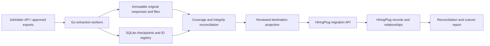

# JobAdder migration into HiringPlug

The goal is an external tool that moves approximately 80,000 candidates and
all obtainable related JobAdder records/files while retaining source values.
JobAdder API access is available. The owner explicitly requires existing fields
to stay unchanged: do not clean notes, normalize salary, merge duplicates,
rename statuses, infer employers or run AI enrichment during migration.

## Implemented: read-only discovery

`tools/jobadder-migrator` is an independent Go module and executable. It embeds
a small browser interface, listens on loopback and needs no Docker, HiringPlug
database or Python worker. Its initial release provides:

- JobAdder OAuth with state validation, encrypted refresh credentials and an
  access-token alternative; use the regional `api` returned by authorization.
- A persistent SQLite workspace, exclusive process lock, encrypted credentials
  and original response bodies (AES-GCM/scrypt), plus source identity binding.
- A reviewed catalog of GET collection counts, activity counts, attachment
  metadata, payroll/billing access and field/lookup definitions. It records
  access failures and missing authoritative counts as unknown, never zero.
- Pause/resume checkpoints, bounded retries with `Retry-After`, cancellation,
  token refresh, count reports and integrity-checked original-response ZIPs.
- A clearly marked synthetic demo, Go tests, browser smoke coverage and a
  Windows x64 build. Linux/Windows tests run in repository CI. `task verify`
  includes this module's checks and Windows cross-build.

This is **discovery only**, not a full source backup or completed importer.
Current resource requests use `Limit=0` for collection totals. Definitions may
be paginated; original responses are evidence of what was observed, not proof
that all definition pages or record custom-field values were retrieved. Counts
reflect account permissions/default visibility and are not one consistent
database snapshot. No live credentials are required for automated tests.

See the tool's [operating instructions](../tools/jobadder-migrator/README.md).
Public API reference: [JobAdder API v2](https://api.jobadder.com/v2/docs), with
the [machine-readable specification](https://api.jobadder.com/v2/openapi.json).
Runtime access to a user's account must still be verified; public documentation
does not guarantee that an account has every feature or scope.

## Remaining architecture

Only discovery and its evidence/checkpoint store exist today. All extraction,
projection, import and cutover components below remain to be built.

### 1. Full extraction, resumable at record and file level

Use bounded Go workers with a shared account-level rate limiter. Keep request
concurrency conservative and adapt to measured throttling. Persist each
original list/detail response before advancing its checkpoint. List pagination,
detail expansion and attachment downloads must be separate retryable tasks;
an interruption must not restart 80,000 records from the beginning.

Preserve exact raw bytes as the source of truth. Parsing extracts routing IDs
and relationship keys without reserializing the original as its replacement.
Track source account, entity type, source ID, source modification/version if
available, observed time, endpoint and SHA-256 in separate metadata. Preserve
all versions observed; record tombstones separately. Keep original filenames,
attachment metadata, MIME type and binary hashes, including multiple CVs and
formatted documents. Stream large binaries rather than loading them into RAM.

The expanded coverage manifest must enumerate nested endpoints and related
records: folder membership, company/contact/job/application/placement files,
custom-field values and definitions, statuses, notes/activities, submissions,
interviews, placements, invoices, timesheets, rate cards, approvals and user
ownership. Retrieve email/SMS and history where the API/export actually exposes
them. Inaccessible, unsupported, empty, missing and failed are distinct states.
Use approved exports for API gaps; never claim “all records” from candidate
counts alone. Do not browse/scrape around API permissions.

### 2. Preview the destination without changing source values

Maintain two layers: immutable original JobAdder evidence and a separate,
versioned HiringPlug projection. Map destination IDs without replacing source
IDs, labels or raw values. Unsupported fields remain accessible in source
metadata or a source-record view; they are not silently discarded. Preserve
original authors/timestamps even when authors no longer have active accounts.

Use `(source account, entity type, source ID)` as the migration identity.
An email address is not a safe deduplication key. Existing HiringPlug uniqueness
constraints require explicit conflict handling: show conflicts for review,
retain the complete source record and do not overwrite an existing candidate
or company. No automatic merge, typo correction, salary recalculation,
industry recognition, CV parsing or outgoing emails.

### 3. HiringPlug import boundary

Build an authenticated Go migration module through contracts first, following
AGENTS.md. The external tool must not write directly to HiringPlug tables.
Tenant-scoped permissions, compensation privacy, row-level security and audit
rules apply to imported records too. Never place salary values in audit logs.

Use idempotent import batches, a durable source-to-destination ID registry and
atomic record/registry transactions. Import users/lookups, companies/contacts,
candidates/files, jobs, applications, history and placements in dependency order.
Unresolved references remain visible and retryable. Imported ownership must
not grant sign-in access automatically. Replaying a successful task must not
duplicate a record, file, note or relationship. Prevent notifications and other
normal-create side effects during a migration through explicit service rules.

### 4. Reconcile and cut over

Start with a small representative pilot including duplicate emails, custom
fields, missing users, multiple CVs, non-ASCII names, salaries and old history.
Compare record IDs/counts, field values, relationships and file checksums.
Report exact exceptions, not just a success percentage. Keep JobAdder available
until the owner reviews the reconciliation.

Whether JobAdder remains active during the migration is not yet confirmed.
Support an initial snapshot followed by a delta/reconciliation pass; use source
modification filters only where documented and include overlap. Stable ordering
and a final inventory must detect pagination drift and missed/deleted records.
If no reliable change feed exists, schedule a final source freeze/export before
cutover. Source deletions must never cause automatic destination deletion.

## Local security and operations

Credentials and original responses are encrypted, but operational SQLite
metadata is plaintext. Use a private local directory and disk encryption.
Downloads are unencrypted and must be treated as private account exports.
Passphrases cannot be recovered. Stop the tool before backing up the whole
workspace. Use separate workspaces for different accounts/API users.

The local interface requires a random session key, rejects other origins/hosts
and never follows provider redirects with bearer credentials. API business
calls are GET only; token requests are POST to JobAdder's authorization server.
There is no telemetry or AI traffic. A Windows package needs only the executable,
launchers and instructions, not the HiringPlug source tree.
