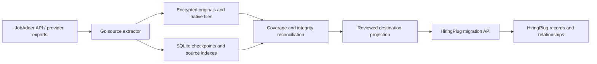

# JobAdder migration into HiringPlug

The goal is an external tool that moves approximately 80,000 candidates and
all obtainable related JobAdder records/files while retaining source values.
JobAdder API access is available. The owner explicitly requires existing fields
to stay unchanged: do not clean notes, normalize salary, merge duplicates,
rename statuses, infer employers or run AI enrichment during migration.

## Implemented: external source extraction

`tools/jobadder-migrator` is an independent Go module with an embedded local
browser interface, Windows x64 build and encrypted SQLite/object workspace.
It needs no Docker, Python or HiringPlug database. Discovery remains available;
full extraction adds durable list/detail/file tasks, original byte preservation,
record observations and relationship pointers, native downloads and a coverage
report for all 30 areas and all 240 documented GET routes.

The API extraction engine uses bulk equivalents explicitly named in the route
report, expands actual typed identifiers, includes retained inactive/closed/old
partitions, and checkpoints each page plus discovered work atomically. Every
successful response and native file is stored before indexing. Unknown fields,
precision, rich text and original names remain in authoritative raw objects.
All observed representations are retained; no person/company deduplication,
salary rewriting, CV parsing, enrichment or source writes occur.

Provider intake preserves original uploads and ZIP members; CSV, JSON and JSONL
support streaming row indexing, including BOM-marked UTF-16 CSV. Unsupported
formats remain archived with **needs adapter**, not fabricated records. The
owner does not yet have an export or know its format. SQL Server backups and
PST need a later format/schema adapter or logical export. Uploaded sources are
unverified and never automatically resolve a scope area.

Downloads comprise a manifest ZIP (all request statuses, source metadata,
record observations, relationship and provider-row indexes) plus object ZIP
parts, with original names mapped separately from safe object paths. Parts
are verified before headers and downloaded natively, avoiding browser RAM
proportional to account size. Native redirects allow only HTTPS JobAdder/object
storage hosts, with credentials stripped across hosts. Arbitrary record links
are retained as data and never followed.

OAuth refresh rotation, persistent provider cooldowns, source binding, private
loopback sessions, exclusive workspace locks, pause/resume, synthetic demo and
Linux/Windows CI are retained. Encrypted objects use independently authenticated
1 MiB frames with a final size/hash commitment, detecting tampering/truncation.
Operational IDs/statuses/paths remain plaintext SQLite metadata; sensitive
record bodies, credentials and original filename/header metadata are encrypted.

See [operating instructions](../tools/jobadder-migrator/README.md) and the
[full-account scope and source limits](jobadder-extraction-scope.md).
The bundled `extraction_routes.json` is a snapshot of the
[public v2 specification](https://api.jobadder.com/v2/openapi.json), not evidence
of live account access. Tests and screenshots use synthetic data only.

## Remaining projection, import and reconciliation

The extractor does not claim a verified full-account backup: email threads,
communications, personal settings, templates, full privacy/audit history and
purged records cannot be inferred from note counts or public API availability.
A provider export must be reconciled against source IDs and attachment versions.
There is no automatic delta snapshot: use a new pass with overlap and a final
freeze/export at cutover; offset pagination can drift while JobAdder changes.
Destination projection, schema-specific backup adapters, HiringPlug import and
final reconciliation remain separate implementation stages.

### 2. Preview the destination without changing source values

Maintain two layers: immutable original JobAdder evidence and a separate,
versioned HiringPlug projection. Map destination IDs without replacing source
IDs, labels or raw values. Unsupported fields remain accessible in source
metadata or a source-record view; they are not silently discarded. Preserve
original authors/timestamps even when authors no longer have active accounts.

Use `(source account, entity type, source ID)` as the migration identity.
An email address is not a safe deduplication key. Existing HiringPlug uniqueness
constraints require explicit conflict handling: show conflicts for review,
retain the complete source record and do not overwrite an existing candidate
or company. No automatic merge, typo correction, salary recalculation,
industry recognition, CV parsing or outgoing emails.

### 3. HiringPlug import boundary

Build an authenticated Go migration module through contracts first, following
AGENTS.md. The external tool must not write directly to HiringPlug tables.
Tenant-scoped permissions, compensation privacy, row-level security and audit
rules apply to imported records too. Never place salary values in audit logs.

Use idempotent import batches, a durable source-to-destination ID registry and
atomic record/registry transactions. Import users/lookups, companies/contacts,
candidates/files, jobs, applications, history and placements in dependency order.
Unresolved references remain visible and retryable. Imported ownership must
not grant sign-in access automatically. Replaying a successful task must not
duplicate a record, file, note or relationship. Prevent notifications and other
normal-create side effects during a migration through explicit service rules.

### 4. Reconcile and cut over

Start with a small representative pilot including duplicate emails, custom
fields, missing users, multiple CVs, non-ASCII names, salaries and old history.
Compare record IDs/counts, field values, relationships and file checksums.
Report exact exceptions, not just a success percentage. Keep JobAdder available
until the owner reviews the reconciliation.

Whether JobAdder remains active during the migration is not yet confirmed.
Support an initial snapshot followed by a delta/reconciliation pass; use source
modification filters only where documented and include overlap. Stable ordering
and a final inventory must detect pagination drift and missed/deleted records.
If no reliable change feed exists, schedule a final source freeze/export before
cutover. Source deletions must never cause automatic destination deletion.

## Local security and operations

Credentials and original responses are encrypted, but operational SQLite
metadata is plaintext. Use a private local directory and disk encryption.
Downloads are unencrypted and must be treated as private account exports.
Archives are fully prepared and verified outside the application lock before
headers are sent. Their private temporary staging file is unlinked on Unix or
uses delete-on-close on Windows, including process termination. Download writes
are bounded, and shutdown cancels handlers before closing their workspace.
Passphrases cannot be recovered. Stop the tool before backing up the whole
workspace. Use separate workspaces for different accounts/API users.

The local interface requires a random session key, rejects other origins/hosts
and never follows cross-host provider redirects with bearer credentials. API business
calls are GET only; token requests are POST to JobAdder's authorization server.
There is no telemetry or AI traffic. A Windows package needs only the executable,
launchers and instructions, not the HiringPlug source tree.
